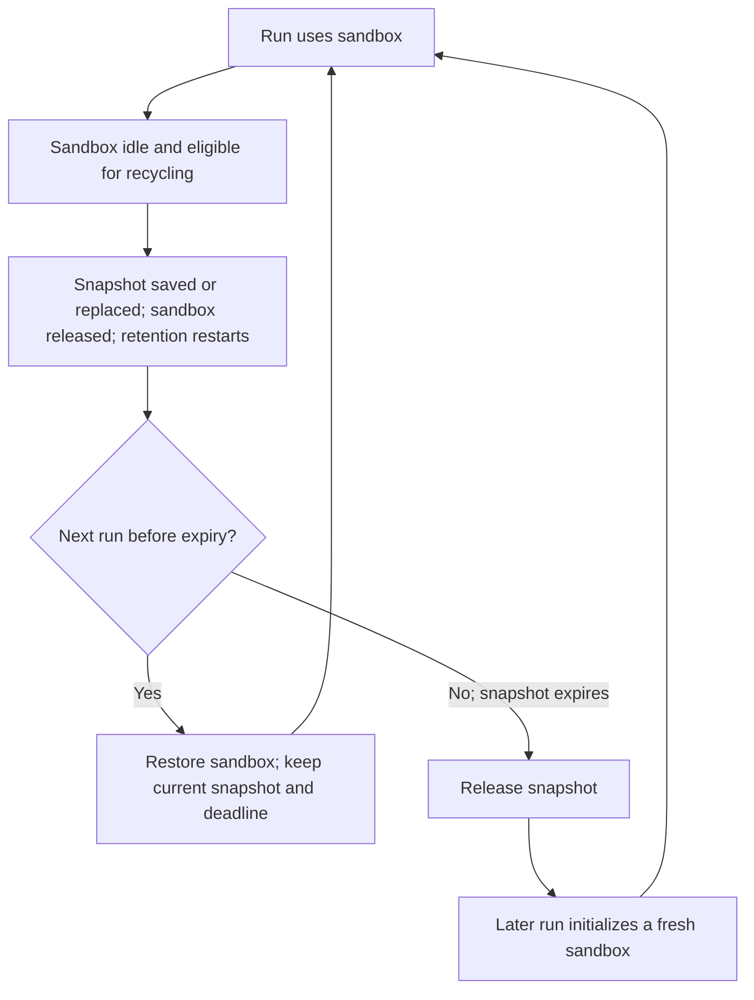

# Session sandbox persistence

Use this reference for retaining work between runs of the same Session, recovery boundaries, automatic retention refresh, expiry, and snapshot costs.

Sources checked **2026-11-17**: [Manage Sessions](https://help.aliyun.com/zh/model-studio/managed-agents-session-operations), [Create Session](https://help.aliyun.com/zh/model-studio/session-create), and [Get Session](https://help.aliyun.com/zh/model-studio/session-get). The resource recovery matrix and snapshot price below also incorporate the user's product clarification on that date. This is a documentation update, not a live recovery or billing test.

## Enable persistence when creating a Session

Persistence saves sandbox working files and environment modifications. It is useful for intermediate work that must survive sandbox recycling, in addition to delivered artifacts. It is disabled by default. The console defaults to **3 days** when enabled and accepts **1–30 days**; the API uses integer seconds.

For `POST /sessions`, add the top-level `sandbox` object to the normal Agent/Environment binding:

```json
{
  "agent": {"type": "agent", "id": "agent_xxx"},
  "environment_id": "env_xxx",
  "sandbox": {
    "enable_snapshot": true,
    "snapshot_persistent_seconds": 259200
  }
}
```

If `sandbox` is present, `enable_snapshot` is required. When true, `snapshot_persistent_seconds` is also required: **86400–2592000**, inclusive. Do not treat the console's default as an API default. Omitting `sandbox` leaves persistence off. These are Session fields, not Environment package configuration or Agent configuration. The checked [Update Session API](https://help.aliyun.com/zh/model-studio/session-update) does not document changing them after creation; do not invent update support, CLI flags, or SDK parameters.

## Lifecycle and automatic retention refresh

1. **Save:** after a run actually uses the sandbox, the platform saves its filesystem when it becomes idle and eligible for recycling, then releases the sandbox. Session `idle` alone does not prove a snapshot exists.
2. **Restore:** before expiry, another run restores a sandbox from the available snapshot. That snapshot remains as a recovery point; restoring does not delete it or refresh its deadline.
3. **Refresh:** only successful creation of the next snapshot replaces the previous copy and starts a fresh retention period. Normally one latest usable snapshot is retained per Session.
4. **Expire:** release the snapshot when retention ends. A later run rebuilds the sandbox; local modifications are lost. Snapshot expiry does not terminate the Session or delete its history or external data.
5. **Close:** archiving or deleting the Session also triggers snapshot cleanup, which can lag briefly. A terminated Session cannot resume; archive retains history, while delete has its separate destructive semantics.

The retention clock starts at **snapshot creation**, not Session creation, message receipt, or the `idle` event. Do not promise renewal after a chat-only run or a failed snapshot save. The previously proposed “reset at every execution end” wording is superseded by the documented creation-time rule.



Without persistence, a recycled sandbox is initialized again on the next run. Persistence stores **disk state, not running processes**; applications and background jobs must be restarted as needed. This filesystem snapshot is separate from the Agent configuration snapshot embedded in the Session.

## Resource recovery rules

The following matrix follows the user's **2026-11-17** clarification. “External rebind” means the current external binding/data is authoritative, even when other sandbox paths restore from a snapshot.

| Resource | Persistence enabled, usable snapshot exists | Persistence disabled, or rebuilding after expiry |
| --- | --- | --- |
| Uploaded files: `/mnt/session/uploads` | **External rebind:** remount the external files currently bound to the Session, replacing sandbox copies. Editing a copy does not change the source file. | Same external rebind. |
| Artifacts: `/mnt/session/outputs/` | **External rebind:** restore the Session artifacts already synchronized to external storage. | Same external rebind. |
| Memory mount directory / binding | **External rebind:** access the latest external data using the bound memory library and user/entity identity where required. | Same external rebind. |
| Skills: `/mnt/skills/`, `/root/workspace/skills/` | **External rebind:** restore Skills from their external source. | Same external rebind. |
| Other working directories, e.g. `/root/workspace` | **Snapshot:** retain working files and environment modifications. | Reinitialize; local modifications are not retained. |

- Upload/artifact mount contents come from external data; do not merge stale snapshot files into those managed paths. The specific external-resource rows take precedence over the general working-directory row, including `/root/workspace/skills/`.
- An unsynchronized artifact is **not saved** merely because it exists in the sandbox. Surface synchronization/save failures; do not tell the user a deliverable is safely stored without successful synchronization.
- Snapshot expiry affects sandbox persistence only. Session records, event history, external files, synchronized/delivered artifacts, and Memory follow their own storage rules.
- Memory identity is provider-specific. In the MA API, Bailian Memory Library uses `entity_id`, not a new `uid` field or the cloud account UID, and has no filesystem mount path. Built-in file memory uses its returned mount path. See [knowledge and memory](knowledge-and-memory.md).

## Observe configuration, availability, and usage separately

Creation returns configuration, not proof of a saved snapshot. Read `GET /sessions/{session_id}` for current status and duration fields:

| Field | Meaning |
| --- | --- |
| `sandbox.enable_snapshot` | Whether this Session is configured for persistence. |
| `sandbox.snapshot_persistent_seconds` | Configured retention per snapshot, in seconds. |
| `sandbox.is_persisting` | Whether a usable snapshot is currently retained; may be omitted before statistics are available. It is not a “save in progress” flag. |
| `sandbox.predict_release_time` | Predicted release timestamp, ISO 8601 UTC; `null` when there is no current snapshot. |
| `usage.sandbox.session_total_persisted_hours` | Historical cumulative snapshot retention hours for the Session; integer or `null`. |
| `usage.sandbox.latest_snapshot_persisted_hours` | Retention hours of the current latest snapshot; integer or `null` when none exists. |

Enabled but not yet snapshotted can return `is_persisting=false`, `predict_release_time=null`, and both hour counters `null`. Preserve missing/null as unknown or unavailable, rather than coercing them to zero. Do not add the latest counter to the cumulative counter or substitute Session `stats.active_seconds` / `duration_seconds` for snapshot storage time. For a UI countdown, use the returned release timestamp; do not manufacture a deadline from `idle` events. See [Session duration and token usage](session-stats-and-usage.md) for those separate metrics.

## Billing and the three-day example

**User-provided price, 2026-11-17: CNY 0.003 per snapshot-hour**, charged for how long snapshots exist. Snapshot storage is separate from Session runtime, model, and tool/MCP fees. An idle Session can still incur snapshot charges. The [general billing page](https://docs.agent.bailian.aliyun.com/zh/managed-agents/pricing/billing), checked on that date, did not yet list this snapshot item; do not attribute the price to that page or invent rounding/minimum-charge rules.

```text
Snapshot cost estimate = sum of snapshot retention hours × CNY 0.003
```

For the user's illustration, retention is configured to 3 days:

| Stage | Snapshot and deadline |
| --- | --- |
| Run 1: 10 minutes | After sandbox recycling conditions are met, create snapshot S1 at T0; its deadline is T0 + 3 days. |
| Wait 2 days | S1 remains available. |
| Run 2: 10 minutes | Restore from S1. S1 remains retained with its existing deadline during this run. |
| Save again at T1 | Successful creation of S2 replaces S1; the new deadline is T1 + 3 days. The unused part of S1's retention is not added to S2. |
| No more runs for 3 days | S2 expires and is released. The next run rebuilds the sandbox using the external-resource rules above. |

At day-level resolution this is **2 + 3 = approximately 5 snapshot-days**, or approximately **120 × 0.003 = CNY 0.36**. Three days is the retention of each latest snapshot, not a lifetime cap on this Session's storage charges; repeated successful saves can extend retention repeatedly.

The diagram's “5 days” omits the second run's 10 minutes and save/cleanup delays. Since S1 remains retained during recovery and execution, do not infer that running time is free of snapshot charges. With immediate replacement/release and proportional accounting, 5 days plus 10 minutes would estimate **CNY 0.3605**; this is arithmetic, not a verified invoice or a promise of sub-hour billing. Use actual retained durations and the applicable billing rules for a precise charge. The first run before any snapshot exists does not itself add snapshot storage time.
