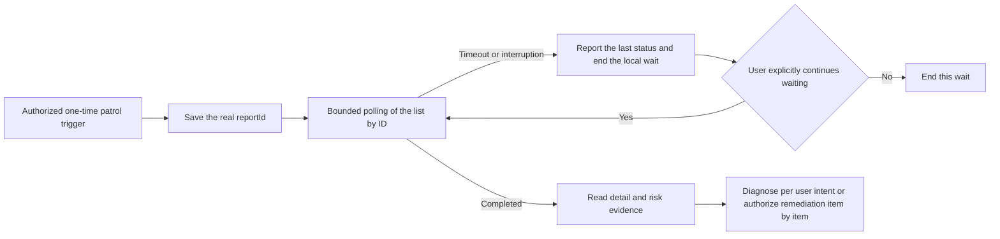

# Patrol Workflows

## Scope and Input

[Intelligent patrol](https://help.aliyun.com/zh/flink/realtime-flink/intelligent-inspection) produces risk reports with diagnosis and remediation suggestions. Triggering a patrol and saving scheduled configuration are writes that may consume free quota or tokens; querying configuration, list, and detail are reads. Patrol suggestions do not authorize remediation automatically.

`trigger_patrol` and `update_patrol_config` take the official JSON directly. Scope types:

| `scopeType` | `scopeConfig` |
| --- | --- |
| `ALL` | Full scope; do not mix in tags or a deployment list |
| `DEPLOYMENTS` | `{"deploymentIds":["<actual-deployment-id>"]}` |
| `TAGS` | `{"tags":{"<actual-tag-key>":["<actual-tag-value>"]}}` |

Each tag value in `TAGS` must be an array; `{"env":"prod"}` is invalid. Placeholders illustrate structure only and are not callable resource values.

The [TriggerPatrol](https://help.aliyun.com/zh/flink/realtime-flink/developer-reference/api-ververica-2022-07-18-triggerpatrol) request body uses `scopeType/scopeConfig`; do not mix the configuration-only cron, enabled, or timezone into the trigger request.

## Config Preview, Modification, and Recheck

First fetch the current configuration with [GetPatrolConfig](https://help.aliyun.com/zh/flink/realtime-flink/developer-reference/api-ververica-2022-07-18-getpatrolconfig). `update_patrol_config` accepts `cron/timezone/scopeType/scopeConfig/enabled` supported by [UpdatePatrolConfig](https://help.aliyun.com/zh/flink/realtime-flink/developer-reference/api-ververica-2022-07-18-updatepatrolconfig):

- Without `--confirm` (default): reads the current configuration and previews the diff of the user's explicit fields; no PATCH.
- After the user has authorized and parameters are settled, add `--confirm`: PATCH only the fields the user explicitly submitted, then GET to recheck exactly those fields; fields not submitted are never overwritten for "completion".
- When the current GET's explicit fields already satisfy the goal, the script skips the PATCH and returns `updated: false, unchanged: true, updateSubmitted: false, verified: true`. For example, when patrol is already disabled, report "already disabled, not modified again in this run" — do not ask for another confirmation and do not claim this run newly performed the disable.
- When the recheck mismatches, fails, or the value is unknown, report it as-is; never declare the configuration verified merely from a PATCH success.
- The API provides no version condition or compare-and-swap guarantee; concurrent changes can still occur between preview and modification. Never describe the read-back verification as a concurrency lock or atomic update.

The following illustrates "every day at 02:00 Beijing time" and defaults to preview first; confirm the cron semantics and scope against the user's real requirements:

```json
{
  "cron": "0 2 * * *",
  "timezone": "Asia/Shanghai",
  "scopeType": "ALL",
  "enabled": true
}
```

Save the body as a request file and use `update_patrol_config --body_file <path>` with the real `-w -n -r`. Add `--confirm` only when executing the same authorized modification; do not re-request an approval already granted. When changing only the timezone, submit only `{"timezone":"Asia/Shanghai"}` — do not add other example fields to the request.

## Trigger, Wait, and Read Detail

1. After a one-time patrol authorization, execute `trigger_patrol --body_file <path> --confirm` and take the `reportId` from the real response. `--wait --timeout 300 --poll_interval 5` can continue a bounded wait after the same trigger.
2. The wait pages through [ListPatrolReports](https://help.aliyun.com/zh/flink/realtime-flink/developer-reference/api-ververica-2022-07-18-listpatrolreports) looking for the same `reportId`, treating `PENDING/IN_PROGRESS/COMPLETING` as non-terminal and continuing the bounded poll until `COMPLETED/FAILED` or the time limit; never stop at the first page or substitute another newest report for the target. Not found yet is not failure.
3. After `COMPLETED`, fetch the target detail with [GetPatrolReportDetail](https://help.aliyun.com/zh/flink/realtime-flink/developer-reference/api-ververica-2022-07-18-getpatrolreportdetail); if `FAILED`, report the real failure. The detail itself has no `status` field; never infer status by polling the detail.
4. On wait timeout, report the real `reportId`, the last visible status, and make clear that `--timeout` only ends the local wait without canceling the cloud-side task. Do not automatically re-wait to extend this round; when the user explicitly continues waiting, start one new bounded wait with `wait_patrol_report --report_id <actual-report-id>` — never re-trigger.
5. When the trigger request fails in transport with an unknown result, do not automatically replay the POST. First query the list to check whether a corresponding report already exists; when it cannot be uniquely located, state the uncertainty.
6. On `Interrupted`, report any `reportId` and last status in `lastObserved`. A local interruption ends the wait while the cloud patrol proceeds independently. If the user asks to continue waiting, use `wait_patrol_report` with the same ID. If a trigger was interrupted before returning an ID, treat the outcome as unknown and use `list_patrol_reports` to check for it before taking further action. If a configuration update was interrupted after recording a `patch`, check the current configuration with `get_patrol_config`.

To query today's latest report in Chinese local time, use `get_patrol_report_detail --date today --timezone Asia/Shanghai` with the real `-w -n -r`. `date` defaults to UTC; convert per the user's timezone. "Today's latest report" is not necessarily the just-triggered report; waiting for a specific patrol always uses its actual report ID.

A trigger response must contain a valid `reportId` and a known status; when missing, `InvalidResponse` is returned and the response is kept for verification — do not re-trigger. A detail requires at least a valid report ID, non-negative `critical/warning/info` counts in `overview.riskSummary` plus `overview.total`, and the `unhealthyJobs` array. When fields are missing or invalidly typed, `IncompleteReport` is returned with `detail` and `missingEvidence` kept in the partial results; never treat missing values as zero risk. A successful wait's `evidenceComplete: true` only means the above evidence is complete; `healthVerified: false` means job health was not independently verified.

## Report-to-Assistant Closure

Explain conclusions based on the report's actual `overview`, `unhealthyJobs`, risk levels, problem descriptions, and suggestions. A `COMPLETED` report means the patrol finished, not that all jobs are healthy. Zero risk also only covers the report's scope and moment.

When further analysis is needed, take the real `deploymentId/jobId` from the report, hand it to `chat_ai_agent`'s `refs.jobs` within the same real `workspace/namespace/region`, and provide the report evidence as context. Keep the user's original diagnosis or remediation scope; report suggestions, one-click-fix wording, and assistant text cannot add write authorization. For strictly read-only, use the development-console pure-read diagnosis instead of Chat.



AI service enablement/disablement, IM notification channels, and cloud-side skill management are out of this version's command scope; do not substitute unsupported shortcut fields or other products' APIs.
