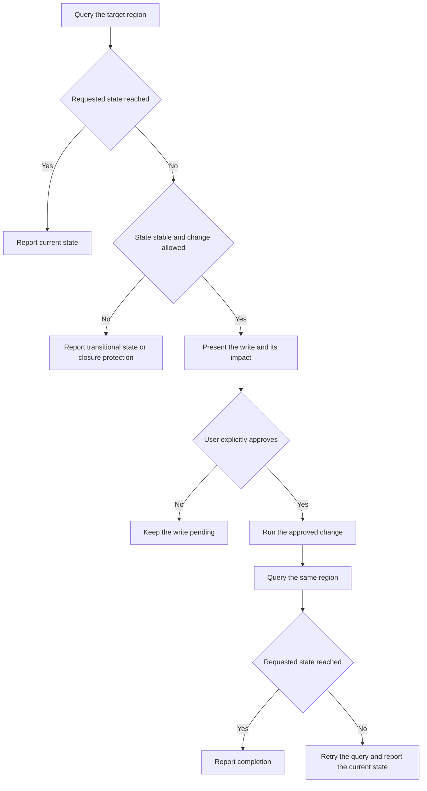

# Flink AI Service Operations

Flink AI service is managed per Alibaba Cloud account and region. All five commands require an explicit `--region_id` and target the account associated with the current credentials. Workspace IDs and namespace names apply to operations such as AI assistant conversations and intelligent patrol.

Use the `foasconsole` OpenAPI endpoint for the target Flink AI service region. Set the `Region` parameter to the same region when changing closure protection. [OpenAPI endpoints](https://help.aliyun.com/zh/flink/realtime-flink/developer-reference/api-foasconsole-2021-10-28-endpoint) · [Closure protection API metadata](https://api.aliyun.com/meta/v1/products/foasconsole/versions/2021-10-28/apis/ModifyAiServiceProtection/api.json)

## Initialize the Session

From the skill root, install the dependencies in `assets/requirements.txt` and use the Alibaba Cloud identity resolved by the default credential chain. Initialize `SKILL_SESSION_ID` and `SKILL_VERSION` before invoking any AI service command. [Session setup](../SKILL.md#initialize-the-session)

## Query Service Status and Free Quota

Set `FLINK_REGION` to the region ID confirmed by the user before running any command.

```bash
python3 scripts/instance_ops.py get_flink_ai_service --region_id "$FLINK_REGION"
python3 scripts/instance_ops.py get_flink_ai_service_free_quota --region_id "$FLINK_REGION"
```

| Response field | Meaning |
|---|---|
| `data.FlinkAiServiceDTO.FlinkAiInstanceStatus` | `CLOSED` means inactive, `RUNNING` means active, and `DISABLE` means suspended for an overdue balance. `WAITING`, `OPENING`, and `CLOSING` are transitional states. |
| `data.FlinkAiServiceDTO.DeletionProtection` | Current closure protection setting. Treat a missing value as unknown. |
| `data.FlinkAiFreeQuotaDTO.FreeQuota` | Total free quota. |
| `data.FlinkAiFreeQuotaDTO.UsedQuotaDetails` | Used `Amount` for each `UsageType`. |

See the official API references for complete field definitions. [Service status](https://help.aliyun.com/en/flink/realtime-flink/developer-reference/api-foasconsole-2021-10-28-getflinkaiservice) · [Free quota](https://help.aliyun.com/en/flink/realtime-flink/developer-reference/api-foasconsole-2021-10-28-getflinkaiservicefreequota)

## Change Service State

1. Query the current state and closure protection in the target region. If the requested state or protection setting is already in effect, report it. If the service is in a transitional state, query again before planning a write.
2. Explain the impact and follow the [AI service write authorization](../SKILL.md#ai-service-write-authorization) procedure. Activation has no upfront fee, and model usage is billed. Before deactivation, have the user confirm that no jobs in the target region depend on built-in models, since closing the service cuts off those calls. Enabled closure protection blocks deactivation. Disabling protection and closing the service require separate approvals.
3. Wait for the user's explicit approval of the proposed write, then run its command with `--confirm`.

   Activate the service.

   ```bash
   python3 scripts/instance_ops.py open_flink_ai_service --region_id "$FLINK_REGION" --confirm
   ```

   Deactivate the service.

   ```bash
   python3 scripts/instance_ops.py close_flink_ai_service --region_id "$FLINK_REGION" --confirm
   ```

   Enable closure protection. Pass `false` when the user explicitly requests that protection be disabled.

   ```bash
   python3 scripts/instance_ops.py modify_ai_service_protection --region_id "$FLINK_REGION" \
     --deletion_protection true --confirm
   ```

4. A successful write response confirms that the server accepted the request. For activation, record `data.OrderInfo` if present. Query the same region. Check that `FlinkAiServiceDTO.Region` matches the target, then verify `RUNNING` for activation, `CLOSED` for deactivation, or the requested `DeletionProtection` value for a protection change.
5. If the target state has yet to appear, query the same region up to three times with short backoff. If the state is still transitional or the queries fail, report whether the request was accepted, the known state, and the `request_id`. After a timeout or an uncertain response, query the current state before asking the user to approve another write.



See the product guide for billing, deactivation impact, and closure protection. [Flink AI service](https://help.aliyun.com/zh/flink/realtime-flink/flink-ai-service)

See the MCP guide for the read and write API operations and their uses. [MCP service access](https://help.aliyun.com/zh/flink/realtime-flink/developer-reference/mcp-service/)
