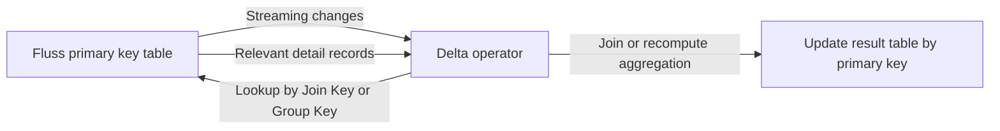

# Alibaba Cloud Flink Delta Query Knowledge Base

Scope: Alibaba Cloud Realtime Compute for Apache Flink. Product capabilities and configuration are based on official documentation. Section 8 also draws on operational experience and the VVR implementation; verify Metric names against the target runtime version.

Delta Query stores some intermediate data required for streaming computation in Fluss. When changes arrive, Flink retrieves the relevant detail records through asynchronous Lookups and updates the results. Consider it for Joins and grouped aggregations with large state, but evaluate its suitability against the available indexes, the number of detail records per key, and the required update and delete semantics. [Official concepts and prerequisites](https://help.aliyun.com/zh/flink/realtime-flink/user-guide/delta-query-rewriting-optimization)

Search keywords: Delta Query, Delta Join, Delta Aggregate, Delta Aggregation, Fluss, asynchronous Lookup, prefix index, MiniBatch.

For runtime tuning, start with the configuration checks, Metric collection, and bottleneck analysis in Section 8.

## 1 How It Works

Understand this optimization by identifying where the historical information needed to produce results is stored.

| Aspect | Conventional streaming computation | Delta Query |
| --- | --- | --- |
| Join | Flink stores records from both sides of the Join | Queries the other side's detail records in Fluss by Join key |
| Non-windowed grouped aggregation | Flink continuously maintains each group's accumulators | Changes trigger a Lookup of the group's detail records and recomputation |
| Main evaluation areas | Flink state access, state size, and Checkpoints | Fluss Lookups, returned data volume, recomputation, and result writes |

See [Delta Join](https://help.aliyun.com/zh/flink/realtime-fluss/user-guide/delta-joins) and [Delta Aggregation tuning](https://help.aliyun.com/zh/flink/realtime-flink/user-guide/optimize-flink-sql) for these mechanisms.



"Statelessness" refers to the rewritten computation state. It does not imply that the entire Job has no state, memory use, or recovery requirements. Source data remains in Fluss, while caches and MiniBatch also consume Flink memory. This distinction defines the scope of resource assessment; it does not establish the actual state size of a particular Job. [Fluss storage capabilities](https://help.aliyun.com/zh/flink/realtime-fluss/product-overview/what-is-alibaba-cloud-fluss), [caching and MiniBatch](https://help.aliyun.com/zh/flink/realtime-flink/user-guide/optimize-flink-sql)

Distinguish Delta Join from a conventional dimension-table Lookup Join: changes from either side drive Delta Join. With a conventional dimension-table Join, updates to the dimension table do not necessarily trigger recomputation of all previously emitted Join results. [Fluss SQL Connector](https://help.aliyun.com/zh/flink/realtime-flink/developer-reference/fluss-connector)

## 2 Publicly Documented Version Support

| Capability | Minimum VVR version listed in the official documentation |
| --- | --- |
| Delta Join INNER JOIN | 8.0.11 |
| Delta Join LEFT, RIGHT, FULL OUTER JOIN | 11.3 |
| Cascaded Delta Joins | 11.4 |
| Lookup node downstream of Delta Join | 11.6 |
| Union node downstream of Delta Join | 11.8 |
| Delta Aggregate | 11.8 |

This table comes from the [Delta Query guide](https://help.aliyun.com/zh/flink/realtime-flink/user-guide/delta-query-rewriting-optimization). It does not mean that arbitrary SQL combinations can be rewritten; the query structure must still satisfy the applicable restrictions.

The strategy for forcing Delta Join rewriting differs by version: use `FORCE` before VVR 11.5 and `EVENTUAL` for VVR 11.5 and later according to the current guide. Some Connector examples still show `FORCE`; interpret them in the context of the target version instead of copying an older setting directly. [Delta Join strategies](https://help.aliyun.com/zh/flink/realtime-fluss/user-guide/delta-joins)

## 3 Source Tables, Indexes, and Result Primary Keys

### 3.1 Connectivity and Permissions

Prepare a Fluss cluster and Fluss Catalog first. The Flink workspace and Fluss cluster must be in the same region and have network connectivity. The Catalog provides source-table metadata directly. For Fluss 0.9-ali-5.0 and later, a passwordless Catalog is recommended, with access permissions determined by the current user. Earlier versions use password authentication. [Manage Fluss Catalogs](https://help.aliyun.com/zh/flink/realtime-flink/user-guide/register-fluss-catalog)

### 3.2 Index Matching

The public Delta Query guide currently restricts Sources to Fluss primary key tables. The Lookup keys must fully cover an available index: equi-join keys for Joins and grouping keys for aggregations. They need not cover the complete source-table primary key; a qualifying prefix index can also be used. [Source-table and index requirements](https://help.aliyun.com/zh/flink/realtime-flink/user-guide/delta-query-rewriting-optimization)

For example, define an order-line table as follows:

```sql
PRIMARY KEY (tenant_id, order_id, line_id) NOT ENFORCED
-- Table property in the WITH clause:
'bucket.key' = 'tenant_id,order_id'
```

For a non-partitioned table, `(tenant_id, order_id)` can serve as a prefix index. For a partitioned table, also verify whether the Lookup keys cover the partition columns; the non-partitioned-table assessment alone is insufficient. [Prefix indexes and partition requirements](https://help.aliyun.com/zh/flink/realtime-fluss/user-guide/delta-joins)

### 3.3 Result Tables

The Sink must support updates by primary key. The primary key of a Join result must uniquely identify one joined record; the result primary key of a grouped aggregation must correspond to all grouping fields. A successful execution-plan rewrite does not prove that the result primary key is correct. The optimizer does not currently validate this business-level requirement. [Result-table requirements](https://help.aliyun.com/zh/flink/realtime-flink/user-guide/delta-query-rewriting-optimization)

## 4 Query Structure Restrictions

| Check | Delta Join | Delta Aggregate |
| --- | --- | --- |
| Target computation | Regular streaming Join between two streams | Single-level non-windowed grouped aggregation |
| Not directly applicable | Window, Interval, Temporal, Lookup Join | Windowed or cascaded aggregation |
| Lookup keys | Each side's equi-join keys match an index | Grouping fields cover a queryable index |
| Source-table Watermarks | Currently unsupported | Currently unsupported |
| Expressions on index fields | Must preserve a direct mapping to source fields | Must preserve a direct mapping to source fields |

See [Delta Query query-structure restrictions](https://help.aliyun.com/zh/flink/realtime-flink/user-guide/delta-query-rewriting-optimization) for the complete node allowlist, multiple-Sink constraints, and cascading restrictions. One eligible Join or Aggregate does not establish that an entire pipeline containing other operators can also be rewritten.

Delta Aggregate supports `SUM`, `COUNT`, `AVG`, `MIN`, `MAX`, `LISTAGG`, `FIRST_VALUE`, and `LAST_VALUE`. It does not currently support DISTINCT aggregations, aggregate FILTER clauses, UDAFs, or Python aggregate functions. Queries must also avoid nondeterministic expressions such as `RAND()` and `PROCTIME()`. [Aggregation and expression restrictions](https://help.aliyun.com/zh/flink/realtime-flink/user-guide/optimize-flink-sql)

For order-dependent aggregations, the accumulation order after a Lookup is not equivalent to the original event-arrival order. Verify the semantics separately when the business requires a deterministic order. [Order-dependent aggregations](https://help.aliyun.com/zh/flink/realtime-flink/user-guide/delta-query-rewriting-optimization)

## 5 SQL Examples

The following examples join order lines with order headers and calculate order totals. Keep the number of lines per order manageable. Replace `demo_fluss` with an actual configured Fluss Catalog. These examples are intended for development and validation and have not been executed against a business cluster.

### 5.1 Delta Join for Enriched Order Lines

When an order header changes, all detail records for that order need to be updated. The order-line table uses the `(tenant_id, order_id)` prefix index, and the order-header table uses those fields as its complete primary key. Results are written using the unique order-line identifier.

```sql
USE CATALOG demo_fluss;
CREATE DATABASE IF NOT EXISTS delta_query_kb;
USE delta_query_kb;

CREATE TABLE sales_order_line (
    tenant_id BIGINT,
    order_id BIGINT,
    line_id BIGINT,
    sku_id BIGINT,
    line_amount DECIMAL(18, 2),
    PRIMARY KEY (tenant_id, order_id, line_id) NOT ENFORCED
) WITH (
    'bucket.key' = 'tenant_id,order_id'
);

CREATE TABLE sales_order_header (
    tenant_id BIGINT,
    order_id BIGINT,
    order_status STRING,
    PRIMARY KEY (tenant_id, order_id) NOT ENFORCED
);

CREATE TABLE sales_order_line_wide (
    tenant_id BIGINT,
    order_id BIGINT,
    line_id BIGINT,
    sku_id BIGINT,
    line_amount DECIMAL(18, 2),
    order_status STRING,
    PRIMARY KEY (tenant_id, order_id, line_id) NOT ENFORCED
);

-- Applies to VVR 11.5 and later as described in the referenced documentation.
SET 'table.optimizer.delta-join.strategy' = 'EVENTUAL';

INSERT INTO sales_order_line_wide
SELECT l.tenant_id, l.order_id, l.line_id, l.sku_id,
       l.line_amount, h.order_status
FROM sales_order_line AS l
JOIN sales_order_header AS h
  ON l.tenant_id = h.tenant_id AND l.order_id = h.order_id;
```

These tables belong to a Fluss Catalog, so a Connector does not need to be specified on each table. The schemas and business fields are illustrative; the Join pattern and configuration follow the [official Delta Join example](https://help.aliyun.com/zh/flink/realtime-fluss/user-guide/delta-joins).

### 5.2 Delta Aggregate for Order Totals

Reuse the order-line Source from the preceding section to count currently valid lines and sum their amounts per order. This represents the current detail records in the Fluss primary key table, not a historical accumulation of payment events. Run this example as a separate aggregation Job on VVR 11.8 or later; do not inherit the forced Delta Join strategy from the preceding Job.

```sql
USE CATALOG demo_fluss;
USE delta_query_kb;

CREATE TABLE sales_order_totals (
    tenant_id BIGINT,
    order_id BIGINT,
    line_count BIGINT,
    total_amount DECIMAL(38, 2),
    PRIMARY KEY (tenant_id, order_id) NOT ENFORCED
);

SET 'table.optimizer.delta-agg.strategy' = 'EVENTUAL';

INSERT INTO sales_order_totals
SELECT tenant_id, order_id,
       COUNT(*) AS line_count,
       SUM(line_amount) AS total_amount
FROM sales_order_line
GROUP BY tenant_id, order_id;
```

The grouping keys match the source-table prefix index, the result-table primary key matches the grouping keys, and the amount total uses a higher-precision DECIMAL. See [Delta Aggregation](https://help.aliyun.com/zh/flink/realtime-flink/user-guide/optimize-flink-sql) for configuration semantics and the [Delta Query guide](https://help.aliyun.com/zh/flink/realtime-flink/user-guide/delta-query-rewriting-optimization) for prefix-index eligibility.

## 6 Update, Delete, and Filter Semantics

| Behavior | Delta Join | Delta Aggregate |
| --- | --- | --- |
| Change types emitted downstream | `+I`, `+U` | `+U`, `-D` |
| Retraction of the old value through `-U` | No | No |
| Physical deletion of a source record | Does not propagate a deletion to remove the old Join result | Recomputes the group; can emit `-D` when the group becomes empty |

See [Delta Query business-logic restrictions](https://help.aliyun.com/zh/flink/realtime-flink/user-guide/delta-query-rewriting-optimization). It is incorrect to generalize that all Delta operators never delete results; distinguish the two operator types.

Missing retractions matter when filtering results. For example, an order total changes from CNY 150 to CNY 90, while the downstream filter retains only amounts above CNY 100. The new value is filtered out, but no `-U` retracts the old value, so the result table may retain CNY 150. This explains the default restriction on non-unique-key filters over aggregation results. Analyze a WHERE clause before aggregation separately from this result-filtering case. [Filter validation](https://help.aliyun.com/zh/flink/realtime-flink/user-guide/optimize-flink-sql)

For logical deletion, retain the update path, represent validity in a flag column, and filter when querying the result table. For Delta Join, the upstream data must express deletion through a flag update. Physically deleting the source record first does not automatically produce that flag. Keep the Join Key or Group Key for the same primary key unchanged as well. [Logical deletion and key requirements](https://help.aliyun.com/zh/flink/realtime-flink/user-guide/delta-query-rewriting-optimization)

## 7 Configuration Quick Reference

### 7.1 Rewriting and Caching

| Parameter | Documented default | Purpose |
| --- | --- | --- |
| `table.optimizer.delta-join.strategy` | `NONE` | Delta Join rewrite strategy |
| `table.exec.delta-join.cache-enabled` | `false` | Enable the local Join cache |
| `table.exec.delta-join.left.cache-size` | `10000` | Key capacity of the left-table Lookup result cache |
| `table.exec.delta-join.right.cache-size` | `10000` | Key capacity of the right-table Lookup result cache |
| `table.optimizer.delta-agg.strategy` | `NONE` | Aggregation rewrite strategy |
| `table.exec.delta-agg.cache-enabled` | `false` | Enable the aggregation cache |
| `table.exec.delta-agg.cache-size` | `10000` | Group-key capacity per aggregation Subtask |

See [Delta Join parameters](https://help.aliyun.com/zh/flink/realtime-fluss/user-guide/delta-joins) and [aggregation tuning parameters](https://help.aliyun.com/zh/flink/realtime-flink/user-guide/optimize-flink-sql). Cache capacity counts keys, not cached detail rows or bytes of memory.

`NONE` disables rewriting, `AUTO` permits fallback when conditions are not met, and `EVENTUAL` requires a successful rewrite or reports an error. When Delta computation is required, inspect the final execution plan so that a regular operator produced by AUTO fallback is not mistaken for a Delta operator. [Strategy values](https://help.aliyun.com/zh/flink/realtime-fluss/user-guide/delta-joins)

`table.optimizer.delta-join.ignore-non-unique-key-filter` and `table.optimizer.delta-agg.ignore-non-unique-key-filter` both default to `false`. Setting them to `true` only relaxes validation; it does not generate missing retractions and is not a fix for stale result records. [Filter restrictions](https://help.aliyun.com/zh/flink/realtime-flink/user-guide/delta-query-rewriting-optimization)

### 7.2 Asynchronous Lookups and the Fluss Client

| Configuration layer | Parameter | Documented default | Controls |
| --- | --- | --- | --- |
| Flink | `table.exec.async-lookup.buffer-capacity` | `100` | Asynchronous request capacity per operator Subtask |
| Flink | `table.exec.async-lookup.timeout` | `3 min` | Timeout for one asynchronous operation |
| Fluss table or Hint | `client.lookup.queue-size` | `25600` | Client queue of pending Lookups |
| Fluss table or Hint | `client.lookup.max-batch-size` | `128` | Request batching size |
| Fluss table or Hint | `client.lookup.max-inflight-requests` | `128` | Maximum number of unacknowledged client requests |
| Fluss table or Hint | `client.lookup.batch-timeout` | `100ms` | Maximum wait to form a batch |

See [SQL tuning](https://help.aliyun.com/zh/flink/realtime-flink/user-guide/optimize-flink-sql) for Flink settings and [Fluss SQL Connector parameters](https://help.aliyun.com/zh/flink/realtime-flink/developer-reference/fluss-connector) for client settings. These settings control different layers; their numeric values are not interchangeable throughput limits.

### 7.3 Aggregation MiniBatch

When the same group changes multiple times within a batch, MiniBatch can consolidate Lookups. The following configuration allows some processing delay. The values are illustrative choices, not defaults:

```sql
SET 'table.exec.mini-batch.enabled' = 'true';
SET 'table.exec.mini-batch.allow-latency' = '5s';
SET 'table.exec.mini-batch.size' = '1000';
```

Processing is triggered when a Subtask reaches the example batch size or wait time. Select values against the latency target rather than increasing the wait solely to reduce request counts. [MiniBatch Delta Aggregation](https://help.aliyun.com/zh/flink/realtime-flink/user-guide/optimize-flink-sql)

## 8 Delta Query Tuning Guide

Follow this sequence: confirm effective configuration → observe Metrics over the same interval → identify the bottleneck → adjust and verify. Distinguish Flink request capacity, serialization of work for the same key, computation and GC, and Fluss service capacity before adjusting buffers, MiniBatch, caches, or parallelism.

### 8.1 Consistent Metrics and Aggregation Scope

**Collect configuration and Metrics separately.** `table.exec.*` and `table.optimizer.*` are configuration options; read their effective values for the target Job. AEC queues, CPU, GC, throughput, and cache hit rates are runtime Metrics. When a setting is absent, check the default for the corresponding VVR version rather than treating it as disabled or zero.

**Observe AEC Metrics per operator and Subtask.** The referenced VVR implementation registers these Metrics:

| Metric | Meaning | Main use |
| --- | --- | --- |
| `flink_taskmanager_job_task_operator_aec_inflight_size` | Number of asynchronous processing units currently executing, denoted I | Determine whether active concurrency approaches capacity |
| `flink_taskmanager_job_task_operator_aec_blocking_size` | Units queued because earlier processing for the same key has not completed, denoted B | Identify serialization and hot keys |
| `flink_taskmanager_job_task_operator_aec_finish_size` | Units whose asynchronous processing has completed but whose output is pending, denoted F | Check waiting for result output |

This document consistently uses `aec_blocking_size`. If an existing dashboard uses `aec_block_size`, first verify whether it is an alias for the same Metric. A nonexistent Metric is not a zero value. With MiniBatch enabled, a processing unit may represent a batch of input records for one group; AEC values are not direct counts of raw records.

The Metric definitions reference VVR's `AsyncExecutionController.registerMetrics()` and `RecordsBuffer`. The implementation reference is VVR source snapshot `351f2728769`, not a public Metric catalog. Whether the target version exposes these Metrics, and which monitoring prefixes and labels it uses, must be established from actual collected data.

**Match buffer comparisons to the aggregation scope.** Let C be the `buffer-capacity` of one Subtask and P be the actual parallelism of the target Delta operator:

- For one Subtask, compare its I with C.
- For the sum across all Subtasks of that operator, compare `sum(I)` with `C × P`. If Subtasks have different settings, use the sum of their corresponding capacities.
- For an average, maximum, or single TM, use a denominator covering the same scope rather than the capacity of all Subtasks.

Do not substitute the cluster's total Slot count. The two numbers coincide only when the number of measured operator Subtasks happens to equal the Slot count. For example, with operator parallelism 32 and C = 100, the comparison capacity for the sum across all Subtasks is 3200, regardless of whether the cluster has 128 Slots.

I represents only active processing. In the current implementation, B units waiting for the same key and F units waiting for output also occupy unfinished processing capacity. Use `I + B + F` as an approximate view of queue occupancy; a low I does not necessarily mean that the buffer has spare capacity. Implementation reference: `TableKeyedAsyncWaitOperator.tryProcess()`

**Analyze CPU together with flame graphs.** Collect CPU usage and quota for the TMs hosting the target operator, per-Subtask Busy/backpressure, heap usage, GC time and pauses, and flame graphs for the corresponding processes. Use CPU flame graphs to confirm computational hotspots such as aggregation, serialization, or cache maintenance, and wall-clock flame graphs to investigate waiting. Confirm GC pressure with JVM GC Metrics; a CPU flame graph that excludes GC threads cannot establish it alone. CPU usage on a shared TM also includes other operators and cannot be attributed entirely to the Delta operator.

### 8.2 Delta Aggregate Tuning

#### Step 1: Confirm Configuration

| Setting | Check |
| --- | --- |
| `table.exec.async-lookup.buffer-capacity` | Effective asynchronous capacity; documented default is 100 |
| `table.exec.mini-batch.enabled`, `table.exec.mini-batch.allow-latency` | Whether MiniBatch is enabled and its wait meets the latency target; also record batch size or buffer settings |
| `table.exec.delta-agg.cache-enabled`, `table.exec.delta-agg.cache-size` | Whether caching is enabled and the key capacity per Subtask |
| `table.optimizer.delta-agg.strategy` | Rewrite strategy; confirm that the final plan actually contains `DeltaAggregate` |
| `table.optimizer.delta-agg.ignore-non-unique-key-filter` | Whether result-filter validation is relaxed; this is not the switch that enables Delta Aggregate |

See Section 7 and [Delta Query parameters](https://help.aliyun.com/zh/flink/realtime-flink/user-guide/delta-query-rewriting-optimization) for meanings and defaults.

#### Step 2: Observe Metrics

Collect I and B for the Delta Aggregate, adding F when needed, and retain both per-Subtask curves and totals. Also collect CPU, GC, flame graphs, input/output throughput, source backlog, and Fluss Lookup latency, errors, and load. Focus on sustained trends and the busiest Subtasks so that overall averages do not hide hot spots.

When caching is enabled, also examine `delta_agg.cache.hitRate` and `delta_agg.cache.keySize` from the local implementation. Use the actual exported names in the target monitoring system. Implementation reference: `DeltaAggCache.registerMetrics()`

#### Step 3: Identify the Bottleneck and Adjust

First determine whether I remains close to capacity for the matching scope, then choose a direction using CPU, GC, and B:

| Observations | Bottleneck to verify | Adjustment direction |
| --- | --- | --- |
| I remains near capacity while upstream backlog persists | Asynchronous capacity may limit throughput; verify that Fluss, TM CPU, and memory still have headroom | Increase `buffer-capacity` gradually and check throughput and Lookup latency; reduce Lookup pressure first if Fluss is already overloaded |
| I is below capacity, heap pressure is high, and GC consumes substantial time | Memory pressure from queued records, Lookup results, or caches | Reduce the buffer, constrain caches, or increase TM memory; also check whether each key returns too many detail records |
| I is below capacity, GC is low, CPU is high, and B is high | Confirm Delta Aggregate computational hotspots with flame graphs and check repeated updates to the same group | Enable MiniBatch first if the latency budget allows; if B stays high and memory permits, evaluate caching to reduce repeated Lookups |
| I is below capacity, GC is low, CPU is high, and B is not high | Computation such as recomputation or deserialization may dominate | Inspect SQL, returned detail volume, and flame graphs first; after confirming computational hotspots, increase Delta Aggregate parallelism and corresponding CPU resources |
| I is below capacity and both GC and CPU are low | Do not immediately conclude that Fluss lacks resources; rule out insufficient input, downstream backpressure, output waits, and hot-key serialization | Reduce requests or scale Fluss only after Lookup latency, server-side queues, or load confirm a storage bottleneck; consider reducing excessive Flink parallelism |

Choose the order of MiniBatch and cache adjustments based on the workload. When a group changes repeatedly within a short interval and some delay is acceptable, use MiniBatch first to combine changes within a batch. If B remains high, groups are reused across batches, and memory has headroom, enable or enlarge the cache. Increasing operator parallelism may not help when recomputing one hot key is itself the bottleneck, because work for that key remains serial.

Reducing Delta Aggregate parallelism mainly controls resource use and request pressure. It can also reduce throughput, so verify backlog and latency requirements. Do not apply it automatically to every low-CPU case. [MiniBatch and cache mechanisms](https://help.aliyun.com/zh/flink/realtime-flink/user-guide/optimize-flink-sql)

### 8.3 Delta Join Tuning

#### Step 1: Confirm Configuration

| Setting | Check |
| --- | --- |
| `table.exec.async-lookup.buffer-capacity` | Effective asynchronous capacity; documented default is 100 |
| `table.exec.delta-join.cache-enabled` | Whether caching is enabled |
| `table.exec.delta-join.left.cache-size`, `table.exec.delta-join.right.cache-size` | Record capacity separately for the left and right caches; the public parameters do not provide a single `table.exec.delta-join.cache-size` |
| `table.optimizer.delta-join.strategy` | Whether the rewrite strategy matches the version and the final plan contains `DeltaJoin` |
| `table.optimizer.delta-join.ignore-non-unique-key-filter` | Whether filter validation is relaxed; this is not the switch that enables Delta Join |

See [Delta Join parameters](https://help.aliyun.com/zh/flink/realtime-fluss/user-guide/delta-joins).

#### Step 2: Observe Metrics

Collect I and B, adding F when needed, together with CPU, GC, flame graphs, Lookup latency, and throughput. When caching is enabled, read hit rates separately for the left and right caches instead of combining them into an unweighted average:

| Native Metric name in the local implementation | Meaning |
| --- | --- |
| `delta_join.left_cache.hitRate` | Hit rate of the left-table result cache, driven by right-side input |
| `delta_join.right_cache.hitRate` | Hit rate of the right-table result cache, driven by left-side input |
| `delta_join.left_cache.keySize`, `delta_join.right_cache.keySize` | Current key counts of the two caches, for comparison with their respective capacities |

In the current implementation, `hitRate` is the cumulative hit ratio since this instance started, not the hit rate for the last few minutes. Observe restarts and cache warmup separately. Inspect the actual Metric list for exported prefixes and dot-to-separator conversion. Implementation reference: `DeltaJoinCache.registerMetrics()`

#### Step 3: Identify the Bottleneck and Adjust

| Observation | Adjustment direction | Verify |
| --- | --- | --- |
| B remains high, caching is disabled, and the same keys are queried repeatedly | Enable caching when memory permits to reduce waits caused by repeated Lookups for the same key | Higher hit rates, fewer Lookup requests, and improvement in B and throughput |
| One cache has a low hit rate, GC pressure is low, the cache is near capacity, and keys are reused | Increase `cache-size` for that side; both sides need not be enlarged together | Manageable heap and GC, and actual improvements in hit rate and throughput |
| The cache hit rate is low, but the cache is not full or most keys are accessed only once | Check warmup, access distribution, and key reuse first | Increasing capacity alone may provide no benefit |
| The cache already has effective hits, but B remains high | Use flame graphs and returned detail volume to investigate serialized computation for a key, result amplification, or another bottleneck | High B alone does not justify further cache expansion |

For buffer changes, reuse the capacity assessment in Section 8.2 and first verify Fluss and memory headroom. Cache capacity counts keys, and one key may correspond to many detail rows. A low GC percentage does not mean that the cache can grow without limit.

### 8.4 Adjust Fluss Resources and Buckets Separately

Scaling a Fluss cluster adds service nodes or increases their specifications. `bucket.num` controls the number of data buckets in a table. The former increases service capacity; the latter affects data distribution and usable parallelism. After confirming a bottleneck, examine node load, bucket distribution, and hot keys together. Low Flink CPU usage alone does not justify adding buckets. [Fluss bucket parameters](https://help.aliyun.com/zh/flink/realtime-flink/developer-reference/fluss-connector)

For an existing table, verify version support and modification restrictions. The official documentation currently states that Fluss 0.9-ali-7.0 and later allow the console to adjust bucket counts for partitioned primary key tables, but only new partitions are affected. Existing partitions are not automatically re-bucketed. Do not describe changing `bucket.num` as an immediate capacity increase for all existing data. [Adjust bucket counts for partitioned tables](https://help.aliyun.com/zh/flink/realtime-fluss/user-guide/adjust-the-number-of-buckets-in-the-partition-table)

### 8.5 Verify After Each Adjustment

Change one main factor at a time and record the effective configuration, operator parallelism, CPU quota, and memory before and after the change. Under comparable input load, compare throughput, backlog, end-to-end latency, I/B/F, CPU/GC, cache hit rates, and Fluss Lookup pressure.

An adjustment is effective only if throughput or latency targets improve without moving the bottleneck to GC, storage overload, or downstream backlog. An increase in I, a decrease in B, or a higher hit rate alone does not establish successful tuning.

## 9 Evaluation and Troubleshooting

### 9.1 Assess Detail Volume per Key First

The following assessment follows from the mechanism; it is not an official performance guarantee:

- For order-level aggregation, measure detail records per order and update frequency for hot orders.
- For an aggregation across a merchant's full history, examine historical detail volume per merchant, not just the total number of merchants.
- For a one-to-many Join, estimate how many left-side detail records one right-side update retrieves and how many result updates it produces.

A simplified estimate is: returned Lookup rows per second ≈ actual Lookups per second × average returned rows per Lookup. Even a modest request count can incur substantial transfer, deserialization, and recomputation costs when result sets are large. Also inspect maxima and hot spots rather than relying only on averages. [Detail-volume limits for a matching index](https://help.aliyun.com/zh/flink/realtime-flink/user-guide/delta-query-rewriting-optimization)

### 9.2 Investigate by Layer

These are engineering troubleshooting suggestions. Validate each row against the actual execution plan and Metrics; CPU or Busy values alone do not establish a cause.

| Observation | Check first |
| --- | --- |
| Rewrite fails | VVR version, source-table indexes, computation nodes, functions, and filters |
| The Job runs, but state remains large | Whether the final plan contains Delta nodes, and whether unrevised or other stateful operators remain |
| Fluss Lookup pressure increases | Hot keys, cache hits, returned rows, aggregation MiniBatch, and client queues |
| Flink CPU is high without an unusually high request count | Returned detail volume, recomputation, result-update amplification, and other operators' overhead |
| Old records remain in the result table | Physical source deletions, result filtering, retraction types, and Sink primary keys |
| Throughput decreases instead of improving | Compare both Flink and Fluss load and check whether the Sink has become the bottleneck |

Focus parameter changes on one bottleneck at a time. Increasing asynchronous capacity and timeouts is not a universal solution; if the storage layer is already queuing requests, additional in-flight work may increase memory use and waiting. [Lookup tuning recommendations](https://help.aliyun.com/zh/flink/realtime-fluss/user-guide/delta-joins)

### 9.3 Minimal Validation Sequence

1. Confirm the target VVR version, actual Fluss schemas and indexes, and complete SQL.
2. Use the forced strategy appropriate for the query and inspect specific rewrite errors.
3. Check for `DeltaJoin` or `DeltaAggregate` in both the execution plan and runtime topology, rather than merely checking whether a parameter was set. [Plan validation examples](https://help.aliyun.com/zh/flink/realtime-flink/user-guide/optimize-flink-sql), [Join topology validation](https://help.aliyun.com/zh/flink/realtime-fluss/user-guide/delta-joins)
4. Prepare validation records covering primary-key updates, deletes, filter-condition changes, and hot keys, then verify result primary keys and actual output.
5. Compare resources, throughput, latency, Checkpoints, and Fluss Lookup costs over the same input and runtime interval before deciding whether to adopt the optimization.

Steps 4 and 5 are recommended validation methods, not an official promise of fixed performance improvements for every business.

## 10 Frequently Asked Questions

**Why does forced rewriting fail?**

`Failed to perform delta-query optimization on the plan` is only a summary error; inspect the underlying cause. First check whether indexes match completely, whether the pipeline contains unsupported nodes, and whether a forced Join strategy was mistakenly enabled for a query without a Join. [Official error categories](https://help.aliyun.com/zh/flink/realtime-flink/user-guide/delta-query-rewriting-optimization)

**Can a Kafka Source become a Delta Query Source by changing one setting?**

No. The public guide requires Fluss primary key source tables to provide both change reading and indexed Lookups. Changing optimization settings does not give an existing Kafka Topic those storage capabilities. [Delta Query Source requirements](https://help.aliyun.com/zh/flink/realtime-flink/user-guide/delta-query-rewriting-optimization)

**Does reducing Flink state mean that complete business data is no longer stored?**

No. Fluss stores the current detail records that are queried. Historical change logs, snapshots, partitions, and retention policies are configured at a different layer. Check detail-data and change-log retention requirements separately; reduced operator state does not establish whether data is retained permanently. [Fluss table properties](https://help.aliyun.com/zh/flink/realtime-fluss/user-guide/table-properties)

**Can batch backfills be combined with streaming updates?**

The official documentation describes updating results through batch processing before handing over to stream processing. A consistent handover boundary still needs to be designed; starting from latest after an arbitrary batch Job finishes does not guarantee a seamless transition. [Aggregation use cases](https://help.aliyun.com/zh/flink/realtime-flink/user-guide/optimize-flink-sql), [Fluss consumption modes](https://help.aliyun.com/zh/flink/realtime-fluss/user-guide/read-data-with-flink)

**Does the official documentation provide general usage guidance for DeltaRangeRank?**

The public capability table in the Delta Query guide reviewed for this document lists Delta Join and Delta Aggregate, but does not provide general configuration or a support matrix for DeltaRangeRank. Do not infer public compatibility guarantees for internal versions from it. Check the corresponding release notes separately when such nodes are involved.

## 11 Official References

| Reference | Purpose |
| --- | --- |
| [Delta Query rewrite optimization](https://help.aliyun.com/zh/flink/realtime-flink/user-guide/delta-query-rewriting-optimization) | Concepts, versions, restrictions, change semantics, and error causes |
| [Delta Join: joining multiple streams](https://help.aliyun.com/zh/flink/realtime-fluss/user-guide/delta-joins) | Changes from both sides, indexes, strategies, and caching |
| [Job performance tuning and SQL techniques](https://help.aliyun.com/zh/flink/realtime-flink/user-guide/optimize-flink-sql) | Delta Aggregation, MiniBatch, caches, and plan validation |
| [Fluss SQL Connector](https://help.aliyun.com/zh/flink/realtime-flink/developer-reference/fluss-connector) | Scan, Lookup, Sink, and client parameters |
| [Manage Fluss Catalogs](https://help.aliyun.com/zh/flink/realtime-flink/user-guide/register-fluss-catalog) | Networking, metadata integration, and authentication |
| [What is Alibaba Cloud Fluss?](https://help.aliyun.com/zh/flink/realtime-fluss/product-overview/what-is-alibaba-cloud-fluss) | Storage capabilities and architectural background |
| [Read Fluss data](https://help.aliyun.com/zh/flink/realtime-fluss/user-guide/read-data-with-flink) | Full and incremental reads and consumption starting points |
| [Fluss table properties](https://help.aliyun.com/zh/flink/realtime-fluss/user-guide/table-properties) | Logs, snapshots, and storage-layer configuration |
| [Adjust bucket counts for partitioned tables](https://help.aliyun.com/zh/flink/realtime-fluss/user-guide/adjust-the-number-of-buckets-in-the-partition-table) | Version requirements, scope, and restrictions for bucket-count changes |

When maintaining this knowledge base, prioritize rechecking version support, table indexes, change types, and parameter defaults. They affect rewrite eligibility and business-result correctness.
