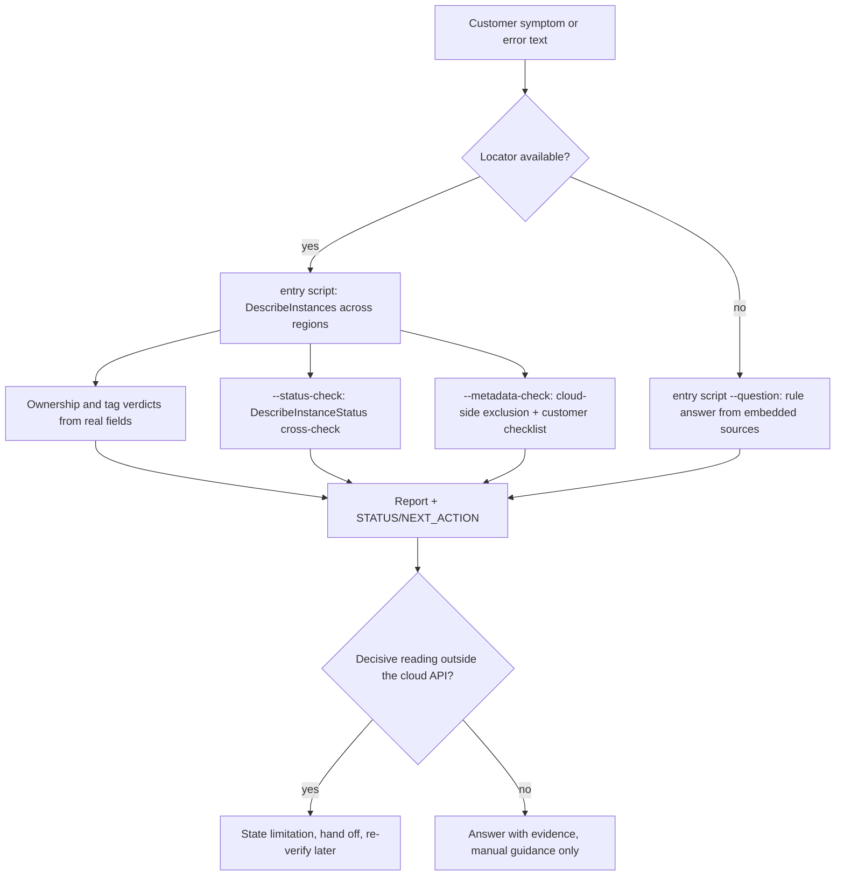

# ECS Instance Tag, Metadata and Resource Group Guide

Customer sentences this skill exists for: "which resource group is this
instance really in?", "I authorized the resource group to the RAM user but the
grant still comes back denied", "the console says a tag permission is missing",
"what tags do my instances actually carry?", "curl to the metadata address
times out and cloud-init cannot read the instance id", "what does metadata
hardening (token-only access) mean and what does it take to turn it on?".

The method is read-only evidence plus documented rules: the instance listing
returns the authoritative resource group id, tag set, region, zone, status,
VPC / security groups and metadata-option values, so "in or not in that group"
is answered from the API instead of from console state that no API can see.
Where the decisive reading lives inside the operating system, this skill says
so and hands the customer a checklist it never runs itself.

## Absolute Rules

1. **ABSOLUTE PROHIBITION (read-only enforcement).** Under NO circumstances may
   this skill generate, write or execute anything that changes cloud or guest
   state: no action of the shape `Create*`, `Delete*`, `Modify*`, `Update*`,
   `Put*`, `Attach*`, `Detach*`, `Bind*`, `Unbind*`, `Release*`, `Reset*`,
   `Tag*`, `Untag*`, `Join*`, `Start*`, `Stop*`, `Reboot*`, `Run*`; no
   configuration submitted on the customer's behalf; and no in-instance
   command, whether read-only or not -- including "a script for the user to
   run" handed out through this skill. Turning on token-only metadata access,
   moving an instance between resource groups and editing a policy are steps
   the customer performs in the console; this skill states them and then
   re-reads the result.
2. **API WHITELIST (only these, enforced in code).** `ecs:DescribeInstances`,
   `ecs:DescribeInstanceStatus` (API version `2014-05-26`) and
   `sts:GetCallerIdentity` (plugin-mode command
   `aliyun sts get-caller-identity`, version `2015-04-01`). Every other action
   is refused inside the script before it reaches the network. Tag facts come
   from the tag array of the instance listing; the dedicated tag-listing
   action is not part of this skill's verified surface and must not be called.
3. **CRITICAL -- MANDATORY EXECUTION.** All cloud evidence comes from the one
   entry script below. Do NOT hand-assemble `aliyun` commands, do not write
   ad-hoc Python to re-query or reshape data, do not skip a step, and do NOT
   fall back to the CLI when a call fails: the script already implements
   pagination, retry, degradation and the account-scope declaration.
4. **NO FABRICATION.** Conclusions come only from returned fields or from the
   source-labelled rule set in `references/` and the script constants. Quote
   the real values; state which parameters were auto-filled; where the evidence
   set has no verified documentation URL, say so instead of citing one.
   `NoPermission` / `ImplicitDeny` wording for denials, and never an invented
   error code.
5. **EMPTY / NOT-FOUND IS A VALID RESULT -- NEVER REACT TO IT WITH A CHANGE.**
   An instance id that returns nothing, an empty tag array and an instance with
   no resource group id are findings: report them, name what cannot be
   distinguished from here, then stop. Do not re-create, "verify", repair or
   guess an owner.
6. **SCOPE BOUNDARY.** Instance tags, resource-group ownership / visibility and
   metadata-service rules only. Console or browser filter state, RAM policy
   JSON, approval and filing progress, and everything inside the guest OS are
   outside what this skill can read: hand them off (see `references/` and the
   hand-off table).

## Quick Start -- the one sanctioned command

```bash
python3 scripts/axes/instance_tag_metadata_guide/ecs_instance_tag_metadata_check.py \
  --region <region-id> --instance-id <i-instance-id> --status-check
```

Then relay the report. Variants: add `--resource-group-id rg-...` or
`--tag-key/--tag-value` to filter, `--metadata-check` for the
metadata-endpoint exclusion plus the customer checklist, and
`--question "<customer wording or pasted error>"` for a rule answer with no
cloud read at all.

## Trigger Conditions

Mirror of the `description` triggers; match the customer's symptom sentence,
the error wording or the permission point -- not the product vocabulary a
support agent would use:

- "which resource group does this instance belong to"
- "tags on my ECS instances"
- "ImplicitDeny"
- "ecs:ListTagResources permission error"
- "100.100.100.200 metadata timeout"
- "cloud-init cannot reach the metadata service"

When the customer gives nothing to locate the resource, still run the entry
script: it exits `STATUS: FAIL` with a `NEXT_ACTION` naming the missing input.
That output is what should be put back to the customer.

## Execution Principle

The agent maps the request to entry-script arguments and transcribes the
script's report; it performs no business logic of its own. Nothing is executed
inside any instance and no cloud resource is changed -- this skill is read-only
by design, so there is no confirmation gate for a change and no rollback. What
the customer has to do themselves (switch the console resource-group selector,
grant at the right scope, run the in-guest checks, move an instance between
groups) is delivered as numbered steps plus the material list, and this skill
re-verifies the cloud-side result afterwards.

## Observability

Every OpenAPI call is issued through the aliyun CLI by `scripts/axes/instance_tag_metadata_guide/_cli.py` and
carries:

- **User-Agent template**: `AlibabaCloud-Agent-Skills/{skill-name}/{session-id} skill-version/{skill-version}`,
  where `{skill-name}` is `alibabacloud-ecs-instance-tag-metadata-guide`.
- **session-id**: a 32-character hex string (`uuid.uuid4().hex`) generated once
  per script run and attached to every call of that run, so all reads behind one
  answer can be correlated. The shared CLI layer implements this; no caller can
  turn it off.

## Prerequisites

1. **aliyun CLI 3.x** -- the only API channel (built-in API metadata for ECS in
   PascalCase form, plugin mode for `sts get-caller-identity`).
2. **Python 3.9+** -- standard library only; see `scripts/requirements.txt`.
3. **A working credential profile** -- see the next section.
4. **Read permissions** for the three whitelisted actions:
   `references/ram-policies.md`.

## Credentials

Credentials are resolved exclusively by the aliyun CLI default credential chain
(the CLI profile configuration or the platform-injected credential environment).
This skill never reads, prints, caches, uploads or asks for an access key, a
secret or a session token, and it writes no credential file. If
`aliyun sts get-caller-identity` fails, tell the customer to configure the CLI
profile; do not request a credential.

Run `python3 scripts/axes/instance_tag_metadata_guide/sts_token.py` to confirm which account the facts will be
scoped to before reading instances.

## User Confirmation

There is no write path to confirm. Confirmation applies to scope instead:

1. Before reading, echo back the region(s) and the locators that will be used,
   and any auto-filled value.
2. When the answer depends on information this skill cannot read (policy JSON,
   console filter state, guest configuration), state the gap and ask for it or
   hand off -- do not proceed as if it were known.
3. Before the customer acts on a checklist, name what each step does and that
   the customer is the one running it.

## Input Parameters

| Parameter | Required | Notes |
|---|---|---|
| `--region` | yes (auto-filled) | Repeatable for cross-region checks. Omitted -> `cn-hangzhou`, and the report declares the default. |
| `--instance-id` | one locator | Repeatable or comma separated; shape-checked before the call. |
| `--resource-group-id` | one locator | `rg-...`; combined with instance ids the group is compared locally, not filtered server-side. |
| `--tag-key` / `--tag-value` | one locator | Narrows the listing to a tag. |
| `--instance-name` | one locator | Name filter as an alternative to ids. |
| `--status-check` | optional | Adds the `DescribeInstanceStatus` cross-check. |
| `--metadata-check` | optional | Cloud-side exclusion for the metadata endpoint plus the customer checklist. |
| `--question` | optional | Rule answer only; no cloud read. |
| `--inventory` | optional | Deliberate fleet-wide read when no locator is given; without it a locator-free run ends `STATUS: FAIL` and prints the visible records as a pick-list. |
| `--profile` | optional | Alternate CLI credential profile. |

**Auto-fill declaration (mandatory).** Any defaulted parameter -- the region,
the account UID taken from `sts get-caller-identity` -- MUST be declared in the
answer, e.g. "region defaulted to cn-hangzhou because none was given".

## Orchestration



| Capability | What it answers | Entry-script mode | Reference module |
|---|---|---|---|
| Ownership and tag facts | which resource group / tags / region / status an instance carries | default listing (+ `--status-check`) | `references/instance-tag-metadata-guide__tag-inventory.md` |
| Rule answers | authorization-error wording, metadata-service rules, tag naming rules, hand-offs | `--question`, `--metadata-check` | `references/instance-tag-metadata-guide__resourcegroup-authorization.md`, `references/instance-tag-metadata-guide__metadata-service-facts.md` |

## Execution Flow

1. **Scope confirmation.** Read `references/ram-policies.md` if a denial is
   involved; run `python3 scripts/axes/instance_tag_metadata_guide/sts_token.py` once to pin the account; echo
   the regions and locators back.
2. **Collect evidence.** Run the entry script with the locators; on
   `STATUS: FAIL` ask for the missing input named by `NEXT_ACTION` instead of
   guessing.
3. **Read the verdicts.** Use the script's OWNERSHIP VERDICT and TAG INVENTORY
   blocks; never recompute them.
4. **Interpret denials.** Run `--question` with the exact error text and relay
   the matching rule, its source label and the customer-side steps.
5. **Metadata symptoms.** Run `--metadata-check`: relay the cloud-side exclusion,
   then the customer checklist and the hand-off line. Never assert a root cause
   this skill did not observe.
6. **Conclusion.** Relay the report per the output contract below.

## Module Index

| Module | File | Responsibility |
|---|---|---|
| M1: RAM policies | [references/ram-policies.md](references/ram-policies.md) | Minimal read-only permission points actually used |
| M2: Resource-group authorization | [references/instance-tag-metadata-guide__resourcegroup-authorization.md](references/instance-tag-metadata-guide__resourcegroup-authorization.md) | Account vs resource-group scope rules, authorization-error wording, visibility triage |
| M3: Metadata service facts | [references/instance-tag-metadata-guide__metadata-service-facts.md](references/instance-tag-metadata-guide__metadata-service-facts.md) | Metadata endpoint rules, what read-only can exclude, customer checklist, evidence limits |
| M4: Tag inventory | [references/instance-tag-metadata-guide__tag-inventory.md](references/instance-tag-metadata-guide__tag-inventory.md) | Tag fields as returned, naming rules, inventory method, tag-driven policies |

## Error Handling

**EXECUTION RULE FOR ERRORS.** The entry script logs
`[WARN] <Code>: <Message>` to stderr, keeps going with the remaining reads and
still prints the report with a `## GRACEFUL DEGRADATION LOG` block. The agent
must relay that block, never suppress it, and must not improvise a retry loop or
switch tools.

| Signal | What it means here | Response |
|---|---|---|
| `NoPermission` / `ImplicitDeny` with `PolicyType: ResourceGroupLevelIdentityBasedPolicy` | the identity has no grant at that resource-group scope | name the missing whitelisted action, point to `references/ram-policies.md`, and run `--question` with the pasted text |
| A permission point the console names for a listing call | that call is issued without a resource group, so a group-scoped grant cannot satisfy it | relay both options in `references/instance-tag-metadata-guide__resourcegroup-authorization.md`; the customer chooses |
| `InvalidParameter` from this skill's own validation | malformed region id / instance id / group id | no cloud call is made; ask for a well-formed value |
| `InvalidOperation.NotSupportedEndpoint` | the region id is not usable by that endpoint | re-check the region id, then re-run once |
| `Throttling.User` / `InternalError` / `ServiceUnavailable` / timeout | transient | already retried with backoff (3 attempts); then degraded with `[WARN]` |
| Empty result for an id | not in the queried region / another account / not visible | report as a finding with the three undistinguishable reasons |
| Empty result for a resource-group filter | no instance carries that group id in that region | check whether the instance returns no group id at all (default group) |
| Credential-chain failure (an unresolvable UID, a rejected token) | the session itself is unusable -- NOT a missing permission and NOT an empty fleet | relay the script's "CREDENTIAL CHECK FIRST" block, ask the customer to refresh their own credential, and fabricate nothing |
| No locator at all | nothing was named, so no conclusion is possible | the run still lists what the credential can see, then ends `STATUS: FAIL` with the missing input named; `--inventory` opts into a deliberate fleet-wide read |

## Output Contract (MANDATORY)

The final answer MUST:

1. Start with the report's banner line and the `STATUS: OK|DEGRADED|FAIL` and
   `NEXT_ACTION:` lines, relayed faithfully.
2. Quote only values the script printed (instance ids, group ids, tags, statuses,
   region names, error codes); every number and id traceable to the run.
3. Declare every auto-filled parameter and the account the read was scoped to.
4. Keep the limitation statement: console / browser filter state, policy JSON and
   anything inside the guest are not visible to this skill.
5. For rule answers, keep the source label and the evidence-strength line
   attached to the answer, plus the doc links or the explicit "no verified doc
   URL" statement.
6. End with manual guidance only -- steps the customer performs -- or the
   hand-off sentence.

**MANDATORY POST-OUTPUT VERIFICATION.** Before presenting, check the answer
contains: the banner, the facts or rule answer, the degradation log, the
limitation statement, and the `STATUS` / `NEXT_ACTION` lines. If anything is
missing, append it explicitly. Never present raw JSON or a partial report.

## Examples

**Example 1 -- "is the instance really in the group I authorized?"**

> User: "I granted the resource group to the RAM user, but the user still
> cannot see instance `i-bp1...`. What is wrong?"

```bash
python3 scripts/axes/instance_tag_metadata_guide/ecs_instance_tag_metadata_check.py \
  --region cn-hangzhou --instance-id i-bp1... --resource-group-id rg-aek...
```

Relay the OWNERSHIP VERDICT: `IN_GROUP` means the grant and the object line up
and the remaining step is the console resource-group selector plus any
`ResourceGroupId` parameter left in the URL; `NOT_IN_GROUP` names the group the
instance really carries; a `DEFAULT_GROUP` result means the instance carries no
group id at all.

**Example 2 -- authorization error wording**

> User: "The instance-creation call comes back denied with
> `NoPermissionType: ImplicitDeny` and
> `PolicyType: ResourceGroupLevelIdentityBasedPolicy`, even though the user
> has an account-level Allow."

```bash
python3 scripts/axes/instance_tag_metadata_guide/ecs_instance_tag_metadata_check.py --question \
  "NoPermissionType: ImplicitDeny PolicyType: ResourceGroupLevelIdentityBasedPolicy"
```

Relay the matched rule, its customer-side steps and its ticket source. The skill
explains and never edits a policy.

**Example 3 -- metadata endpoint unreachable**

> User: "curl to `100.100.100.200` times out and cloud-init reports `Network is
> unreachable` for the instance id."

```bash
python3 scripts/axes/instance_tag_metadata_guide/ecs_instance_tag_metadata_check.py --metadata-check \
  --region cn-hangzhou --instance-id i-bp1...
```

Relay the cloud-side facts (status, region, VPC, attached groups, metadata
option values), the explicit statement that the decisive reading is inside the
guest, the checklist for the customer to run, and the ticket hand-off sentence.

## Important Notes

- **Console state is invisible.** A correct grant is not the same as a visible
  list: the resource-group selector, the URL parameter and the region selector
  are all browser-side. Say "the API says X; the console view you describe is
  not something any API can read".
- **An account-level Allow does not satisfy a group-scoped call, and a
  group-scoped grant does not satisfy a call issued without a group.** Both
  directions appear in real tickets and both are explained, not guessed.
- **Stopped is not the same as unreachable-by-metadata.** A stopped instance
  explains an unreachable service inside it; it does not explain a metadata
  failure by itself.
- **A returned empty metadata option means "never set"**, not "hardening is
  off". Do not infer a configuration from an absent value.
- **Tags: the listing is the source.** The tag array of each instance record is
  what gets reported; keys with the reserved service prefix are counted
  separately from customer tags.
- **Evidence ages.** Rule wording was cross-checked in 2026-08 and response
  shapes were live-verified on 2026-09-18; re-check the linked documents before
  quoting a rule to a customer, and state the check date in the answer.
- **Neighbour names are placeholders.** The skill names used in hand-off
  wording come from the out-of-scope symptoms seen in the source tickets, not
  from an authoritative boundary list for this batch. Recognise the symptom,
  hand it over, and never diagnose it here.
- **No commercial or approval work.** Billing treatment, filing, refunds and
  qualification reviews are out of scope: name the gap and point at the
  ticket route.

## Available Scripts

| Script | Purpose |
|---|---|
| `scripts/axes/instance_tag_metadata_guide/ecs_instance_tag_metadata_check.py` | the only entry point: ownership and tag facts, status cross-check, metadata-service exclusion, rule answers; ends with `STATUS` / `NEXT_ACTION` |
| `scripts/axes/instance_tag_metadata_guide/sts_token.py` | credential pre-flight via `aliyun sts get-caller-identity`; account UID as a scope label |
| `scripts/axes/instance_tag_metadata_guide/_cli.py` | shared CLI layer: command style, session-id User-Agent on every call, per-call timeout, transient retry, credential masking, pagination |
| `scripts/axes/instance_tag_metadata_guide/_constants.py` | embedded tables and rule text (no data files live in `scripts/`) |
