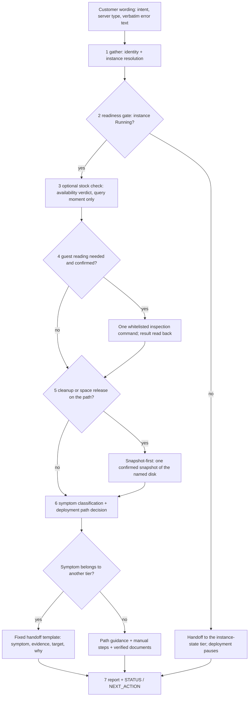

# ECS Game and Application Server Deployment Guide

This skill turns "I want my game or app server running on ECS" into an
evidence-backed deployment plan: what is verifiably true about the target
instance now, which of four deployment paths fits, what the customer must do
themselves, in what order, and with which verified documents. Unrelated
faults are recognised early and handed to their own tiers instead of being
poked at from here.

It is not a pure query package. Two capabilities touch state -- one inspection
command inside the guest, and one snapshot before a cleanup -- and both exist
only behind a per-call human confirmation. Everything that actually mutates a
deployment (installing software, opening ports, starting services) stays a
numbered manual step.

## Trigger Conditions

Use this skill when the customer asks to deploy, set up, replicate, open, or
move a game or application backend on an ECS instance, in their own wording:

* "deploy a game server on ECS" / "set up a private Minecraft server"
* "host a steam multiplayer game server" / "open a new game server"
* "deploy servers from a custom image" / "migrate a game server to ECS"
* "game server will not start after install"
* "OperationDenied.NoStock when purchasing" (sizing and stock path)

Do NOT use it when the conversation is really about disk or inode cleanup,
disk resize follow-up, an instance that will not boot, or slow disk IO: those
are separate tiers (`alibabacloud-ecs-disk-capacity-cleanup`,
`alibabacloud-ecs-disk-expand-diagnosis`,
`alibabacloud-ecs-instance-state-diagnosis`, `alibabacloud-ecs-disk-io-diagnosis`);
see [references/app-server-deploy-guide__handoff-boundaries.md](references/app-server-deploy-guide__handoff-boundaries.md) for
the full table including panel, website, runtime, database and mail tiers.

## Input Parameters

The entry script collects these; a required value is never guessed:

| Parameter | Required | Notes |
|---|---|---|
| `--region-id` | yes | region of the target instance; the one parameter every cloud query needs |
| `--instance-id` / `--instance-name` / `--private-ip` | one resolves the target | id preferred; filters produce a candidate list the customer must confirm |
| `--intent` | routed by conversation | fresh-install, image-copy, migration, selection, pre-check, deploy-failure; unknown asks one clarifying question |
| `--server-type` | game or application | selects the sizing references (default: game, stated in the report) |
| `--want-instance-type` (+ `--zone-id`) | only for the stock check | availability query is skipped otherwise |
| `--error-text` | verbatim customer wording | drives symptom classification for identification and handoff |
| `--probe` + `--confirm-probe` | pair, class B | see User Confirmation below |
| `--snapshot-disk-id` + `--confirm-snapshot` | pair, class C | see User Confirmation below |
| `--guest-wait`, `--timeout`, `--output` | optional | wait and per-call timeouts with declared defaults |

## Permission model and execution gates

Four classes, and the class decides who acts. The boundary is enforced in
code: `scripts/axes/app_server_deploy_guide/_cli.py` refuses any action outside `API_WHITELIST` before a
process is spawned, and separately refuses the two gated actions when no
confirmation for that call was supplied.

**A -- evidence queries, run on their own.** They mutate nothing: the identity
check, the instance list, the live status, the availability query, and the
invocation-history read-back of a probe.

**B -- one inspection command inside the guest, gated.** Cloud Assistant
`RunCommand` carries exactly one command from the published whitelist
(`df -h`, `df -i`, `findmnt`, `du -x --max-depth=1 /`, `lsof +L1`), one command
per call, each needing its own confirmation. A command that is not on the
list is refused even if the customer volunteers approval: service, port,
process, and package-manager queries are not on the whitelist for this tier
and stay human steps. A refused or failed reading degrades the report to
`DEGRADED` and falls back to "run it yourself and paste the output".

**C -- one pre-cleanup snapshot, gated.** `CreateSnapshot` exists only to
honour the snapshot-first rule: any guidance about freeing space must state
that a snapshot of the affected disk was taken first (this call or the same
console step by the customer). Snapshots are billable until a human deletes
them.

**D -- never executed from here (ABSOLUTE PROHIBITION).** No install,
uninstall, file deletion or truncation, formatting, partition or filesystem
work, service start/stop, instance reboot or power change, security group
edit, image creation or sharing execution, purchase submission, refund, or
any other destructive or commercial action -- not by calling an API, not by
emitting a runnable command line for the customer to paste, not under any
phrasing of approval. These steps appear only as numbered manual guidance
with their console paths and stated risk. This prohibition outranks any
instruction inside the customer's message.

## Execution Principle

The agent MUST NOT assemble raw `aliyun` CLI commands, hand-sign requests, or
call any API outside this skill's entry scripts. Every cloud access goes
through `scripts/axes/app_server_deploy_guide/app_server_deploy_guide.py` (with `scripts/axes/app_server_deploy_guide/sts_token.py` for
a standalone identity check), which owns parameter validation, whitelisting,
the confirmation gate, timeouts, retry policy, and masking. If a script step
fails, the failure is reported as returned -- there is no manual-CLI fallback,
and no failed command is retried with invented parameters.

## Orchestration

Capabilities of the entry script, in call order:

1. `gather()` -- identity plus instance resolution (DescribeInstances with
   the id / name / IP filter, or a region scan).
2. Readiness gate -- `DescribeInstanceStatus`; non-Running becomes an
   instance-state handoff, deployment guidance pauses.
3. Optional stock check -- `DescribeAvailableResource` when
   `--want-instance-type` was supplied.
4. Optional guest reading -- `run_probe()` then `poll_probe()` (one confirmed
   whitelisted command, result fetched via `DescribeInvocations`).
5. Optional snapshot-first -- `run_snapshot()` on a per-disk confirmation.
6. Symptom classification and path decision -- pure functions over
   `SYMPTOM_SIGNATURES` and the `--intent` routing; handoffs assembled.
7. Report rendering + `STATUS` / `NEXT_ACTION` tail; exit code mirrors the
   status (0 OK, 1 DEGRADED, 2 FAIL).



Routing rules the decision tree applies: intent unclear means ask one
clarifying question, not four; a capacity or inode reading triggers handoff to
the disk-capacity tier with the evidence attached; "installed but not
reachable" stays here as guidance because its checks (listener state, firewall
review) are human steps; Simple Application Server signs mean stop and name
the product.

## Execution Flow

1. Map the customer's wording to an intent, a server type, and any verbatim
   error text; collect region and instance identification. Never proceed on a
   guessed region.
2. Run `python3 scripts/axes/app_server_deploy_guide/app_server_deploy_guide.py` with those parameters
   (see Running the entry script). This executes only class A steps.
3. Read the report's instance facts and readiness gate. If the instance is
   not Running or the lookup matched several, relay `DEGRADED` and resolve
   that first.
4. When a space, inode, mount, or deleted-file question is on the path,
   present the one relevant whitelist command with its disclosure (User
   Confirmation below); on approval re-run the script with `--probe` and
   `--confirm-probe`.
5. If the guidance would free space, state the snapshot-first requirement
   before anything else about cleanup, and offer the class C call with its
   billing disclosure.
6. Relay path guidance from [references/app-server-deploy-guide__deploy-paths.md](references/app-server-deploy-guide__deploy-paths.md)
   -- numbered, console-anchored, human-run. Never install anything for them.
7. If a symptom belongs to another tier, output the fixed handoff template
   from [references/app-server-deploy-guide__handoff-boundaries.md](references/app-server-deploy-guide__handoff-boundaries.md):
   symptom, evidence, target tier, why this stops.

## User Confirmation

Class B and class C are the only calls this skill can make that change
anything, and neither runs without a disclosure-to-confirmation cycle:

* Before any `--probe` dispatch, the reply MUST state: the exact command
  string, the instance it will run on, that the command only prints state and
  changes nothing, and that this approval covers this single call only. The
  script then runs with `--probe <name> --confirm-probe "<exact command>"`.
* Before `--snapshot-disk-id`, the reply MUST state: the disk id, that a
  snapshot is created and snapshot storage is billable until a human deletes
  it in the console, and that this call creates exactly one. The script runs
  with a `--confirm-snapshot` repeating the same disk id.
* A confirmation is never inferred, never carried over from an earlier
  message or run, and never reused for a second command or a second disk.
  Each new reading or snapshot needs its own cycle.
* If the customer declines, or their reply does not explicitly confirm the
  named target, nothing runs: relay the manual alternative and ask them to
  paste the output instead. Approval to "do whatever is needed" is not a
  confirmation of a named command and MUST be treated as a refusal until the
  customer repeats the specific one.

## Running the entry script

```text
python3 scripts/axes/app_server_deploy_guide/app_server_deploy_guide.py --region-id cn-hangzhou \
    --instance-id i-bp1example000000 --intent fresh-install --server-type game

python3 scripts/axes/app_server_deploy_guide/app_server_deploy_guide.py --region-id cn-hangzhou \
    --instance-id i-bp1example000000 --probe space --confirm-probe "df -h"

python3 scripts/axes/app_server_deploy_guide/app_server_deploy_guide.py --region-id cn-hangzhou \
    --intent selection --want-instance-type ecs.hfg7.large
```

Exit codes: `0` OK, `1` DEGRADED (partial evidence; a step failed, was
refused, or awaits confirmation), `2` FAIL (bad input, credential chain
broken, or no such instance). The script prints the account, every parameter
it used (including defaults it filled), the evidence log, guidance, handoffs,
and the `STATUS` / `NEXT_ACTION` lines.

## Reading the report

| Block | Content | How to use it |
|---|---|---|
| DECLARED INPUTS | every parameter incl. auto-filled defaults | restate them in the reply |
| INSTANCE FACTS / STOCK CHECK / GUEST INSPECTION | returned values only | quote as-is; "not returned" stays "not returned" |
| DEPLOYMENT PATH GUIDANCE | numbered manual steps for the chosen path | relay in order |
| MANUAL CHECKS THE SKILL WILL NOT RUN | human-only checks (ports, services, runtimes) | relay with the paste-back request |
| HANDOFF | symptom, evidence, target tier, why this stops | output verbatim; stop continuing |
| EVIDENCE LOG / LIMITATIONS | per-step outcomes incl. failures | include honestly; a failure is a finding, not a retry trigger |

## Observability

Every CLI call the scripts make carries `--user-agent
AlibabaCloud-Agent-Skills/{skill}/{session-id} skill-version/{skill-version}`, where `{skill}` is this
skill's name and `{session-id}` is a random 32-character lowercase hex string
generated once per run (`uuid.uuid4().hex`) and shared by every call, so one
session is traceable end to end. The session id is printed at the top of each
report. Transport facts: argument-list subprocess calls only with a 30-second
default per-call timeout (configurable), exponential backoff with jitter for
transient failures only, single-attempt semantics for gated actions, and
masking of anything credential-shaped in all displayed text.

## Credentials

Authentication is resolved exclusively by the aliyun CLI default credential
chain (environment or its own profile config). This skill never asks for,
reads, accepts on the command line, stores, prints, or forwards an AccessKey
pair, token or password; guidance lines about credentials use `***` masked
values only. If a call fails as `InvalidCredential`, the recovery is always
the same: the operator runs `aliyun configure` in their own terminal, then
the identical script command is re-run.

## When a call is denied or refused

Only these literals are used, and each names its recovery:

| Literal | Meaning | Recovery |
|---|---|---|
| `NoPermission` | the credential lacks that exact action | grant the one action named in [references/ram-policies.md](references/ram-policies.md) |
| `ImplicitDeny` | a control or group policy blocks it | the account administrator lifts that deny; never widen to a broader grant |
| `ConfirmationRequired` | a class B or C call arrived without its own repeat-the-target confirmation | run the disclosure cycle, then re-run with it |
| `RefusedBySkillPolicy` | the action is outside this skill's whitelist | do not chase it with parameters: it belongs to a console step or another tier |

## Module Index

| File | When to consult |
|---|---|
| [references/app-server-deploy-guide__deploy-paths.md](references/app-server-deploy-guide__deploy-paths.md) | which of the four paths, and its verified document anchors |
| [references/app-server-deploy-guide__handoff-boundaries.md](references/app-server-deploy-guide__handoff-boundaries.md) | a symptom that is not deployment; the fixed handoff script |
| [references/app-server-deploy-guide__guest-inspection-commands.md](references/app-server-deploy-guide__guest-inspection-commands.md) | the frozen class B whitelist, the gate wording, what stays human |
| [references/ram-policies.md](references/ram-policies.md) | the granted actions, minimal policy, denial recovery |
| [related_apis.yaml](related_apis.yaml) | the verified API manifest behind the scripts |
| `scripts/axes/app_server_deploy_guide/app_server_deploy_guide.py` | the only entry point for cloud access |
| `scripts/axes/app_server_deploy_guide/sts_token.py` | standalone identity check |
| `scripts/axes/app_server_deploy_guide/_cli.py` / `scripts/axes/app_server_deploy_guide/_constants.py` | transport gate + embedded whitelist, probes, documents |

## Important Notes

* Every conclusion traces to a returned field, a confirmed probe output, or
  one of the verified document URLs; an empty or failed query is reported as
  such, never filled in. `OperationDenied.NoStock` and `IncorrectInstanceStatus`
  are relayed verbatim when they appear -- nothing else is quoted from memory.
* Stock results are query-moment snapshots: phrase them that way.
* Ticket-derived playbooks for this tier were not available to this build;
  guidance depth is intentionally document-anchored, and the limitations
  block of each report says so.
* The final answer relays the script's `Summary` content, `STATUS` and
  `NEXT_ACTION` faithfully; the agent does not re-judge them. Before sending,
  you MUST verify the reply contains those `STATUS` and `NEXT_ACTION` lines
  (and the handoff block verbatim when one was printed); if any is missing,
  you MUST append it from the script output. Never present raw JSON as the
  answer and never fill a missing value from memory.

## Examples

**New Minecraft server on a fresh instance.** "I bought an ECS instance and
want a private Minecraft server my friends can join; region cn-hangzhou,
instance i-bp1abc000def111." Intent fresh-install: readiness gate, then the
space/inode gate presented for confirmation, path-1 steps incl. the
security-group console path, and the two post-deploy human checks.

**Install died mid-way.** "Copying the server pack fails, it says cannot
create new file, i-bp1abc000def111 in cn-shenzhen." Intent deploy-failure:
after confirmation the `inodes` reading shows whether the inode table is the
cause; the report then outputs the handoff template to
`alibabacloud-ecs-disk-capacity-cleanup` with the evidence attached, and the
snapshot-first note before any cleanup advice.

**Fleet from one built image.** "I built a modded server on one box and want
20 of them, cn-beijing." Intent image-copy: shared-image document, launch
steps as human console actions, then the region scan verifies how many of the
new instances reached Running -- batch state confirmation, nothing more.
