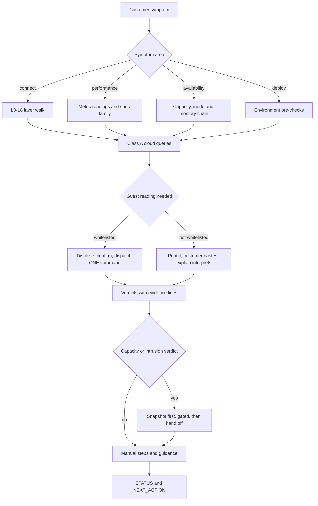

# Database on ECS: Deployment, Connection and Performance Diagnosis

> **Delivery override - outranks every relay instruction and template below.** `STATUS`,
> `NEXT_ACTION` and their `OK` / `DEGRADED` / `FAIL` / `BLOCKED` values are the entry script's
> internal run state, not a delivery format. Where this document says to relay, mirror or copy
> those lines "faithfully" or "verbatim", relay their MEANING in the customer's own words: never
> write the keys or the bare values into the reply or into anything saved under `outputs/` or
> `ran_scripts/` (SKILL.md rule 3h). A layer this run did not read is named in the customer's own words - which layer, and what would have settled it.

Explains why a database that the customer installed inside an Alibaba Cloud ECS
instance cannot be reached, will not start, or runs slowly. It separates the
layers that support tickets show customers confusing every day: the account and
instance state, the cloud-side allow-list, the listener and bind address inside
the guest, the in-guest packet filters and third-party security suites, the
engine's own authentication and grant rules, and the resource pressure (disk
bytes, inodes, memory, CPU) that routinely wears a "database connection failed"
costume.

The evidence base is the merged ticket set for this tier: 1009 tickets across
three scenarios - install, migrate and day-to-day operations of a self-managed
engine; slow performance with CPU saturated; and remote connection failures on
database ports such as 3306, 6379, 1433, 5432 and 27017. MySQL, MariaDB, SQL
Server, Redis, PostgreSQL and MongoDB all appear in that set.

## Absolute Rules

CRITICAL - MANDATORY EXECUTION. These four rules override any habit or shortcut:

1. **One entry point.** The agent MUST run `scripts/axes/db_on_ecs_diagnosis/db_on_ecs_diagnosis.py`
   (or `scripts/axes/db_on_ecs_diagnosis/sts_token.py` for the credential preflight) and nothing else. It
   MUST NOT assemble an `aliyun` command by hand, MUST NOT call an OpenAPI
   action directly, and MUST NOT reach into a helper module to bypass the entry
   point.
2. **No hand-built substitution.** If a leg of the script fails, the failure
   is recorded as
   `[WARN]`, the run degrades, and the remaining legs continue. Replacing the
   script with hand-built CLI calls is prohibited, including "just this once".
3. **Evidence or silence.** Every cloud fact in the reply comes from a call the
   script actually made; every judgement comes from the frozen tables in
   `scripts/axes/db_on_ecs_diagnosis/_constants.py` or from output the customer pasted in. A value that
   was not returned is reported as not visible at that layer. Never supply one
   from memory, and never present a guidance step as something the skill did.
4. **Gated actions stay gated.** A guest command dispatch (CLI plugin-mode
   `run-command`) and a snapshot creation (CLI plugin-mode `create-snapshot`) run
   only after the disclosure
   in `## User Confirmation` was relayed and an explicit yes for that single
   call came back. The script refuses without its confirmation flag, and the
   refusal is not something to argue around.

## Scope

In scope:

* Layered triage of a remote connection failure to a database port, driven by
  the error semantics of `Connection refused` versus `timed out`.
* Availability triage of an engine that will not start or keeps stopping,
  including the capacity, inode and memory chains that cause it.
* Performance triage: sustained metric readings, spec-family interpretation
  (shared and burstable classes have no performance guarantee), and the split
  between a resource chain and business SQL before either half is handed off.
* Environment pre-checks for an install, migration, backup or restore: free
  space at the target path, inode headroom, port availability, login path.
* Database-port exposure findings and the hardening standard set.
* Capacity, inode and deleted-but-still-open detection through the whitelisted
  non-mutating guest commands - strictly to answer "is this database failure
  actually a capacity failure", after which the cleanup itself is handed off.

Out of scope, recognised and handed off rather than attempted: an instance that
will not boot, a disk that was expanded but did not grow in the guest, disk IO
below the purchased specification, the cleanup of a full disk or of exhausted
inodes, managed database products, orders and refunds, ransomware decryption,
data recovery, and business-layer work such as SQL tuning or a restore wizard.
Targets and wording are in
references/db-on-ecs-diagnosis__handoff-boundaries.md (in alibabacloud-ecs-high-frequency-issues).

## Trigger Conditions

Trigger on the customer's own words, not on a root-cause label:

* "I cannot connect to MySQL on 3306 from my machine, the security group is
  open"; "redis 6379 gives Connection refused"; "the application says the
  connection to the database timed out".
* "The database is slow and CPU is at 100 percent"; "MySQL stopped answering
  after the restart"; "mysqld will not start, the pid file is missing".
* "I want to install / migrate / restore a database on this ECS instance";
  "is there enough space for the backup file".
* "SQL Server 1433 login failed after I reset the password"; "the website
  shows a database connection failure".

Do not trigger for: the instance itself not booting or stuck in an intermediate
power state; a disk expansion that did not land in the guest; disk throughput
below specification; freeing space on a full disk; a managed cloud database
product; billing, refunds and package changes. Say the boundary, name the target
skill, and stop.

## Input Parameters

| Parameter | Flag | Required | Notes |
| --- | --- | --- | --- |
| Region | `--region-id` | yes in practice | Auto-filled as `cn-hangzhou` when absent; the report declares that it was auto-filled and asks the customer to confirm |
| Instance | `--instance-id` or `--public-ip` | one of the two | The queries are regional; a public IP is resolved inside the given region only, never by sweeping regions |
| Symptom area | `--symptom` | no, default `connect` | `connect`, `performance`, `availability`, `deploy` |
| Engine | `--db-type` | no | `mysql`, `mariadb`, `sqlserver`, `redis`, `postgresql`, `mongodb` |
| Port | `--port` | no | Auto-filled from `--db-type` (3306, 1433, 6379, 5432, 27017); the auto-fill is declared |
| Customer error text | `--error-text` | no | Paste verbatim; the classifier matches it, quotes are never paraphrased |
| Client egress IP | `--client-ip` | no | Needed for the allow-list and grant layers |
| Recent change | `--recent-change` | no | A rule added minutes ago makes propagation delay a live hypothesis |
| Backup size | `--backup-size-mb` | no | Deploy leg: compares against free space |
| Metrics | `--metrics` | no, default `cpu` | Comma list of `cpu`, `memory`, `disk` |
| Guest command | `--command` (probe) | yes for probe | One whitelisted non-mutating command |
| Disk | `--disk-id` (create-snapshot) | yes for snapshot | The disk the snapshot protects |

Parameter provenance is mandatory: every value the agent filled in itself
(region, port, symptom area, engine) is named in the reply as auto-filled, with
its source. A value the customer never gave and the cloud never returned is
asked for, not invented.

## Execution Principle

The agent's only job is to map the customer's words onto one subcommand plus
its flags, then relay the report. Subcommands of
`scripts/axes/db_on_ecs_diagnosis/db_on_ecs_diagnosis.py`:

| Subcommand | Purpose | Cloud calls |
| --- | --- | --- |
| `check-auth` | Credential preflight and account label | identity query |
| `diagnose` | Full layered triage on one symptom area | instance, full status, spec detail, assistant status, invocation history, metric queries |
| `probe` | Dispatch ONE whitelisted non-mutating guest command | assistant status, gated dispatch, invocation result |
| `explain` | Interpret pasted guest output or raw error text | none |
| `create-snapshot` | Gated pre-cleanup or evidence snapshot | gated snapshot creation |

Typical invocations, run from the skill directory:

```bash
python3 scripts/axes/db_on_ecs_diagnosis/db_on_ecs_diagnosis.py check-auth

python3 scripts/axes/db_on_ecs_diagnosis/db_on_ecs_diagnosis.py diagnose \
  --region-id cn-hangzhou --instance-id i-example0123456789 \
  --symptom connect --db-type mysql --client-ip 203.0.113.9 \
  --error-text "Connection refused"

python3 scripts/axes/db_on_ecs_diagnosis/db_on_ecs_diagnosis.py diagnose \
  --region-id cn-hangzhou --instance-id i-example0123456789 \
  --symptom performance --metrics cpu,memory

python3 scripts/axes/db_on_ecs_diagnosis/db_on_ecs_diagnosis.py explain --paste - --port 3306

python3 scripts/axes/db_on_ecs_diagnosis/db_on_ecs_diagnosis.py probe \
  --region-id cn-hangzhou --instance-id i-example0123456789 \
  --command "df -i"

python3 scripts/axes/db_on_ecs_diagnosis/db_on_ecs_diagnosis.py create-snapshot --disk-id d-example0123456789
```

`probe` and `create-snapshot` print their disclosure and stop with
`NEXT_ACTION: AWAIT_EXPLICIT_CONFIRMATION` unless `--confirm` (probe) or
`--confirm-cost` (snapshot) is present. That first, unconfirmed run is the
intended way to obtain the exact disclosure text to relay to the customer.

## Operation classes

This skill is **not** an inspection-only package. It uses four classes of
action, each with its own gate:

| Class | What it covers | Gate |
| --- | --- | --- |
| A - cloud queries | Identity, instance and full-status reads, spec detail, Cloud Assistant readiness, invocation history, CloudMonitor readings | None: they retrieve state and change nothing |
| B - one guest command | A single non-mutating command from the frozen whitelist, dispatched through Cloud Assistant | Announce, then confirm; one command per acknowledgement |
| C - low-risk reversible write | A snapshot of one disk, taken before any cleanup advice is acted on or to preserve the scene of an intrusion | Announce cost and reversibility, then confirm |
| D - never executed | Destructive, service-affecting, commercial or product-internal actions | Human procedure, blast radius and rollback only |

Class B is write-class at the API level even though its payload only reports
state; that is why the confirmation gate exists. Class B is the only way this
skill obtains what no cloud API exposes: actual filesystem and inode usage,
deleted-but-still-open files, mount layout, volume free space.

## User Confirmation

Before any class B or class C call, the agent MUST state, in the same turn and
before acting:

1. exactly what will be executed - the literal command text, or the literal
   snapshot parameters including the disk id;
2. the single resource it targets, by identifier, and the region;
3. that a whitelisted guest command writes nothing, or for a snapshot that it
   adds a copy and alters no existing data;
4. the cost consequence - a snapshot bills by stored capacity and retention
   time, and the wording plus the official pricing link are in
   references/db-on-ecs-diagnosis__security-hardening-checklist.md (in alibabacloud-ecs-high-frequency-issues);
5. what happens if it fails, and that the acknowledgement covers this one call
   only.

Then the agent MUST wait for an explicit affirmative answer. Silence, ambiguity,
a "just fix it" from earlier in the conversation, or a confirmation given for a
different command is not confirmation for this one. Every further reading -
even the next level of the same directory walk - needs a fresh disclosure and a
fresh yes.

Anything not on the whitelist in `scripts/axes/db_on_ecs_diagnosis/_constants.py` is refused even after a
confirmation, and is converted into a paste-back instruction: the customer runs
it inside the instance and the `explain` subcommand interprets the output. The
command list and the refusal classes are documented in
references/db-on-ecs-diagnosis__guest-commands.md (in alibabacloud-ecs-high-frequency-issues).

## API whitelist

Exactly these actions, and no others, are ever issued. The three lists - this
table, [references/ram-policies.md](references/ram-policies.md) and
[related_apis.yaml](related_apis.yaml) - are kept aligned; adding a call without
adding it in all three is a defect.

| Product | Action | Class | Permission point |
| --- | --- | --- | --- |
| sts | `GetCallerIdentity` | A | `sts:GetCallerIdentity` |
| ecs | `DescribeInstances` | A | `ecs:DescribeInstances` |
| ecs | `DescribeInstancesFullStatus` | A | `ecs:DescribeInstancesFullStatus` |
| ecs | `DescribeInstanceTypes` | A | `ecs:DescribeInstanceTypes` |
| ecs | `DescribeCloudAssistantStatus` | A | `ecs:DescribeCloudAssistantStatus` |
| ecs | `DescribeInvocations` | A | `ecs:DescribeInvocations` |
| ecs | `RunCommand` | B, gated (Class B, no declared grant) | `run-command` (CLI plugin-mode; API `RunCommand`) |
| ecs | `CreateSnapshot` | C, gated (Class B, no declared grant) | `create-snapshot` (CLI plugin-mode; API `CreateSnapshot`) |
| cms | `DescribeMetricLast` | A | `cms:QueryMetricLast` (the RAM point differs from the API name) |

Deliberately not declared and never called: the command-invocation reuse action
and the stored-command listing action (not verified for this tier), the
security-group rule detail action (so rule detail stays a console check by the
customer), the disk listing action (capacity baseline comes from the guest
reading instead), and every order, renewal and bill action. No wildcard appears
anywhere in this package.

## ABSOLUTE PROHIBITION

This skill MUST NOT generate, execute, schedule, or hand over as a
copy-paste-ready automated step any of the following. For each one it outputs a
human procedure, the blast radius, and the rollback path, then stops:

* Any mutating cloud action. The `Modify`, `Delete`, `Release`, `Remove`,
  `Reset`, `Replace`, `Attach`, `Detach`, `Reboot`, `Start`, `Stop`,
  `Authorize`, `Revoke`, `Bind`, `Unbind`, `Assign`, `Import`, `Export`,
  `Cancel`, `Add`, `Put`, `Tag` and `Untag` families are refused mechanically
  by `NEVER_ALLOWED_ACTION_PREFIXES`, confirmation included.
* Security-group rule edits, even to "fix" a blocked database port. Opening a
  port is a change; the report names the exact missing ingress entry and the
  console path instead.
* Service and process actions inside the guest: starting, stopping or
  restarting a database service, killing a process, changing a startup unit.
* Firewall and filter changes: flushing rules, adding a port, disabling a
  suite, kernel connection-tracking tuning.
* Filesystem and disk writers: formatting, partitioning, filesystem repair or
  growth, mount and swap edits, permission changes on data directories.
* Any deletion, truncation or "cleanup" of logs, data files or snapshots. A
  capacity verdict routes to the capacity tier after a snapshot, never to a
  delete step here.
* Database-internal changes: grants, accounts, authentication mode, engine
  configuration, restore and detach operations, SQL tuning.
* Commercial acts: refunds, package changes, renewals, specification purchases.

Emitting a command as **text for a human to run** is the intended output of
this skill and is not a violation; executing it, or wrapping it so that
something else executes it, is.

## Snapshot First

No cleanup, space-releasing or repair guidance is handed over without a
snapshot status in the report. Where the customer is about to act on a capacity
verdict, or where an intrusion pattern was matched, a fresh snapshot of the
affected disk is the precondition - created through the gated class C call after
cost disclosure, or created by the customer in the console when this session
holds no write permission. Two facts are stated every time because both are
widely misunderstood: a snapshot lives in cloud storage and consumes no space on
the disk being diagnosed, and it bills by stored capacity and retention time, so
a temporary one should be deleted after the change is verified. Deleting a
snapshot is always a human decision and is never performed here.

## Workflow

```text
Step 0  Identity and inputs. Run the preflight, name the account actually
        queried, and ask for the region plus an instance id or public IP when
        either is missing. Confirm which symptom area the customer means:
        cannot connect, will not start, runs slow, or about to install.
Step 1  Cloud facts, class A, no confirmation. Instance existence and power
        state, bound security groups, public addresses, guest OS family,
        scheduled expiry or release events, spec family and level.
Step 2  Branch on the area.
        connect      -> the L0-L8 layer walk below.
        performance  -> metric readings, then spec-family interpretation, then
                        the resource-chain versus business-SQL split.
        availability -> capacity, inode and memory chain, engine error log.
        deploy       -> environment pre-checks: space, inodes, port, login path.
Step 3  Error semantics. Classify the customer's verbatim text: a refusal sends
        the walk to the listener and grant layers, a timeout sends it to the
        allow-list and filter layers, a name-resolution failure sends it to the
        client side.
Step 4  Layer walk for the connect area, in ticket-frequency order:
        L0 account and instance state; L1 reachability and error semantics;
        L2 cloud allow-list and port-number consistency; L3 listener, bind
        address and dynamic-port drift; L4 in-guest filters and third-party
        suites; L5 engine authentication and grants; L6 capacity and resource
        pressure; L7 client-side and link path; L8 exposure and ransom patterns.
        Full detail in references/db-on-ecs-diagnosis__connectivity-decision-tree.md.
Step 5  Guest readings. Offer at most one whitelisted non-mutating command per
        acknowledgement through the confirm gate. Everything else is printed for
        the customer to run and paste; the explain subcommand interprets the
        paste. If Cloud Assistant is not answering, degrade to paste-back and
        say so.
Step 6  Capacity or intrusion verdict. Snapshot first (gated, cost disclosed),
        then hand the cleanup or the recovery off. Nothing is deleted here.
Step 7  Report: verdicts with their evidence lines, the layer walk state,
        matched signals with confidence, manual steps, pending gated actions,
        hand-offs, assumptions and auto-filled inputs, limits, then the
        STATUS and NEXT_ACTION contract lines.
```

Windows instances are supported. NTFS has no inode equivalent, so an inode
verdict is Linux-only and a Windows file-count conclusion always carries an
explicit confidence caveat.

## Orchestration



## Observability

Every CLI invocation carries a User-Agent built from a per-run session
identifier, so all calls belonging to one diagnosis can be attributed and
counted together.

* Template: `AlibabaCloud-Agent-Skills/{skill}/{session-id} skill-version/{skill-version}`, defined as
  `USER_AGENT_TEMPLATE` in `scripts/axes/db_on_ecs_diagnosis/_constants.py` with the format fields
  `skill_name` and `session_id`.
* Flag: `--user-agent`, appended by `run_cli` in `scripts/axes/db_on_ecs_diagnosis/_cli.py` to every
  single call without exception.
* Session identifier: 32 hex characters from `uuid.uuid4().hex`, generated once
  per run by `new_session_id`, printed in the report header as `session_id`
  together with the full `user_agent` string.

Every call also carries an explicit timeout - 30 seconds for queries, 90 for a
gated write - a bounded exponential-backoff retry for transient failures only,
and a detached standard input so no call can hang waiting for a keystroke. A
write-class call is never retried, so an uncertain submission is not doubled.
Non-transient failures raise immediately.

## Credentials

Authentication uses the aliyun CLI default credential chain only. This package
never asks for, reads, stores, prints or forwards an AccessKey pair or a
security token; the credential-shaped names in `scripts/axes/db_on_ecs_diagnosis/_cli.py` exist purely as
redaction targets applied to every error string before it is echoed. If the
preflight fails, the remedy is `aliyun sts get-caller-identity`, or the role the environment
already provides - never a literal key. When a customer pastes a password or a
connection string into the conversation, do not repeat it, do not write it to
any file, and advise rotating it afterwards.

A denied call is reported with the code the platform returned, `NoPermission`
or `ImplicitDeny`, together with the specific missing action and a pointer to
[references/ram-policies.md](references/ram-policies.md) for the minimal policy
fragment. Where the caller holds the query permissions but not the gated ones,
the run continues and degrades: the cloud-side verdict is still delivered, the
guest legs become paste-back, and the snapshot leg becomes console guidance.

## Output Contract

Every run ends with the two contract lines, and the agent relays them
faithfully instead of summarising them away:

```text
STATUS: OK | DEGRADED | FAILED
NEXT_ACTION: <code>
```

`STATUS: OK` means the tree reached a verdict on cloud facts plus guest
evidence. `STATUS: DEGRADED` means a call failed, an input was missing, a gate
was not passed, or the guest side is unverified - and the report states which.
`STATUS: FAILED` means no judgement could be produced. Exit codes mirror this:
0, 1 and 2.

The report body always contains: the evidence actually collected, the layer
walk with a state per layer, matched error signals with their confidence and
whether they are tier-quotable or a ticket sample, the verdicts, metric
readings with their period, manual steps for a human, pending gated actions that
were **not** executed, hand-offs with their wording, assumptions and auto-filled
inputs, and the limits on confidence.

`NEXT_ACTION` codes the agent must obey rather than reinterpret:
`ASK_REGION_OR_RESOURCE_ID`, `ASK_CUSTOMER_TO_RUN_AND_PASTE`,
`AWAIT_EXPLICIT_CONFIRMATION`, `CUSTOMER_RUNS_GENERATED_COMMANDS`,
`ENSURE_FRESH_SNAPSHOT_BEFORE_CHANGE`, `RUN_ALIYUN_CONFIGURE`,
`RETRY_TRANSIENT_FAILURE`, `HAND_OFF_TO_TARGET_TIER`,
`STOP_AND_REPORT_LIMITATIONS`, `NONE`.

## Important Notes

* Failure circuit-breaker: one failed leg never aborts the run. It is recorded
  as a limit, the layer is marked not visible, and the remaining legs continue.
* No fabrication: an empty query result is reported as empty. A metric series
  that only exists when the in-guest monitoring agent is installed is reported
  as "no datapoints, agent required", not as a healthy reading.
* Propagation delay is a real verdict with LOW confidence: a rule added minutes
  ago can take effect late, so the report asks for a retest before deeper
  digging instead of declaring a fault.
* Invocation history is not a live reading. A fresh dispatch is required for a
  current value; a historical record is labelled with its timestamp.
* Overdue bills and order state are not queryable with this tier's surface. The
  report says so and points at the billing console; it never guesses an
  account's payment state.
* Engine-side procedures come from ticket practice. Where no official help-doc
  link was verified, the report says so rather than inventing a URL - see the
  honesty note in
  references/db-on-ecs-diagnosis__database-engine-checks.md (in alibabacloud-ecs-high-frequency-issues).

## Examples

1. "My MySQL is on an ECS instance in cn-hangzhou, i-example0123456789. From my
   office the client gets Connection refused on 3306 but the security group
   looks open." - connect area: class A facts, refusal semantics route the walk
   to the listener and grant layers, paste-back command for the listener
   reading, one gated `df -h` only if a capacity chain is suspected.
2. "The database server i-example0123456789 is extremely slow since this
   morning and CPU shows 100 percent, it is a burstable spec." - performance
   area: metric readings, shared-family interpretation, then the split between
   business SQL and a resource chain, with process attribution handed to the
   customer as a paste-back step.
3. "I want to restore a 40 GB backup onto the instance and the panel says the
   database connection failed." - deploy area: free-space and inode pre-checks
   through one gated command or a paste, then the boundary statement that the
   restore itself is business-layer work.

## References

* [references/ram-policies.md](references/ram-policies.md) - every action, its
  class, its permission point, and the minimal policy fragments.
* references/db-on-ecs-diagnosis__connectivity-decision-tree.md (in alibabacloud-ecs-high-frequency-issues)
  - the L0-L8 layer walk with evidence sources and verdict ids.
* references/db-on-ecs-diagnosis__error-signatures.md (in alibabacloud-ecs-high-frequency-issues) - tier
  quotable strings versus ticket-sample patterns, and the branch each one opens.
* references/db-on-ecs-diagnosis__guest-commands.md (in alibabacloud-ecs-high-frequency-issues) - the
  auto-dispatch whitelist, the paste-back list, and the never-executed list.
* references/db-on-ecs-diagnosis__database-engine-checks.md (in alibabacloud-ecs-high-frequency-issues) -
  per-engine check procedures for MySQL, SQL Server, Redis, PostgreSQL and
  MongoDB.
* references/db-on-ecs-diagnosis__security-hardening-checklist.md (in alibabacloud-ecs-high-frequency-issues)
  - the exposure hardening standard set, the intrusion action order, and the
  snapshot cost wording.
* references/db-on-ecs-diagnosis__handoff-boundaries.md (in alibabacloud-ecs-high-frequency-issues) - what
  belongs to another tier or a human channel, and the wording to move it there.
