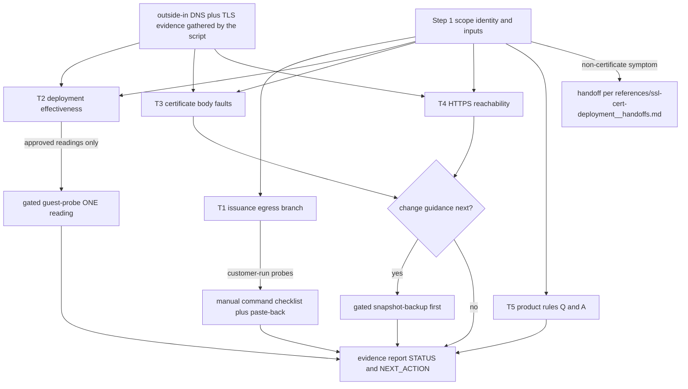

# ECS SSL Certificate Application and Deployment Triage

> **Delivery override - outranks every relay instruction and template below.** `STATUS`,
> `NEXT_ACTION` and their `OK` / `DEGRADED` / `FAIL` / `BLOCKED` values are the entry script's
> internal run state, not a delivery format. Where this document says to relay, mirror or copy
> those lines "faithfully" or "verbatim", relay their MEANING in the customer's own words: never
> write the keys or the bare values into the reply or into anything saved under `outputs/` or
> `ran_scripts/` (SKILL.md rule 3h). A layer this run did not read is named in the customer's own words - which layer, and what would have settled it.

This skill answers five connected customer questions with evidence: why a
certificate request or renewal fails from an ECS instance, why a site still
shows the old certificate or a browser warning after a deployment, whether
the served certificate is expired or paired with the wrong key, why HTTPS
on port 443 is still unreachable once everything looks configured, and
what the certificate-service console rules really say about free
certificates, domain levels and validation calls.

This skill is NOT observation-only. Besides the query-class evidence calls
and the outside-in verification it can perform exactly two
confirmation-gated actions — dispatch ONE information-only guest reading
through Cloud Assistant, and create ONE backup snapshot of one named disk
before the customer performs a guided server-side change. Everything that
deletes, restarts, reloads, rebinds or reconfigures stays a manual human
step with a risk statement, matching how support engineers close these
tickets. Match on customer symptom wording and quoted error strings; the
script's decision tree does the routing.

## In-Scope Customer Symptoms

| What the customer says | Branch |
| --- | --- |
| "certbot / acme.sh / the panel cannot reach Let's Encrypt", renewal fails with `context deadline exceeded` | T1 issuance egress |
| "I imported the certificate but https still shows not secure", IIS binding not applied | T2 deployment effectiveness |
| "the browser says the certificate expired" (`err_cert_date_invalid`), "nginx says the key does not match" | T3 certificate body |
| "https not working after installing the certificate", connection reset (`err_connection_closed`), port 443 timeout | T4 HTTPS reachability |
| "where is the free certificate entry now", "will the review call my phone", "can the review be expedited" | T5 product rules |
| SMTP ports, ICP filing, registration documents, moved RDP ports, disk topics in the same ticket | recognize and hand off (references/ssl-cert-deployment__handoffs.md) |

## ABSOLUTE PROHIBITION: destructive and service-affecting operations are never executed here

Under **NO** circumstances may this skill generate, execute, or
package-for-execution any operation that: deletes or overwrites certificate
files or snapshots, restarts or reloads nginx, IIS, containers or the
instance, edits security group or guest firewall rules, changes forced-HTTPS
redirects or any web-server configuration, or submits, cancels or modifies
certificate orders. Such requests are answered with the manual steps, the
risk statement, and — where a server-side change follows — the
snapshot-first notice FIRST. This holds even when the customer insists.

The only two non-observation dispatches are the gated pair in the table
below, each behind the User Confirmation gate, each ONE action per approval.

## API Whitelist and Permission Gates

| Product | Action | Version | Class | Gate | Purpose |
| --- | --- | --- | --- | --- | --- |
| ecs | `DescribeInstances` | 2014-05-26 | evidence | none | region, guest kind, state, public addresses |
| ecs | `DescribeInstanceStatus` | 2014-05-26 | evidence | none | lifecycle state of the named instance |
| ecs | `DescribeInvocations` | 2014-05-26 | evidence | none | fetch ONE gated guest reading result |
| cas | `ListUserCertificateOrder` | 2020-04-07 | evidence | none | certificate/order inventory, issuance status and validity window (`OrderType` = `CERT` and `CPACK`) |
| ecs | `RunCommand` | 2014-05-26 | gated dispatch | explicit customer confirmation | deliver ONE whitelisted information-only guest reading; its payload is always a query, never a change |
| ecs | `CreateSnapshot` | 2014-05-26 | gated write | explicit customer confirmation | backup snapshot of one named disk before a guided change |
| sts | `GetCallerIdentity` | 2015-04-01 | identity | none | account proof and traceability label |

The certificate service also exposes `ListCertificates`,
`GetUserCertificateDetail` and `DescribeCertificateState`, and DNS record
content is readable with `alidns DescribeDomainRecords` (2015-01-09); this
area deliberately calls only `ListUserCertificateOrder` and states the other
two surfaces as customer-read, so no capability is denied — each one is
either read here or named with its exact action.

Actions outside this whitelist are REFUSED by the scripts themselves
(`build_command` checks the declared set before anything runs), and the
guest payload is validated against the command whitelist in
`scripts/axes/ssl_cert_deployment/_constants.py` — anything beyond `stat`, `ls -l`, `wc -l` on one
validated path, including any quoting, redirection or chaining token, is
rejected and routed to the manual checklist in
references/ssl-cert-deployment__guest-diagnostics-runbook.md (in alibabacloud-ecs-high-frequency-issues).
Permission denials are reported with the literals `NoPermission` or
`ImplicitDeny` naming the missing action, per
[references/ram-policies.md](references/ram-policies.md).

## Execution Principle (MANDATORY)

* The ONLY permitted way to touch the cloud in this skill is
  `python3 scripts/axes/ssl_cert_deployment/ssl_cert_deployment_report.py`. The agent MUST NOT
  hand-assemble `aliyun` commands, invent action or parameter names, or
  probe with trial calls. There is NO fallback: if the entry script fails,
  relay its `STATUS` and `NEXT_ACTION` and degrade as instructed — never
  re-implement the query by hand.
* Outside-in verification (public DNS resolution and a real TLS handshake
  with certificate verification fully ON) is part of the script run, not a
  free-standing tool: the agent never substitutes its own network probes.
* Evidence-first: every conclusion quotes API-returned values, probe
  results, or the embedded references. A field that did not come back
  renders as `not returned`; reasonable defaults are not allowed. Every
  auto-filled parameter is declared in the report.
* Certificate-tier core readings that are not on the approved whitelist yet
  (openssl comparisons, curl egress tests, listener tables, firewall
  queries, `nginx -t`, IIS binding views) are printed as a command list
  for the CUSTOMER to run and paste back. The agent states which readings
  are missing and why, and marks the run `DEGRADED` when a conclusion
  needs one.

## Credentials

Credential material is never requested, read, stored, echoed or passed by
this skill. The locally configured CLI resolves the principal through its
default chain, and `aliyun sts get-caller-identity` (run by the operator) is the only
refresh path. A failed or mismatched identity surfaces as the account
label plus manual guidance; the run never asks a customer for keys.
Reports carry the account label with only the last four digits of the
account id, so they can be pasted into a case without leaking data.

## User Confirmation

The gate in `scripts/axes/ssl_cert_deployment/ssl_cert_deployment_report.py` is deterministic and
MUST be respected:

1. Before any gated dispatch, the agent presents the notice the script
   prints: the exact command or action, the target instance or disk and
   region, its information-only (or reversible) nature, and that approval
   covers THIS action at THIS time only.
2. The customer explicitly approves that exact notice.
3. Only then the identical command line is re-run with `--user-confirmed`
   plus `--confirmation-scope "<region> <target> <action> approved"`. The
   script verifies the scope text names this run's region and target.
4. One approval authorizes exactly one action. Approvals are never cached,
   reused or broadened. A declined or unanswered notice means the degraded,
   manual-guidance path only.
5. Snapshot-first: before guiding ANY in-server change (replacing
   certificate files, editing nginx or IIS configuration, toggling forced
   HTTPS), the backup snapshot comes first — gated dispatch or the console
   steps with the billing and delete notice. Pure diagnosis is exempt.

No file writing exists in this skill at all: there is no artifact option on
the entry script, and nothing is created, appended or overwritten on the
instance or on the operator's machine. The report is returned as text for
the customer to copy into a case.

## Trigger Conditions

Use this skill when the customer's own wording matches (or translates to)
any phrase below; all nine phrases mirror the `description` and MUST stay
in sync with it. The certificate / SSL / HTTPS / 443 / ACME co-occurrence
requirement is the dedup boundary against general connectivity skills:

* "certbot cannot reach Let's Encrypt"
* "certificate deployed but https still shows not secure"
* "SSL certificate renewal failed"
* "https not working after installing certificate"
* "certificate and private key do not match"
* "expired SSL certificate browser warning"
* `err_cert_date_invalid`
* `err_connection_closed`
* "context deadline exceeded" (in a certificate or panel request)

## Input Parameters

| Parameter | Required | Notes |
| --- | --- | --- |
| `--region-id` | yes for cloud evidence modes | never guessed; mainland versus overseas changes the conclusion |
| `--instance-id` or `--public-ip` | one of them | what support asks first |
| `--domain` (repeatable) | for effectiveness checks | the host the browser visits |
| `--symptom` | routing hint | apply-fail / deploy-not-effective / cert-invalid / https-unreachable / product-rules |
| `--web-server` | for the checklist | nginx / iis / apache / baota / 1panel / docker-nginx |
| `--quoted-error` (repeatable) | when the customer quotes one | err_cert_date_invalid, err_connection_closed, context deadline exceeded, ... |
| `--mode` | no | report (default) / guest-probe / snapshot-backup / checklist / faq |
| `--guest-command` + `--guest-path` | guest-probe | one approved reading, one validated path |
| `--disk-id` | snapshot-backup | one named disk |
| `--user-confirmed` + `--confirmation-scope` | gated modes | see User Confirmation |
| `--tls-port` | no | default 443 |
| `--json`, `--check-auth-only` | no | machine output / credential pre-check |

The agent MUST ask the customer for a missing region or instance selector
instead of inventing one; `checklist` and `faq` modes need neither.

## Orchestration

The entry script owns every branch decision above; the agent maps the
customer sentence onto parameters and relays the script output.

## Execution Flow

1. Confirm scope: region, instance selector, the domain(s) the browser
   visits, web-server type, and the exact symptom sentence or quoted error
   string. If credential health is in doubt, run the entry script once
   with `--check-auth-only` first.
2. Run the report:
   `python3 scripts/axes/ssl_cert_deployment/ssl_cert_deployment_report.py --region-id <r>
   --instance-id <i> --domain <host> --symptom <s> --web-server <w>`.
3. Relay the rendered sections: instance context, the outside-in TLS and
   DNS verdicts with dates, the ACME endpoint ownership lines, the
   matching WHEN/FINDING/NEXT branches, and the misconception corrections.
4. Where the conclusion needs guest evidence: approved readings go through
   the User Confirmation gate one at a time; everything else goes out as
   the printed manual checklist and the customer's paste-back decides the
   branch. Mark `DEGRADED` while waiting.
5. Before guiding any server-side change: snapshot-first (gated
   `CreateSnapshot` or the console steps with the billing and delete
   notice verbatim).
6. End with the script's `STATUS:` and `NEXT_ACTION:` lines copied
   verbatim; route every out-of-scope thread with the handoff sentences.

## Observability

Each skill run generates one session id, a 32-character lowercase hex
string from `uuid.uuid4().hex`, and attaches it to EVERY single CLI call
through the CLI's own `--user-agent` parameter (the shared transport layer
appends it automatically; the agent never builds these commands).

* **User-Agent template**:
  `AlibabaCloud-Agent-Skills/{skill}/{session-id} skill-version/{skill-version}`
* **Resolved example** for this skill:
  `AlibabaCloud-Agent-Skills/alibabacloud-ecs-high-frequency-issues/3f2b7c9d4e1f8a6b5c0d9e2f1a6b5c0d`
* The session id and the full User-Agent value appear in the report header
  and in `--check-auth-only` output, enough to verify the mechanism.

## Report Contract

The script renders the answer banner (skill name + session id), the
evidence sections and closes with exactly one status line and one action
line:

| Status | Meaning | Exit code |
| --- | --- | --- |
| `OK` | all needed evidence collected | 0 |
| `DEGRADED` | partial evidence, pending gate, blocked probe or assistant gaps (`[WARN]` explains) | 1 |
| `FAIL` | missing required input, no matching instance, refused dispatch | 2 |

Missing values render as `not returned`. Suggestions are always manual
console guidance; nothing in the report applies a change by itself.

## Error Handling

* Permission denial: reported with the literals `NoPermission` or
  `ImplicitDeny`, naming the missing action; recovery is the minimal
  policy fragment in [references/ram-policies.md](references/ram-policies.md),
  then re-run the identical command.
* Credential failure: guide them to verify the default credential chain with `aliyun sts get-caller-identity`; never ask for keys.
* Probe host egress blocked (sandboxed networks): the TLS line reports
  `blocked`, the run degrades and the customer-run checklist replaces it —
  an honest report of the restriction IS the compliant outcome.
* Cloud Assistant offline or invocation unsettled after the poll window:
  `DEGRADED` plus the invoke id plus the paste-back fallback.
* Quoted customer strings (`err_cert_date_invalid`,
  `err_connection_closed`, "context deadline exceeded", "query timed out
  looking up A/AAAA"): interpreted exactly per
  references/ssl-cert-deployment__error-codes.md (in alibabacloud-ecs-high-frequency-issues).
* Requests the whitelist refuses: the refusal reason is relayed verbatim,
  followed by the manual path — never a silent workaround.

## Module Index

* references/ssl-cert-deployment__triage-decision-tree.md (in alibabacloud-ecs-high-frequency-issues)
  -- inputs, the full tree, security-group self-check list, verdict
  vocabulary, misconception table.
* references/ssl-cert-deployment__guest-diagnostics-runbook.md (in alibabacloud-ecs-high-frequency-issues)
  -- the two whitelist states, dispatch rules, interpretation table.
* references/ssl-cert-deployment__acme-network-egress.md (in alibabacloud-ecs-high-frequency-issues)
  -- issuance egress facts with ticket anchors and conclusion wording.
* references/ssl-cert-deployment__nginx-iis-deploy-checklist.md (in alibabacloud-ecs-high-frequency-issues)
  -- per-server deployment checklists including containers and panels.
* references/ssl-cert-deployment__error-codes.md (in alibabacloud-ecs-high-frequency-issues) -- the quotable
  codes and literal tool strings, splits and actions.
* references/ssl-cert-deployment__aliyun-cert-service-faq.md (in alibabacloud-ecs-high-frequency-issues)
  -- product rules with confidence tags and the automation ceiling.
* references/ssl-cert-deployment__handoffs.md (in alibabacloud-ecs-high-frequency-issues) -- boundary recognition
  and transfer wording, plus the never-execute list.
* references/ssl-cert-deployment__help-links.md (in alibabacloud-ecs-high-frequency-issues) -- the verified
  official URLs this skill may quote, and the flagged gaps.
* [references/ram-policies.md](references/ram-policies.md) -- exact action
  list, gates, minimal policy, denial recovery.
* [related_apis.yaml](related_apis.yaml) -- the verified API manifest the
  scripts actually call.

## Important Notes

1. Import is not load, and load is not served: only the outside-in TLS view
   proves a certificate reached visitors (tickets T-382FDB28, T-08D625D0).
2. Inbound and outbound directions are evaluated separately; mainland
   regions reach overseas CA edge nodes over the public path, and no
   platform block exists (tickets T-233E37E1, T-75A1E320, T-C3B1F4A7).
3. Expiry and key pairing are independent faults; a months-old-fresh
   certificate still fails with the wrong key (ticket T-B5F37974).
4. A failed renewal plus a live forced-HTTPS switch takes the whole site
   down; the switch is the first-aid lever, and it is manual (ticket
   T-411B8BA7).
5. DNS drift beats every server-side theory when the public answer differs
   from the instance address; check it first, it costs no authorization
   (ticket T-BF6A05D6).
6. Certificate inventory, order state and validity dates ARE queried: report
   mode reads them with `cas ListUserCertificateOrder` (read-only, no gate)
   and prints the stock list with each status token and its meaning. Two
   figures are still not returned by that action — the remaining free quota
   and the review progress — so those stay console-side and the FAQ figures
   carry the confidence tag. A refused/failed read is printed as
   `NOT VERIFIED this run` with a `[WARN]`; it is never filled in from
   memory.
7. Guest evidence beyond the approved three commands is customer-run until
   the whitelist extension is approved; say which reading is missing.
8. `STATUS:` and `NEXT_ACTION:` must be relayed verbatim; the agent must
   not reinterpret them.
9. Never fabricate documentation URLs: quote only
   references/ssl-cert-deployment__help-links.md (in alibabacloud-ecs-high-frequency-issues).
10. When the TLS handshake for the requested host returns a certificate
    whose CN/SAN belongs to ANOTHER site on the same server (typically the
    main domain), the first ruling is nginx SNI fallback, not a certificate
    SAN gap: the `server` block whose `server_name` covers the requested
    host has no `ssl_certificate`/`ssl_certificate_key` (or does not
    `listen 443 ssl`), so nginx hands the handshake to the default server
    block and serves its certificate (ticket T-F9AA3466). State the manual
    fix on that block; "the certificate does not cover the domain" ranks
    second, and DNS/CDN explanations come only after this check.

## Examples

* "My nginx site shows 'connection reset' since I moved to HTTPS on port
  443 yesterday" (`err_connection_closed` wording plus 443): run report
  mode with the region, instance id, domain and `--symptom
  https-unreachable --quoted-error err_connection_closed`; relay the
  resolution-drift line, then the security-group self-check list
  (deny-self-rule highlighted).

* "I bought a certificate, imported it in IIS, but visitors still get the
  old warning": run report mode with `--symptom deploy-not-effective
  --web-server iis`; the outside-in view names whether the old certificate
  is still served; relay the binding checklist (select the certificate in
  the site binding; bare host name, no trailing slash) and the
  snapshot-first notice before the customer recycles anything.

* "Renewing through the panel failed with context deadline exceeded, my
  server is in Guangzhou": run report mode with `--symptom apply-fail
  --quoted-error "context deadline exceeded"`; the region lens plus the
  endpoint ownership lines produce the cross-border conclusion; relay the
  alternative-path menu and the "no platform block" correction.
