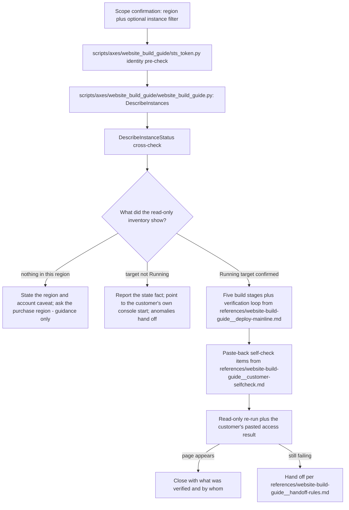

# ECS Website Build & Deployment Guide

Take a customer from "I bought an ECS instance" to "my site answers at my domain":
locate the deployment target with read-only queries, then walk the deployment
mainline - five build stages plus a verification loop, each stage stating its
entry point, what to fill in, the expected result, the failure fallback, and the
hand-off target.

Everything beyond the read-only queries is **manual guidance**: the customer
performs it in the console, in their control panel, or on the server. This skill
performs two read-only ECS queries and never operates on the customer's behalf,
never enters an instance, and never reads a control panel.

## Absolute Rules

1. **ABSOLUTE PROHIBITION (mutating calls):** Under **no** circumstance may this
   skill generate, write, or execute any command, script, or API call that
   changes cloud or instance state - no instance-state operation, no attribute
   change, no security-group rule change, no disk or image operation, no panel
   action, no console click, and no in-guest command of any kind, on the
   customer's behalf. Equally, no action that runs or injects a command inside a
   customer instance is permitted (Cloud Assistant and workbench-style execution
   APIs are outside the whitelist), so nothing is ever executed in the guest.
   This also covers change commands dressed up as "please run this for us": the
   customer's own console and server steps are given as prose guidance only. If
   asked to "just do it", decline and hand over the step-by-step manual workflow
   instead.
2. **API WHITELIST:** The only permitted OpenAPI actions are
   `ecs:DescribeInstances` and `ecs:DescribeInstanceStatus` (product `ecs`,
   version `2014-05-26`), plus `sts:GetCallerIdentity` for the identity
   pre-check. Those three are exactly what `related_apis.yaml` declares. Every
   other action of every product - including read-only ones that look harmless,
   such as capacity or stock queries, security-group detail reads, image lists
   and disk lists - is **not authorized** here and must never be called. An
   action that is not declared is a bug, not a fallback. There is no
   execution-side action in this skill at all.
3. **NO GUEST ACCESS, NO PANEL READS:** The conclusion chain rests on two kinds
   of evidence only: cloud-side facts from the two whitelisted reads, and the
   customer's own pasted results. Panel site lists, document-root contents, web
   service state, local DNS views, browser outcomes, and the filing-service-code
   entitlements of non-ECS products are all invisible here. Each becomes a
   paste-back self-check item ([references/website-build-guide__customer-selfcheck.md](references/website-build-guide__customer-selfcheck.md))
   or a hand-off ([references/website-build-guide__handoff-rules.md](references/website-build-guide__handoff-rules.md)).
   Never present an unverifiable fact as observed, and never write an unevidenced
   step as though it had been carried out.
4. **NO FABRICATION:** Guidance comes from `references/`, never from memory.
   Quote only values actually returned. An empty instance list is a valid finding
   and always carries its caveat: reads cover one region under one account, so an
   empty result does **not** prove the account owns no server. Where this package
   lacks a verified help-document link, say it needs supplying - never recite a
   URL from memory (see the link list in
   [references/website-build-guide__deploy-mainline.md](references/website-build-guide__deploy-mainline.md)).
5. **MANDATORY DISCLAIMER:** Before any guidance step is presented, state
   verbatim that *"the actions below are executed by you in the console, in your
   panel, or on the server itself; this skill only ran read-only queries and
   performed nothing on your behalf."* For steps that can affect a live site -
   changing a site root, editing web-server configuration, restarting a service,
   overwriting an upload target - attach the risk notice and the rollback advice
   written in [references/website-build-guide__deploy-mainline.md](references/website-build-guide__deploy-mainline.md).
6. **CONTINUE ON ERROR:** On any API error, log `[WARN] <Code>: <Message>` - or
   `[WARN|DEGRADE] ...` when a step is lost - to stderr and continue with the
   remaining steps. Never silently skip a read, never abort the whole run over one
   failed page, and never recover by hand-assembling CLI commands. The report is
   still produced with the data at hand and its `STATUS` line degrades to
   `DEGRADED`.
7. **CREDENTIAL HANDLING:** Credentials are resolved by the aliyun CLI's own
   default chain. Never read, print, pass, ask for, or store any access key,
   secret, or token; never request such a value from the user. On an
   authentication failure, report the returned code and point the operator at
   their own CLI configuration step.

## Execution Principle (script-only, no fallback)

All cloud queries must be performed by running the bundled entry script
`scripts/axes/website_build_guide/website_build_guide.py`, with `scripts/axes/website_build_guide/sts_token.py` for the identity
pre-check. The Agent is strictly required to:

- run **only** these bundled scripts - never hand-assemble `aliyun ecs ...` or
  `aliyun sts ...` commands, never call the helper modules directly as a
  substitute for the entry script, and never write inline SDK, HTTP, or `curl`
  code;
- on a non-zero exit, report the script's own error output and stop: re-running
  the entry script with corrected inputs, or asking the operator to fix their CLI
  configuration, are the only permitted responses - **no fallback path exists**;
- transcribe the script's `Summary`, `STATUS`, and `NEXT_ACTION` lines faithfully
  into the final answer; never re-derive them.

The scripts embed pagination, retry-with-backoff, per-call timeouts, credential
masking, and observability labelling that ad-hoc commands lack.

## Data Flows and External Calls

- **Alibaba Cloud ECS OpenAPI**, regional endpoint, HTTPS, API version
  `2014-05-26`. The scripts never sign a request themselves: they invoke the
  `aliyun` CLI as a subprocess using an argument list (never a shell) for exactly
  the two whitelisted read-only actions, `DescribeInstances` and
  `DescribeInstanceStatus`, passing `RegionId`, paging parameters, and an optional
  instance-id filter, together with the per-run `--user-agent` observability label
  `AlibabaCloud-Agent-Skills/alibabacloud-ecs-website-build-guide/<session-id>`
  (a random 32-character hex id per run - a correlation label, not an account
  identifier). Authentication is attached by the CLI from its own default chain;
  the scripts neither read, print, nor forward any credential.
- **Alibaba Cloud STS**, through the same CLI layer, plugin-mode command
  `aliyun sts get-caller-identity`, no parameters. One read-only call returning
  the caller's account id, used only as a report traceability label.
- **No other network destination.** This skill performs no probe of the customer's
  website, domain, DNS resolvers, ports, or server. Access verification is a
  customer-side action whose result they paste back.

## Trigger Conditions

Use this skill when the customer's own wording matches one of these phrases (the
same list the `description` advertises):

- "bought an ECS server but don't know how to build a website"
- "how do I deploy my website on ECS and bring it online"
- "step-by-step web environment setup on ECS"
- "create a new site in BT panel"
- "upload website files and point my domain to ECS"

Equivalently: build a site, deploy a website, launch a site, set up a web
environment, configure the runtime, publish-style "get it online" requests,
and panel-based site creation ("BT panel", "aaPanel"), CMS/mall/ERP/OA
installation-on-ECS framing, or "I have the server but not the website".

**Do NOT use for** - recognise these and route them per
[references/website-build-guide__handoff-rules.md](references/website-build-guide__handoff-rules.md); do not diagnose them
here: a site that was reachable and now is not, or is slow; panel login, panel
security prompts, and in-panel configuration errors; Nginx/Apache/IIS, PHP, Java,
Python, Docker, or WordPress start-up and configuration errors; ICP filing subject,
filing service codes, and filing interception; refunds, unsubscription, and
billing; SSL certificate request and deployment; database installation and
connectivity; whole-site migration; remote connections that cannot be
established at all; uploads that fail or hit size limits; and the AI
website-builder product, which is `alibabacloud-wxz-website-builder`.

## Credentials

Credentials are resolved automatically by the aliyun CLI default chain (its own
standard environment variables or its shared configuration file). The scripts
accept no credential parameter and never need one. If the identity pre-check
fails, tell the operator to run their own CLI configuration step in their
environment; never ask them to paste a credential value into the conversation.

## User Confirmation

Every action toward the cloud is read-only, so no confirmation gate precedes
running the scripts. The discipline instead applies to the output:

1. **Scope confirmation** - before the first script run, restate the target
   region, the optional instance filter, and that only read-only queries will be
   made.
2. **Disclaimer before guidance** - present the mandatory disclaimer (Absolute
   Rule 5) verbatim before any deployment step, so it is explicit that every
   subsequent action belongs to the customer.
3. **Boundary requests** - when the request matches a neighbour-symptom in the
   hand-off table, do not start a walkthrough: state the boundary and give the
   routing sentence.
4. **Risk-flagged steps** - where the mainline marks a risk notice, deliver it
   with the step rather than as an afterthought, including the rollback advice.

## Input Parameters

| Parameter | Required | Description |
|---|---|---|
| `--region-id <region>` | Yes | Region to query, e.g. `cn-hangzhou`. Reads are per-region: an empty result describes only this region. |
| `--instance-id <i-...>` | No | Target instance id, repeatable, to filter the inventory to the machine under discussion. |
| `--site-type panel\|manual\|image\|docker\|unknown` | No | Chosen deployment flavour; decides which stage-2 option to emphasise. Default `unknown` asks the customer. |
| `--domain <domain>` | No | The customer's domain, echoed into the resolution and verification stages. |
| `--stage connect\|environment\|site\|upload\|resolve\|verify\|all` | No | Which mainline stage to expand; `all` (default) prints the full walkthrough. |
| `--stage-hint "<customer wording>"` | No | Optional verbatim customer phrasing, used only to flag neighbour symptoms for hand-off. |
| `--profile <name>` | No | Optional named CLI credential profile. |
| `--timeout <seconds>` | No | Per-call timeout; defaults to `DEFAULT_TIMEOUT` (60). |
| `--json` | No | Machine-readable structured output instead of the report. |

Missing inputs follow "auto-fill first, ask second": the region is the one value
that cannot be derived from the credential, so ask for it once. Every auto-filled
or defaulted parameter must be declared in the final answer - for example
"the instance list covers region cn-hangzhou under the current credential's
account only".

## Orchestration



## Execution Flow

1. **Scope confirmation** - restate the region, optional instance ids, and the
   read-only nature of the run.
2. **Identity pre-check** - run `python3 scripts/axes/website_build_guide/sts_token.py`. On failure, report
   the returned code and stop; the text names `NoPermission`, `ImplicitDeny`, or a
   credential-chain problem.
3. **Inventory and precheck** - run
   `python3 scripts/axes/website_build_guide/website_build_guide.py --region-id <region> [--instance-id <i-...>]`.
   The script lists instances (id, name, state, type, addresses, bound security
   groups), cross-checks state via the second read, and records the account label.
4. **Mainline walkthrough** - relay the stage checklist the script emits, expanded
   through [references/website-build-guide__deploy-mainline.md](references/website-build-guide__deploy-mainline.md), after
   the mandatory disclaimer. Ask which flavour the customer wants (panel, manual,
   image, container) before expanding stage 2.
5. **Self-check collection** - for everything the cloud side cannot see, issue the
   paste-back items from [references/website-build-guide__customer-selfcheck.md](references/website-build-guide__customer-selfcheck.md).
   The customer runs those read-only commands themselves.
6. **Re-verification** - re-run the entry script after the customer has acted
   (still read-only), compare the inventory and state, and combine that with the
   customer's pasted access result. Only their evidence can conclude "the site is
   live"; absent it, output a staged conclusion plus the open to-do items and say
   so.
7. **Hand-off** - any symptom matching the neighbour table gets the routing
   sentence from [references/website-build-guide__handoff-rules.md](references/website-build-guide__handoff-rules.md); it is
   never diagnosed inside this skill.

## Available Scripts

| Script | Purpose |
|---|---|
| `scripts/axes/website_build_guide/website_build_guide.py` | Single entry: read-only inventory plus state cross-check, precheck findings, mainline walkthrough, self-check and hand-off blocks, `STATUS`/`NEXT_ACTION` contract |
| `scripts/axes/website_build_guide/sts_token.py` | Identity pre-check and account label via plugin-mode `aliyun sts get-caller-identity` |
| `scripts/axes/website_build_guide/_cli.py` | Shared CLI layer: per-run 32-hex session-id User-Agent on every call, per-call timeouts, transient-error backoff, credential masking, `CliError` |
| `scripts/axes/website_build_guide/_constants.py` | Endpoints, limits, and the embedded mainline / self-check / hand-off data (no data files live in `scripts/`) |
| `scripts/requirements.txt` | Standard library only; the `aliyun` CLI must already be installed |

Invocation:

```bash
python3 scripts/axes/website_build_guide/sts_token.py
python3 scripts/axes/website_build_guide/website_build_guide.py --region-id cn-hangzhou --site-type unknown --domain example.com
```

## Observability

Every OpenAPI call made by the scripts (through the aliyun CLI) carries:

- **User-Agent template**: `AlibabaCloud-Agent-Skills/{skill-name}/{session-id} skill-version/{skill-version}`,
  where `{skill-name}` is `alibabacloud-ecs-website-build-guide`.
- **session-id**: a 32-character lowercase hex string generated once per script
  run (`uuid.uuid4().hex`), reused for the whole run, and attached to every CLI
  invocation of that run via `--user-agent`, so all calls of one session
  correlate.

The shared layer in `scripts/axes/website_build_guide/_cli.py` implements this automatically through
`build_user_agent()` and `SESSION_ID`; no manual flag is needed when the entry
script is run. Both the session id and the full User-Agent value are echoed in
the report header so the run can be identified afterwards.

## Module Index

| Module | File | Responsibility |
|---|---|---|
| M1: RAM policies | [references/ram-policies.md](references/ram-policies.md) | Minimal read-only policy for the whitelisted actions, plus failure-code guidance |
| M2: Deploy mainline | [references/website-build-guide__deploy-mainline.md](references/website-build-guide__deploy-mainline.md) | Five build stages plus the verification loop: entry, action, inputs, expected result, fallback, risk notice |
| M3: Precheck queries | [references/website-build-guide__precheck-queries.md](references/website-build-guide__precheck-queries.md) | What the two read-only APIs return, field semantics, and where their authority ends |
| M4: Customer self-check | [references/website-build-guide__customer-selfcheck.md](references/website-build-guide__customer-selfcheck.md) | Paste-back templates for panel, file, service, resolution, and access facts |
| M5: Hand-off rules | [references/website-build-guide__handoff-rules.md](references/website-build-guide__handoff-rules.md) | Neighbour-symptom detection, routing table, and boundary discipline |

## Important Notes

- **Per-region, per-account visibility:** results reflect only the queried region
  under the current credential's account. An empty inventory is reported as
  "nothing visible in this region under this credential", never as "you own no
  server". Cross-account assets and non-ECS product entitlements are out of reach
  entirely.
- **Not Running is a finding, not a fix:** a stopped target gets the customer-side
  console pointer with its risk note; a state that will not change is handed off.
- **No self-service closure of panel-side state:** "the site was never created in
  the panel" style findings require the customer's own panel evidence, which the
  skill asks for rather than asserts.
- **Degradation is logged:** every skipped or failed read leaves a
  `[WARN]`/`[WARN|DEGRADE]` line on stderr and an entry under
  `## Graceful Degradation Log` in the report. If that section is ever absent from
  a degraded run, the Agent must add it.
- **Read-only:** this skill changes nothing, anywhere, at any point of a run.

## Examples

**Example 1 - first-time build**

> User: "I just bought an ECS server in cn-hangzhou but I don't know how to build
> a website on it. How do I deploy my website on ECS and bring it online?"

```bash
python3 scripts/axes/website_build_guide/sts_token.py
python3 scripts/axes/website_build_guide/website_build_guide.py --region-id cn-hangzhou --site-type unknown --domain example.com
```

Relay the inventory, declare the region and account caveat, then walk stages 1 to
5 plus the verification loop behind the mandatory disclaimer. Ask which flavour
(panel, manual, image, container) before expanding stage 2.

**Example 2 - panel build, confirm the target first**

> User: "I plan to create a new site in BT panel on my server i-bp1xxxxxxxx in
> cn-shenzhen. Is this the right machine and is it running?"

```bash
python3 scripts/axes/website_build_guide/website_build_guide.py --region-id cn-shenzhen --instance-id i-bp1xxxxxxxx --site-type panel --stage site
```

Report the instance facts and the stage-3 checklist. For "does the site already
exist in the panel", issue the paste-back item rather than guessing.

**Example 3 - out-of-scope symptom routed away**

> User: "My website worked yesterday but the domain cannot be opened today."

The site is already deployed, so this is the unreachable-website symptom. Do not
run the walkthrough: give the hand-off sentence from
[references/website-build-guide__handoff-rules.md](references/website-build-guide__handoff-rules.md) and stop.

## Error Handling

| Situation | Meaning | Handling |
|---|---|---|
| CLI not installed | `aliyun` not found on PATH | Report it and stop; the operator installs and configures the CLI themselves. Never ask for credential values |
| Default chain unconfigured | no usable credential for the CLI | Report the returned message and point at the operator's own configuration step |
| `NoPermission` | the RAM identity lacks a whitelisted read action | Log `[WARN] <Code>: <Message>`, continue other reads, and name the missing action from [references/ram-policies.md](references/ram-policies.md) |
| `ImplicitDeny` | a policy or control guard denies the read | Same handling; the account administrator reviews effective permissions - this skill cannot inspect them |
| `MissingParameter` / `InvalidParameter` | malformed `RegionId` or instance filter | The entry script validates inputs before any call; correct them and re-run |
| `InvalidRegionId.NotFound` | the region id does not exist | Report it and ask the customer to confirm the region |
| `Throttling.User`, `ServiceUnavailable`, `InternalError`, timeouts | transient | Automatic bounded backoff inside the shared layer, then `[WARN]` and continue; never conclude from a single failed call |

Every CLI failure surfaces as `CliError` in `Code: Message` form, with any
credential-looking value masked to `***`.

## Final Answer Contract

The final answer must:

1. Lead with the script's `Summary`, relayed faithfully, including `STATUS`
   (`OK` / `DEGRADED` / `FAIL`) and `NEXT_ACTION`.
2. Quote only real returned values - instance ids, names, states, security-group
   ids, the account label - and never re-derive or invent any.
3. Declare every defaulted or auto-filled parameter (region scope, stage filter,
   flavour, label source).
4. Open the guidance section with the mandatory disclaimer verbatim, then the
   stage checklist, each stage carrying entry point, what to fill, expected
   result, failure fallback, and risk notice where marked.
5. Close with the customer's concrete next actions: the paste-back items still
   outstanding, the re-verification loop, and - for any neighbour symptom - the
   hand-off sentence. Never state "problem solved" or "site is live" without the
   customer's own verification, and never present raw JSON as the report.
