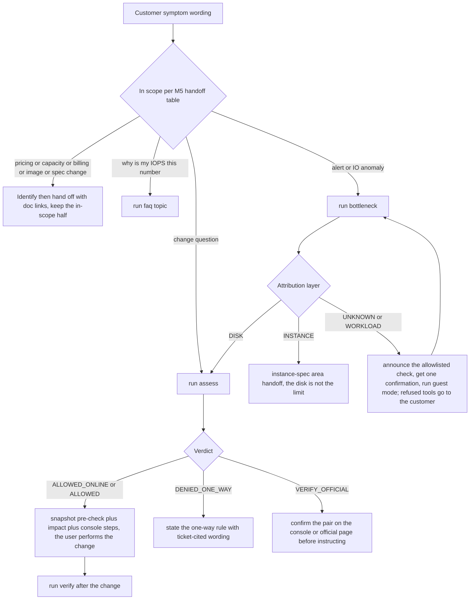

# ECS Disk Type & Performance Level Change Guide (judge, guide, gated diagnostics)

> **Delivery override - outranks every relay instruction and template below.** `STATUS`,
> `NEXT_ACTION` and their `OK` / `DEGRADED` / `FAIL` / `BLOCKED` values are the entry script's
> internal run state, not a delivery format. Where this document says to relay, mirror or copy
> those lines "faithfully" or "verbatim", relay their MEANING in the customer's own words: never
> write the keys or the bare values into the reply or into anything saved under `outputs/` or
> `ran_scripts/` (SKILL.md rule 3h). A layer this run did not read is named in the customer's own words - which layer, and what would have settled it.

Help customers decide **whether and how** an Alibaba Cloud ECS cloud disk can
change type (ultra disk / SSD disk / ESSD family / ESSD Entry / ESSD AutoPL)
or performance level (PL0-PL3), **what the real per-disk limits are**
(capacity-driven IOPS / throughput formulas), and **which side a disk
bottleneck is on** (disk ceiling vs instance storage bandwidth vs workload
inside the guest). Every cloud change stays a CUSTOMER console action: this
skill judges, explains, guides, re-verifies by query, and may dispatch only
the allowlisted diagnostics defined in Rule 3.

## Trigger Conditions (customer-symptom wording)

Trigger this skill when the customer says things like:

- "upgrade performance level" / "can I go from PL0 to PL1 online, does it restart, do I lose data"
- "change disk type to ESSD" / "ultra disk to ESSD" (efficient cloud disk upgrade questions)
- "EcsBaseBPS alert" / "disk performance bottleneck alarm keeps firing although I raised the PL"
- "IOPS lower than documented" / "console shows 3000 IOPS but the doc says 10000"
- "AutoPL cannot go back to PL1" / one-way change rule questions
- "disk IO at 100 percent" / "server freezes, disk reads pinned at exactly ~125 MB/s"
- ESSD Entry capacity questions ("40G Entry only has 2120 IOPS"), AutoPL baseline vs burst caliber questions

Do NOT use for: disk capacity expansion / shrinking, instance CPU/memory
spec changes, unsubscribe / refund / billing, images / migration, or any
request to execute a change — see the handoff table in
`references/disk-pl-change-guide__handoff-boundaries.md` and the `Do NOT use` clause of the
description.

## Absolute Rules (read first; they override everything else)

1. **ABSOLUTE PROHIBITION on changing cloud resources.** This skill never
   issues a mutating cloud API or CLI call for any disk, snapshot, image,
   instance or billing object — including passing such a command to the
   customer "to paste". Disk type / performance-level / capacity changes,
   snapshot taking, attach and detach, billing conversion and release are
   console actions performed by the customer with their own permissions
   (see `references/disk-pl-change-guide__change-matrix.md` §4).
2. **API WHITELIST (complete, nothing outside it).** Permitted calls:
   `ecs DescribeDisks`, `ecs DescribeInstances`, `ecs DescribeInstanceTypes`,
   `ecs DescribeSnapshots`, `ecs DescribeInvocations`, `cms DescribeMetricLast`,
   `sts get-caller-identity` — all queries — **plus `ecs RunCommand`**, whose
   only allowed use is Rule 3. The whitelist equals `related_apis.yaml` and
   `references/ram-policies.md`.
3. **GUEST COMMANDS: ALLOWLIST + MANDATORY CONFIRMATION GATE.** Before ANY
   command is dispatched into an instance the agent MUST tell the user, in
   the same message: which exact command, which instance, what it reads, that
   it writes nothing and needs no undo, and that the approval covers this one
   command only — then WAIT for an explicit yes and rerun with `--confirm`.
   The only dispatchable commands are the five fixed entries of
   `GUEST_COMMAND_ALLOWLIST` in `scripts/axes/disk_pl_change_guide/_constants.py` (`df -h`, `findmnt`,
   `stat /`, `ls /var/log/atop`, `wc -l /var/log/messages`), one per
   confirmation. Free-form command text is never accepted: the script maps
   the requested value to the table or refuses it. Anything else — atop, any
   package install, `top`, `lsblk`, `iostat`, reading log CONTENT, cleanup,
   restarts, config edits, formatting — is REFUSED with the wording of
   `references/disk-pl-change-guide__guest-diagnostics.md` and converted into a customer-run step.
   A refusal is correct behavior, never a failure to hide.
4. **NO FABRICATION.** Every number comes from a script API result or the
   embedded formula/matrix knowledge with its cited source. If a query fails
   or returns empty, record the gap and state the limitation — an empty
   result is a valid conclusion; invented values never are. Do NOT invent
   error codes: quote the actual `Code` the API returned.
5. **SCRIPTS-ONLY CLOUD ACCESS.** Never compose raw `aliyun ecs ...` calls;
   all cloud access goes through the bundled scripts. If a script fails,
   stop and report the error — do not fall back to manual calls.
6. **ERROR SURFACE.** On permission failures report `NoPermission` or
   `ImplicitDeny` naming the exact missing action plus the snippet from
   `references/ram-policies.md`; never reinterpret a denial as "not found".

## Execution Principle (script-only)

There are exactly two runnable scripts:

| Allowed invocation | Purpose |
|---|---|
| `python3 scripts/axes/disk_pl_change_guide/disk_pl_advisor.py` | single business entry (modes: assess / bottleneck / guest / verify / faq) |
| `python3 scripts/axes/disk_pl_change_guide/sts_token.py` | standalone caller-identity pre-check (the entry also runs it internally) |

Any other cloud-touching command is a structural violation even if the
output looks correct.

## Data Flows and External Calls

The scripts open HTTPS connections **only** to Alibaba Cloud OpenAPI
endpoints through the `aliyun` CLI subprocess inside `scripts/axes/disk_pl_change_guide/_cli.py`:
the regional `ecs` endpoint of the queried region, `cms`, and `sts`.
Every request carries the session User-Agent (see Observability), has a
bounded timeout, retries only transient throttling/5xx errors, and passes
through credential masking before any error text is printed. The one
dispatched command goes to Cloud Assistant for the instance the customer
named, and its output is relayed verbatim. No data leaves the machine except
these API requests; no credentials are read, printed, cached, or transmitted
by this skill (default credential chain only; see Credentials).

## Credentials

`disk_pl_advisor.py` (every mode except `faq` and the allowlist listing) and
`sts_token.py` resolve the caller identity via the aliyun CLI default
credential chain (`ALIBABA_CLOUD_*` environment variables or
`~/.aliyun/config.json`, or an instance RAM role). When nothing is configured
the scripts print the guidance to verify the default credential chain with `aliyun sts get-caller-identity`. NEVER accept or
handle an access key pair or token explicitly anywhere in this flow.

## User Confirmation (mandatory gates)

1. **Before the first cloud query**: confirm with the user that the target
   account (STS UID echoed by the pre-check) and region are the intended
   ones; queries are invisible outside the authorized account/region.
2. **Before relaying any change guidance**: confirm the user accepts the
   impact statement — online change, brief IO fluctuation, off-peak
   window, snapshot taken by the user FIRST (`references/disk-pl-change-guide__change-matrix.md` §2).
3. **Before every guest command**: relay the Rule 3 announcement, obtain an
   explicit yes, then rerun with `--confirm`. One confirmation authorizes
   exactly one command on one instance; a previous yes never carries over,
   and a declined confirmation means the report says so and degrades.
4. `RunCommand` failure, an offline Cloud Assistant agent, or a missing grant
   is reported as `STATUS: DEGRADED` with the customer-run fallback — never
   retried silently and never presented as an executed check.

## Input Parameters

| Parameter | Required | Notes |
|---|---|---|
| `--mode` | yes (default `assess`) | `assess` / `bottleneck` / `guest` / `verify` / `faq` |
| `--region-id` | contract-required input; if omitted falls back to `cn-hangzhou` and the report DECLARES that auto-fill | e.g. `cn-hangzhou`; resources outside the account/region are invisible (report DEGRADED, ask) |
| `--disk-id` / `--instance-id` | one of them for assess; `--disk-id` for bottleneck/verify; `--instance-id` for guest | validated `d-xxxx` / `i-xxxx` shapes; invalid shapes FAIL with a fix prompt |
| `--guest-command` | guest mode | an allowlist key or the exact allowlisted command; any other value is refused, never executed |
| `--confirm` | guest mode | the ONLY flag that authorizes one dispatch; requires gate 3 to have happened in the conversation first |
| `--list-guest-commands` | no | prints the allowlist + refusal list, no cloud call |
| `--target-category` / `--target-performance-level` | optional | what the customer wants to change to; absent = print the whole matrix |
| `--alert-code` | optional | e.g. `EcsBaseBPS` |
| `--observed-bps-mbps` / `--observed-iops` | optional | readings the customer pasted; feed deterministic attribution |
| `--expected-category` / `--expected-performance-level` / `--expected-size` | verify mode | post-change comparison values |
| `--topic` / `--question` / `--list-topics` | faq mode | embedded knowledge, zero cloud calls |

## Module Index (references, one per capability)

| Module | File | Covers |
|---|---|---|
| M1 | `references/disk-pl-change-guide__performance-formulas.md` | IOPS / throughput formulas, AutoPL baseline-vs-burst caliber, min(instance, disk) rule, iostat reading rules |
| M2 | `references/disk-pl-change-guide__change-matrix.md` | allowed directions, one-way rules, impact & preconditions, manual console steps, refusal wording |
| M3 | `references/ram-policies.md` | exact action-level policy for every whitelisted call, permission-gap behavior |
| M4 | `references/disk-pl-change-guide__guest-diagnostics.md` | dispatch allowlist, announce + confirm template, refusal wording, customer-run list, DEGRADED contract |
| M5 | `references/disk-pl-change-guide__handoff-boundaries.md` | out-of-scope symptom areas, handoff targets and wording |

## Orchestration (decision tree)



## Execution Flow

1. Map the customer wording to a mode: change question → `assess`;
   performance number puzzling → `faq` (+ `assess` for their real disk);
   alert / saturation / freeze → `bottleneck`; a needed in-guest reading →
   `guest`; after the customer acted → `verify`.
2. Collect `RegionId` (contract-required) plus `DiskId` or `InstanceId`;
   state the User Confirmation gate 1 (account + region) once.
3. Run the script (see Quick Start). Read stdout faithfully; stderr carries
   `[WARN]` degradation traces.
4. Relay the report: disk facts, expected ceilings with formula, verdict,
   snapshot pre-check, impact + console steps, or the attribution layer —
   always reading + formula + doc source together.
5. End with the script's `STATUS` (OK / DEGRADED / FAIL) and its
   `NEXT_ACTION`; on DEGRADED say exactly which evidence is missing.
6. If the answer crosses a handoff boundary, use the M5 wording template
   instead of guessing an answer.

## Quick Start

```bash
# 0) optional identity pre-check
python3 scripts/axes/disk_pl_change_guide/sts_token.py

# 1) can this disk change, and what will it actually be limited to?
python3 scripts/axes/disk_pl_change_guide/disk_pl_advisor.py --mode assess --region-id cn-hangzhou \
  --disk-id d-bp1exampleb448263f9c --target-performance-level PL1

# 2) alerts keep firing although the PL was raised - which side binds?
python3 scripts/axes/disk_pl_change_guide/disk_pl_advisor.py --mode bottleneck --region-id cn-hangzhou \
  --disk-id d-bp1exampleb448263f9c --alert-code EcsBaseBPS

# 3) see what may be run inside the guest (no cloud call)
python3 scripts/axes/disk_pl_change_guide/disk_pl_advisor.py --mode guest --list-guest-commands

# 4) announce first (nothing is dispatched), then dispatch after the
#    customer's explicit yes for this single command
python3 scripts/axes/disk_pl_change_guide/disk_pl_advisor.py --mode guest --region-id cn-hangzhou \
  --instance-id i-bp1example75b80be77f --guest-command atop-logs-present
python3 scripts/axes/disk_pl_change_guide/disk_pl_advisor.py --mode guest --region-id cn-hangzhou \
  --instance-id i-bp1example75b80be77f --guest-command atop-logs-present --confirm

# 5) after the customer changed the disk in the console: re-verify
python3 scripts/axes/disk_pl_change_guide/disk_pl_advisor.py --mode verify --region-id cn-hangzhou \
  --disk-id d-bp1exampleb448263f9c --expected-performance-level PL1

# 6) pure knowledge answer, no cloud call
python3 scripts/axes/disk_pl_change_guide/disk_pl_advisor.py --mode faq --topic autopl-one-way
```

Exit codes: `0` = OK or DEGRADED, `1` = FAIL (no usable conclusion),
`2` = argparse usage error only. A diagnosed condition never exits 2.

## Observability (User-Agent)

Every Alibaba Cloud CLI call made by this skill carries the UA template
`--user-agent AlibabaCloud-Agent-Skills/{skill-name}/{session-id} skill-version/{skill-version}`,
where `{skill-name}` is this skill's name from the frontmatter and
`{session-id}` is one 32-character hex string
(`uuid.uuid4().hex`) generated per script run and shared by all calls of
that run (see `user_agent()` in `scripts/axes/disk_pl_change_guide/_cli.py`), so a dispatched command
and the queries around it are traceable to one session on the platform side.

## Important Notes

- **Guidance tier.** The output is: eligibility verdict, impact
  statements, console paths, official docs, gated diagnostics, and a
  query-based re-check after the customer acted. The customer always
  performs changes in the console UI.
- **One-way doors must be said out loud**: AutoPL cannot go back to a
  fixed PL (tickets T-B525FD49 / T-CB4F17DF). VERIFY_OFFICIAL matrix rows
  must never be presented as promises.
- **Capacity drives ceilings**: quoted "max" numbers need the disk's real
  size; compute with assess mode instead of reciting caps.
- **min(instance, disk)**: before advising a PL upgrade, check the
  instance side (ticket T-39B4EB79 pattern).
- **Pricing, refunds, billing outcomes are never quoted** — handoff (M5).
- Windows guest-side flows are not offered (no ticket evidence); the
  dispatch allowlist is POSIX shell text and Windows instances are refused.
- When CloudMonitor datapoints are unavailable the bottleneck mode
  DEGRADES gracefully and asks for console curve or iostat pastes.

## Error Handling

| Situation | What scripts emit | What the agent does |
|---|---|---|
| `NoPermission` / `ImplicitDeny` on a whitelisted action | `[WARN] <Action>: NoPermission ...` + remediation hint | name the missing action; paste the policy snippet from `references/ram-policies.md`; STATUS DEGRADED |
| `InvalidParameter` / bad id shape | FAIL or `[WARN]` with the received value | ask the customer to correct `d-xxxx` / `i-xxxx` / region; never retry unchanged, never guess a corrected value |
| `InvalidDiskId.NotFound` / empty list | explicit "not visible in this account/region" | confirm account + region; state that empty IS a conclusion; do not fabricate disk data |
| Requested guest command is not allowlisted | refusal block (M4 wording) | decline, give the customer-run equivalent, interpret pasted output |
| Cloud Assistant agent offline / no `InvokeId` | `[WARN]` + `STATUS: DEGRADED` | relay that nothing was executed; hand the customer the equivalent command |
| `Throttling` (incl. `Throttling.User`) | automatic backoff retries (max 3), then `[WARN]` | report residual throttling; keep DEGRADED evidence |
| `InternalError` / `ServiceUnavailable` / timeout | `[WARN]` and continue with remaining evidence | relay which layers are missing; offer console/manual fallback |
| Customer asks to perform a cloud change | refusal per Rule 1 | decline; give the console path + impact statement |

## Examples

**Example 1 — "Is upgrading PL0 to PL1 safe? Will it restart?"**
Input: "Can I upgrade my 100G ESSD PL0 disk to PL1? Will my business be interrupted?"
1. `python3 scripts/axes/disk_pl_change_guide/disk_pl_advisor.py --mode assess --region-id cn-hangzhou --disk-id d-2ze1... --target-performance-level PL1`
2. Relay: online, no restart, brief IO fluctuation off-peak, snapshot-first (with pre-check result), expected ceiling min(1800+12×100,10000)=3000 IOPS → after change 1800+50×100=6800; console steps; then `--mode verify`.

**Example 2 — "PL2 but still disk-performance alerts"**
Input: "I already changed the disk to PL2 and I keep getting EcsBaseBPS disk performance bottleneck alerts, what is wrong?"
1. `python3 scripts/axes/disk_pl_change_guide/disk_pl_advisor.py --mode bottleneck --region-id cn-hangzhou --disk-id d-bp1ct... --alert-code EcsBaseBPS`
2. Relay: attribution layer INSTANCE (u1 example 375 MB/s < 750 MB/s disk cap); fix = instance-type change (M5 handoff area); disk is NOT the limit.

**Example 3 — "Server freezes with reads pinned at ~125 MB/s, was anything recording?"**
Input: "My PL0 system disk hangs at peak, is there an atop log window I can look at?"
1. `python3 scripts/axes/disk_pl_change_guide/disk_pl_advisor.py --mode guest --region-id cn-hangzhou --instance-id i-bp1... --guest-command atop-logs-present` — relays the announce block, dispatches nothing.
2. After the customer's explicit yes: rerun the same line with `--confirm`; relay status, exit code and the decoded output verbatim.
3. `lsblk` / `iostat` / atop itself are outside the allowlist: give the customer-run list and interpret what comes back.

**Example 4 — "Console shows 3000 IOPS, docs say 10000, and can my AutoPL go back to PL0?"**
Input: "My ESSD PL0 disk only shows 3000 IOPS but the documentation says 10000. Also I switched to AutoPL - can I switch back?"
1. `python3 scripts/axes/disk_pl_change_guide/disk_pl_advisor.py --mode faq --topic why-iops-lower-than-doc` then `--topic autopl-one-way` (or one `--question "..."` match)
2. Relay: capacity-linear formula with the customer's size + the one-way AutoPL rule, both with doc links; no cloud access needed for this pair.

## Final Answer Contract

The final answer to the user MUST:
1. Faithfully relay the script `Summary`, including `STATUS`
   (`OK` / `DEGRADED` / `FAIL`) and `NEXT_ACTION`.
2. Quote only real returned values, formulas, and cited sources
   (reading + formula + doc — always as a set); never re-compute silently.
3. Declare every auto-filled parameter (e.g. defaulted region) explicitly.
4. Present changes ONLY as customer console steps preceded by the impact
   statement; never as commands to run through this skill.
5. State plainly whether a guest command was dispatched or refused, and never
   claim an in-guest check ran when the confirmation gate stopped it.
6. On out-of-scope areas, use the M5 handoff wording with doc links.

## Available Scripts

| Script | Role |
|---|---|
| `scripts/axes/disk_pl_change_guide/disk_pl_advisor.py` | single business entry: assess / bottleneck / guest / verify / faq modes; STATUS + NEXT_ACTION contract; `--json` supported |
| `scripts/axes/disk_pl_change_guide/sts_token.py` | caller identity pre-check + UID traceability label |
| `scripts/axes/disk_pl_change_guide/_cli.py` | shared CLI layer: argument-list subprocess calls with per-call timeouts, UA/session-id, transient retry, credential masking |
| `scripts/axes/disk_pl_change_guide/_constants.py` | embedded knowledge constants (formulas, matrix, guest allowlist, FAQ, handoffs) — no data files in scripts/ |
| `scripts/requirements.txt` | standard library only; no third-party packages |
