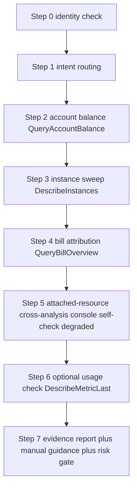

# ECS Arrears, Trial Expiry and Stop-Billing Diagnosis

> **Delivery override - outranks every relay instruction and template below.** `STATUS`,
> `NEXT_ACTION` and their `OK` / `DEGRADED` / `FAIL` / `BLOCKED` values are the entry script's
> internal run state, not a delivery format. Where this document says to relay, mirror or copy
> those lines "faithfully" or "verbatim", relay their MEANING in the customer's own words: never
> write the keys or the bare values into the reply or into anything saved under `outputs/` or
> `ran_scripts/` (SKILL.md rule 3h). A layer this run did not read is named in the customer's own words - which layer, and what would have settled it.

Handle the three billing-lifecycle symptoms customers actually report on ECS:

- **Area A — arrears**: the account went overdue, the instance was stopped or an
  EIP got locked, and the customer wants to settle the bill and restore service
  (or knows what happens to their data meanwhile).
- **Area B — free trial / campaign offer expiry**: a "free trial" server is about
  to expire (or already did); the customer wants to keep it, convert or renew it,
  and understand what happens next.
- **Area C — stop billing**: the customer wants all charges to end — they say
  "shut down / unsubscribe / delete everything" — and needs the complete
  release/cleanup order, including attached resources (snapshots, auto snapshot
  policies, standalone disks, EIP, VPC) that keep billing after the instance is
  gone, plus the delayed-statement explanation.

Core approach: confirm the account identity, read the real arrears state and
bill attribution, sweep the instance inventory across regions, then answer
strictly from evidence — plus manual-only guidance. **This skill is read-only
and executes no cloud write operation of any kind; every release/delete step is
a console action the customer performs themselves**, always accompanied by the
mandatory risk-disclosure gate below.

## Absolute Rules

1. **ABSOLUTE PROHIBITION (read-only enforcement).** Under NO circumstances may
   you generate, write, or execute any command or script that calls a mutating
   API — any `Create*`, `Delete*`, `Modify*`, `Update*`, `Put*`, `Release*`,
   `Start*`, `Stop*`, `Reboot*`, `Reset*`, `Attach*`, `Detach*`, `Bind*`,
   `Unbind*`, `Renew*`, `Convert*`, `Refund*` action — including commands
   "written for the user to run manually" through this skill's scripts. When
   the customer asks you to release, delete or settle something FOR them, the
   only compliant answer is: manual console steps + the mandatory
   risk-disclosure gate + the statement that this skill is read-only. Support
   engineers in the underlying tickets likewise never operated on the
   customer's resources.
2. **API WHITELIST.** The only permitted OpenAPI actions are the five verified
   read actions: `sts:GetCallerIdentity` (identity), bssopenapi
   `QueryAccountBalance` (arrears) and `QueryBillOverview` (bill attribution),
   `ecs:DescribeInstances` (instance state), `cms:DescribeMetricLast` (optional
   usage corroboration). Everything outside this list — including snapshots,
   disk, EIP, VPC, image, order, and savings-plan queries — is NOT authorized
   here: those facts are degraded to console self-check guidance, never probed
   ad hoc.
3. **MANDATORY RISK-DISCLOSURE GATE.** Whenever any cleanup/release/delete
   guidance is output, ALL six disclosures must appear together (they are also
   printed by the entry script): (1) release/delete is irreversible and the
   data is unrecoverable; (2) back up first via snapshot or custom image; (3)
   snapshots themselves keep billing and their deletion is irreversible; (4)
   the auto snapshot policy must also be deleted or charges recur; (5) a
   delayed statement may still arrive after cleanup — that is billing
   statement latency, not continued charging; (6) nobody — neither this skill
   nor a support engineer — performs the release for the customer.
4. **NO FABRICATION.** Every conclusion cites the API and field it rests on,
   or is labeled as a console self-check / degraded gap. Numbers such as
   retention day-counts are stated only when the cited official document is
   shown; ticket lore alone never becomes a hard figure. SMS/notification
   wording is attributed by product name, never guessed at.
5. **EXECUTION RULE FOR ERRORS.** On any API error the script logs
   `[WARN] <Code>: <Message>` to stderr, records it in `errors[]` and
   continues with the remaining queries; the report is still produced with the
   evidence at hand and the final `STATUS:` becomes `DEGRADED` (or `FAIL` when
   nothing could be read). Never silently skip, never retry-bomb, never abort
   the whole diagnosis on one region.
6. **SCOPE BOUNDARY.** Refunds, unsubscription, vouchers, invoices, account
   cancellation, real-name subject changes, cross-account transfers, payment
   restrictions, ICP-filing rules, DDoS/blackhole incidents, guest-OS
   connectivity, passwords and disk-capacity problems are NOT this skill.
   Detect them in the customer wording, finish the billing-side exclusion
   anyway, then hand off per [references/arrears-trial-billing-stop__handoff-map.md](references/arrears-trial-billing-stop__handoff-map.md)
   with a structured summary (symptom wording, resource IDs, what the account
   check already proved).

## Trigger Conditions

Use this skill when the customer's own wording matches one of these phrases
(the same list the `description` advertises; Chinese-speaking customers say
the equivalent of "overdue stop", "free trial expired" or "stop billing" —
route them here too):

- "instance stopped due to overdue payment"
- "free trial expired"
- "how to stop ECS billing"
- "still charged after releasing the instance"
- "insufficient balance arrears notification"
- "auto snapshot policy keeps charging"

Match on the symptom sentence, never on internal cause wording. A customer
saying "it deducted a few cents every day although I deleted everything" IS
this skill (attached-resource residue); a customer saying "I want a refund"
IS NOT (commercial handoff), even though both mention money.

## Execution Principle

All evidence collection MUST be performed by running the entry script
`scripts/areas/arrears_trial_billing_stop/billing_lifecycle_diagnosis.py`. The Agent is PROHIBITED from
assembling its own `aliyun` CLI commands, calling any API outside the
whitelist, or skipping the script to "answer faster" — the script embeds the
region sweep, pagination, retry, timeout, credential masking and session-id
observability that ad-hoc commands lack. If the script errors, relay the
degraded output; there is NO fallback path to manual CLI. Knowledge questions
(no account data needed) are answered from the `references/` modules, never
from model memory.

## Data Flows and External Calls

The shipped code contacts exactly the destinations below and nothing else:

- **Alibaba Cloud BSS (billing) OpenAPI — `business.aliyuncs.com`, HTTPS, API
  version `2017-12-14`**, via the `aliyun` CLI as a subprocess: read-only
  actions `QueryAccountBalance` (no parameters) and `QueryBillOverview`
  (parameter: billing cycle `YYYY-MM` only).
- **Alibaba Cloud ECS OpenAPI — API version `2014-05-26`**, same CLI
  subprocess channel: read-only action `DescribeInstances` (parameter:
  `RegionId` from the sweep list, optional instance-ID filter, page size and
  number).
- **Alibaba Cloud CloudMonitor — API version `2019-01-01`**, optional step
  only (`--check-usage`): read-only action `DescribeMetricLast` (parameters:
  namespace, metric name from the built-in allow-list, instance dimension).
- **Alibaba Cloud STS — `sts.aliyuncs.com`, API version `2015-04-01`**,
  plugin-mode command `aliyun sts get-caller-identity`, one parameterless
  read-only identity call.

What leaves the machine per call is the action name plus the query parameters
listed above, and the per-run `--user-agent` observability label
`AlibabaCloud-Agent-Skills/alibabacloud-ecs-high-frequency-issues/<session-id> skill-version/<skill-version>`
(a random 32-hex identifier, not an account identifier). Authentication is
attached by the aliyun CLI from its own default credential chain
(`~/.aliyun/config.json` or platform-injected environment); the scripts never
read, print, pass or cache any credential material, and mask credential
substrings out of any CLI error text. No other network destination, no
telemetry, no file writes.

## Observability

All OpenAPI calls (invoked through the aliyun CLI by the scripts) include:

- **User-Agent template**: `AlibabaCloud-Agent-Skills/{skill-name}/{session-id} skill-version/{skill-version}`,
  where `{skill-name}` is `area:arrears-trial-billing-stop`.
- **session-id**: a 32-character hex string (`uuid.uuid4().hex`) generated once
  per script run and attached to every CLI call of that run, so all calls of
  one diagnosis can be correlated. The shared layer
  (`scripts/areas/arrears_trial_billing_stop/_cli.py`) implements this automatically via `--user-agent`.

## Prerequisites

1. **aliyun CLI 3.x** — the only API channel (built-in metadata mode for
   `bssopenapi` / `ecs` / `cms`, plugin mode for `sts`). No direct HTTP
   signing, no external Python SDK.
2. **Python 3.9+** — standard library only; see
   `scripts/requirements.txt`.
3. **Read-only grants** — the exact minimal action list is in
   [references/ram-policies.md](references/ram-policies.md).

## Credentials

Credentials are resolved automatically by the aliyun CLI default credential
chain (environment or `~/.aliyun/config.json`). The scripts never read, print,
pass, cache or prompt for any AccessKey, SecretKey or STS token, and they mask
credential material out of any CLI error text before it can reach a log or
report. If identity verification fails, guide the user to run
`aliyun sts get-caller-identity`; do not ask for secrets.

## User Confirmation

This skill is read-only, so no confirmation is needed to run its queries.
Confirmation discipline applies to what the customer does next: the entry
script's cleanup guidance is preceded every time by the six-item
risk-disclosure gate of Absolute Rule 3, and the report states verbatim that
release/delete actions must be executed by the customer in the console after
they have verified their backups. Never present cleanup steps as a script the
user should pipe into any tool.

## Input Parameters

- **Billing cycle** (`--billing-cycle YYYY-MM`): default = current month,
  auto-filled and always declared in the output. Cross-month arrears: extend
  with `--months N` (1–3).
- **Regions** (`--regions a,b,c`): default = the built-in sweep list (a script
  constant; region-enumeration APIs are not authorized here). Say so in the
  report; a customer-named region overrides it.
- **Instance ID** (optional `--instance-id i-...`): IDs are type-checked — an
  all-digit value is an account UID, not an instance ID, and gets a `[WARN]`
  instead of a query (a real ticket failure mode).
- **Intent** (`--intent arrears|trial|stop-billing`): default `auto`, routed
  from `--question "<customer original wording>"` plus the data.
- **Usage corroboration** (optional `--check-usage`, `--metric`,
  `--namespace`): CloudMonitor last-datapoint evidence for "is it still doing
  anything"; metric names are restricted to the documented list.

**Auto-fill declaration requirement**: every auto-filled parameter (billing
cycle, region sweep, UID derived from STS) MUST be declared explicitly in the
answer, e.g. "Billing cycle auto-defaulted to the current month (2026-09)".

## Orchestration



| Module | File | Responsibility |
|--------|------|----------------|
| M1 | [references/arrears-trial-billing-stop__arrears-recovery-rules.md](references/arrears-trial-billing-stop__arrears-recovery-rules.md) | Arrears state machine, settle-and-restore path, what arrears does and does not affect |
| M2 | [references/arrears-trial-billing-stop__resource-retention-after-arrears.md](references/arrears-trial-billing-stop__resource-retention-after-arrears.md) | Retention windows and auto-release behavior after overdue (evidence policy: rules yes, unverified numbers never) |
| M3 | [references/arrears-trial-billing-stop__trial-expiry-rules.md](references/arrears-trial-billing-stop__trial-expiry-rules.md) | Trial = pay-as-you-go + entitlement deduction; expiry behavior; keep/renew/convert/migrate branches |
| M4 | [references/arrears-trial-billing-stop__stop-billing-checklist.md](references/arrears-trial-billing-stop__stop-billing-checklist.md) | Ordered full cleanup checklist and why stop/detach are not the end of billing |
| M5 | [references/arrears-trial-billing-stop__billing-attribution-playbook.md](references/arrears-trial-billing-stop__billing-attribution-playbook.md) | Region x product x item attribution; SMS/notification subject attribution; ID-type triage |
| M6 | [references/arrears-trial-billing-stop__handoff-map.md](references/arrears-trial-billing-stop__handoff-map.md) | Out-of-scope symptom to receiving-channel map with handoff summary template |
| M7 | [references/ram-policies.md](references/ram-policies.md) | Minimal read-only RAM actions actually called |

## Execution Flow

1. **Step 0 — Identity.** `python3 scripts/areas/arrears_trial_billing_stop/sts_token.py` (or let the entry
   script run it internally): confirm WHICH account the analysis covers; stop
   with guidance if credentials are absent. Wrong-account analysis is the
   single most damaging failure this skill guards against.
2. **Step 1 — Intent.** Pass the customer's wording via `--question`; the
   script routes areas A/B/C and flags out-of-scope symptoms for handoff.
3. **Step 2 — Account status.** `QueryAccountBalance`: negative available
   amount = arrears, with the exact figure as evidence.
4. **Step 3 — Instance state.** `DescribeInstances` across the swept regions:
   distinguish Running / Stopped / financial-locked / absent, and report each
   instance's charge type and expiry time. Stopping, expiring and being
   released are three different facts — never conflate them.
5. **Step 4 — Bill attribution.** `QueryBillOverview` per cycle: which
   products carry the spend and the outstanding balance, with their billing
   item names. Measured behavior: the statement level of this API has no
   region field — region attribution comes from the instance sweep and from
   the customer's console bill-statement drill-down (labeled CONSOLE-CHECK).
6. **Step 5 — Attached-resource cross-analysis.** Instances gone but products
   still billed ⇒ residue (snapshots, auto snapshot policies, standalone
   disks, EIP, images, VPC). Their query APIs are NOT authorized: the output
   switches to the per-region console self-check list and marks the report
   `DEGRADED`. Policy rule: cleanup lists always pair a resource WITH its
   generating policy.
7. **Step 6 — Usage corroboration (optional).** `--check-usage`:
   `DescribeMetricLast` for CPU/network/disk items proves whether a live
   instance is actually idle before the customer considers releasing it.
8. **Step 7 — Report.** Verdicts with evidence citations; guidance split into
   the resume branch or the stop-billing branch; the six-item risk gate
   verbatim; handoff paragraphs; explicit auto-fill declarations; then relay
   the script's `STATUS:` and `NEXT_ACTION:` lines faithfully.

## Available Scripts

| Script | Purpose |
|--------|---------|
| `scripts/areas/arrears_trial_billing_stop/billing_lifecycle_diagnosis.py` | Single entry point: Steps 0–7 evidence run, verdicts, manual guidance branches, risk gate, handoff detection, `STATUS`/`NEXT_ACTION` contract |
| `scripts/areas/arrears_trial_billing_stop/sts_token.py` | Caller identity pre-check via `aliyun sts get-caller-identity`; UID traceability label |
| `scripts/areas/arrears_trial_billing_stop/_cli.py` | Shared CLI layer: argument-list subprocess calls with per-call timeout, transient retry with backoff, credential masking, session-id User-Agent on every call |
| `scripts/areas/arrears_trial_billing_stop/_constants.py` | Embedded constants: endpoints, sweep-region list, doc/console links, risk gate, guidance texts, handoff map |

## Exit Codes (contract)

- `0` — a conclusion exists: `STATUS: OK`, or `STATUS: DEGRADED` when part of
  the evidence was unavailable (each missing item is named, with the console
  self-check path replacing the un-provable conclusion).
- `1` — no usable conclusion: `STATUS: FAIL` (identity unreadable or every
  evidence call failed); `NEXT_ACTION:` states what to fix first.
- `2` — argparse usage error only; a diagnosed condition never exits 2.

## Error Handling

| Symptom | Category | Handling |
|---------|----------|----------|
| `NoPermission` / `ImplicitDeny` on any action | permission | Name the missing action, attach [references/ram-policies.md](references/ram-policies.md), continue the other steps |
| `InvalidAccessKeyId` / credential-chain failure | missing-credential | Guide to `aliyun sts get-caller-identity`; never accept secrets in chat |
| `InvalidParameter` (bad cycle / RegionId) | parameter | Validate and rerun; report the offending value |
| `Throttling.User` / 5xx | transient | Already retried by the shared layer (3 attempts, linear backoff); then degrade with `[WARN]` |
| Empty result set | valid finding | Zero instances or an empty bill cycle is evidence, not an error — but scope it: "within the swept regions / this cycle" |

Never conclude "nothing is being charged" from a failed or partial read; say
what could not be read instead.

## Important Notes

- **Stop ≠ no charges**: only economical mode plus release ends instance
  billing; disks, snapshots, EIP and images bill while they exist. Cite
  [references/arrears-trial-billing-stop__stop-billing-checklist.md](references/arrears-trial-billing-stop__stop-billing-checklist.md).
- **Detach ≠ release**: a detached data disk keeps billing until released;
  the console path is Block Storage.
- **Delete the policy, not just the snapshots**: an auto snapshot policy
  regenerates billable snapshots after every manual deletion.
- **Delayed statements are normal**: small bills arriving after release are
  the settlement of usage accrued before release.
- **Arrears block pay-as-you-go usage; they do not silently cancel
  subscription instances**, and account arrears are not an ICP-filing factor
  — but filing itself is out of scope (handoff).
- **Trial entitlement expiry is invisible to the authorized read set**; only
  the instance `ExpiredTime` is machine-readable. Say which is which.
- **Read-only guarantee**: the five whitelisted actions are all
  Describe/Get/Query reads; the skill cannot change any resource, order or
  billing state.

## Examples

**Example 1 — arrears shutdown**

> User: "My server stopped right after the overdue SMS. How much do I owe and
> how do I get it back?"

```bash
python3 scripts/areas/arrears_trial_billing_stop/billing_lifecycle_diagnosis.py \
  --intent arrears --question "instance stopped due to overdue payment"
```

Relay the arrears figure from `QueryAccountBalance`, the stopped/locked
instance rows from `DescribeInstances`, then the settle-and-restore branch of
[references/arrears-trial-billing-stop__arrears-recovery-rules.md](references/arrears-trial-billing-stop__arrears-recovery-rules.md).

**Example 2 — still charged after release**

> User: "I released everything weeks ago but a few cents are deducted every
> day."

```bash
python3 scripts/areas/arrears_trial_billing_stop/billing_lifecycle_diagnosis.py \
  --intent stop-billing --months 2 --question "still charged after releasing the instance"
```

The bill attribution names the still-charged product (typically snapshot),
the run reports `DEGRADED` for what the authorized APIs cannot enumerate, and
the per-region console self-check plus the six-item risk gate close the
answer.

**Example 3 — trial expiry panic**

> User: "My free trial server expires tomorrow — will it delete my data?"

```bash
python3 scripts/areas/arrears_trial_billing_stop/billing_lifecycle_diagnosis.py \
  --intent trial --question "free trial expired"
```

Answer from [references/arrears-trial-billing-stop__trial-expiry-rules.md](references/arrears-trial-billing-stop__trial-expiry-rules.md):
the trial instance is pay-as-you-go under an entitlement, expiry alone does
not delete anything, and the keep-vs-stop branches each get their manual
steps — entitlement expiry itself is verified in the console, because the
authorized APIs do not expose it.

## Final Answer Contract

The final answer to the customer MUST:

1. Lead with the script's `Summary` and verdict lines, relayed faithfully,
   including the `STATUS:` outcome (`OK` / `DEGRADED` / `FAIL`) and the
   matching `NEXT_ACTION:`.
2. Quote only real returned numbers, dates and field values, each tied to the
   API and field it came from; never re-compute or invent amounts, dates,
   retention day-counts or product names.
3. Declare every auto-filled parameter (billing cycle, sweep regions, derived
   UID) explicitly.
4. Print the six-item risk-disclosure gate verbatim whenever any cleanup or
   release guidance appears.
5. Route commercial or technical out-of-scope requests with the handoff
   paragraph (billing-side conclusion already proven + customer's own symptom
   wording + resource IDs + receiving channel).
6. End with manual console guidance only — this skill never claims that
   anything was released, deleted, settled or restarted on the customer's
   behalf.
