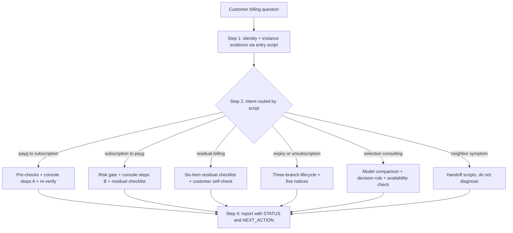

# ECS Billing Mode Selection and Conversion Guide

> **Delivery override - outranks every relay instruction and template below.** `STATUS`,
> `NEXT_ACTION` and their `OK` / `DEGRADED` / `FAIL` / `BLOCKED` values are the entry script's
> internal run state, not a delivery format. Where this document says to relay, mirror or copy
> those lines "faithfully" or "verbatim", relay their MEANING in the customer's own words: never
> write the keys or the bare values into the reply or into anything saved under `outputs/` or
> `ran_scripts/` (SKILL.md rule 3h). A layer this run did not read is named in the customer's own words - which layer, and what would have settled it.

Answer the four questions this tier is asked every day: "subscription or
pay-as-you-go, which fits me?", "how do I switch, which way?", "why is
something STILL charging after I switched or released?", "my yearly server
is expiring - refund, wait, or release?". The skill gathers instance
evidence with read-only ECS queries, classifies the request direction, and
emits console steps a non-technical customer can follow, with the complete
risk notice and re-verification path. It never changes anything, anywhere.

## Absolute Rules

1. **ABSOLUTE PROHIBITION (read-only enforcement):** Under NO circumstances
   may you generate, write, or execute any command or API call that mutates
   cloud state - any action whose name starts with `Modify*`, `Create*`,
   `Delete*`, `Release*`, `Attach*`, `Detach*`, `Reset*`, `Replace*`,
   `Renew*`, `Convert*` (order, instance, disk, billing, refund), including
   scripts "for the user to run manually" through this skill. Conversion,
   top-up, snapshot, unsubscription and release are CUSTOMER console
   actions; this skill only guides them and then re-checks with read-only
   queries.
2. **API ALLOW-LIST:** The ONLY OpenAPI actions this skill may call are the
   read-only ones the entry script itself issues: `ecs:DescribeInstances`,
   `ecs:DescribeInstanceStatus`, `ecs:DescribeAvailableResource` (version
   2014-05-26), plus the STS identity query `sts:GetCallerIdentity`. Any
   action outside this list - including in-instance command execution
   interfaces - is prohibited even if the user asks for it; decline with
   the handoff scripts in [references/billing-mode-selection__handoff-scripts.md](references/billing-mode-selection__handoff-scripts.md).
3. **NO GUEST EXECUTION:** Never run commands inside a customer instance
   and never pretend to. When an answer needs operating-system-side data,
   ask the customer to run the read-only command themselves and paste the
   output, or hand off to the cloud-assistant / remote-connection tier.
4. **NO FABRICATION, NO PRICE PROMISES:** Conclusions come only from data
   the entry script actually retrieved or from the embedded guidance
   (marked with provenance). Savings-plan balances, arrears amounts,
   invoiceable quotas, refundable figures, traffic usage and expiry guesses
   are NOT cloud-visible here: name them as customer self-check items
   (Billing Center / console screenshots). Prices are whatever the console
   order page shows; campaign eligibility goes to a sales manager.
5. **EXECUTION RULE FOR ERRORS:** Every failed query must leave a `[WARN]`
   trace and a "Graceful Degradation Log" entry in the report, and the run
   continues in guidance-only mode; a permission failure such as
   `NoPermission` or `ImplicitDeny` is reported with the missing action
   named, never silently swallowed.
6. **SCOPE BOUNDARY:** neighbor symptoms (spec change, disk expansion,
   bandwidth billing rework, IP/network quality, bill line-item audits,
   other products' charges) are identified, then routed with the handoff
   sentences - never diagnosed here.

## Trigger Conditions

Use this skill when the customer's own wording matches one of these phrases
(the same list the `description` advertises):

- "convert pay-as-you-go to subscription"
- "switch to pay-as-you-go"
- "which billing mode is cheaper"
- "still charged after releasing the server"
- "data disk still billed after conversion"
- "free trial server expires soon"
- "DiskExpiredOrInArrears"
- "InvalidAccountStatus.NotEnoughBalance"

Customers state symptoms, not root causes: match the symptom sentence or
the console error string, then let the entry script classify the intent.
When the customer cannot say which instance or region, still run the entry
script - its `STATUS: FAIL` / `NEXT_ACTION` output names exactly what to
ask for.

## Execution Principle

**CRITICAL - MANDATORY EXECUTION:** All cloud evidence MUST come from the
single entry script `scripts/areas/billing_mode_selection/billing_mode_advisor.py`. You are strictly
prohibited from hand-assembling `aliyun` CLI commands, calling ECS APIs
directly, or skipping any evidence step - the script embeds the allow-list,
pagination, retry, timeout, credential-masking and session tracing that ad
hoc commands lack. If the script fails, read its `[WARN]` lines and
`NEXT_ACTION`; do NOT work around it with manual CLI attempts. Knowledge
questions are answered from the script's embedded topics
(`--list-topics` / `--topic`), never from model memory.

## Observability

All OpenAPI calls (issued through the aliyun CLI by the scripts) include:

- **User-Agent template**: `AlibabaCloud-Agent-Skills/{skill-name}/{session-id} skill-version/{skill-version}`,
  where `{skill-name}` is `area:billing-mode-selection`.
- **session-id**: a 32-character lowercase hex string (`uuid.uuid4().hex`)
  generated once per script run, cached for that run, and attached to
  EVERY CLI invocation through `--user-agent`, so all calls of one advisory
  can be correlated end to end.

The shared layer `scripts/areas/billing_mode_selection/_cli.py` implements this automatically; the code
path always passes `--user-agent` on each `aliyun` subprocess call.

## Prerequisites

1. **aliyun CLI 3.x** - the only API channel (built-in metadata mode for
   `ecs` PascalCase actions, plugin mode `aliyun sts get-caller-identity`).
   No direct HTTP signing, no external Python SDK.
2. **Python 3.9+** - standard library only (see `scripts/requirements.txt`).
3. **Alibaba Cloud credentials** - resolved automatically by the aliyun CLI
   default credential chain (environment or `~/.aliyun/config.json`).

## Credentials

Never read, print, store, or pass credential values explicitly; the scripts
accept no credential arguments and resolve credentials only through the
default chain. If `scripts/areas/billing_mode_selection/sts_token.py` fails, guide the customer to run
`aliyun sts get-caller-identity` - asking them to paste credentials is prohibited. CLI
error text passing through the scripts is credential-masked before display.

## User Confirmation

This skill performs no cloud changes, so no confirmation gate applies to
its own reads. The confirmation gate lives on the GUIDANCE side: before
presenting any irreversible customer-performed step (switch to
pay-as-you-go, unsubscription, release, disk cleanup), deliver the full
risk list first - arrears auto-release losing data unrecoverably,
promotional purchases not refunding the difference, the five unsubscription
notices - and obtain the customer's explicit acknowledgement. Only then
walk the console steps.

## Orchestration

One read-only entry script gathers evidence and routes the symptom; the
reference modules interpret it.



| Module | Responsibility |
|---|---|
| M1: Billing model basics | Mode comparison, free-trial and savings-plan mechanics, misconception scripts |
| M2: Conversion playbook | Both-direction console steps, pre-checks, link-direction trap, error-string handling |
| M3: Residual billing checklist | Disks, snapshots, bandwidth, side products, billing lag, arrears blockage |
| M4: Lifecycle and unsubscription | Renew / wait / refund branches, five notices, release windows |
| M5: Handoff scripts | Neighbor-symptom routing table and ready-to-send sentences |
| M6: RAM policies | Minimal read-only policy actually required |

## Input Parameters

- **`--region-id`** (required for any evidence): ECS queries are regional;
  the skill never guesses a region. One run per region; cross-region review
  repeats the run.
- **`--instance-ids`** (optional): comma-separated `i-...` values from the
  customer (tickets show staff quoting wrong ids - always echo id + name +
  IP + billing type back for confirmation).
- **`--question "<customer original wording>"`** (optional): feeds
  deterministic intent classification; relay the customer's own words.
- **`--intent`** (optional): explicit override when the direction is
  already clear; default `auto`.
- **`--check-availability --instance-type ecs.<family>.<size> [--zone-id]`**
  (optional): selection-time availability evidence.
- **`--profile`**, **`--json`**: CLI profile passthrough; machine output.
- **UID**: never asked from the user - auto-derived via
  `aliyun sts get-caller-identity` as a trace label only.

**Auto-fill declaration requirement**: every auto-filled or auto-derived
value (UID, `--target-charge-type` default `PrePaid`, intent classified from
question text) MUST be declared explicitly in the reply, e.g. "UID
auto-derived via the identity query: 1234...".

## Module Index

Reference modules, strictly 1:1 with the `references/` directory:

| Module | File | Responsibility |
|---|---|---|
| M1 | [references/billing-mode-selection__billing-model-basics.md](references/billing-mode-selection__billing-model-basics.md) | Billing modes, trial/savings-plan mechanics, misconception defusing |
| M2 | [references/billing-mode-selection__conversion-playbook.md](references/billing-mode-selection__conversion-playbook.md) | Both-direction conversion guidance, pre-checks, risk gate |
| M3 | [references/billing-mode-selection__residual-billing-checklist.md](references/billing-mode-selection__residual-billing-checklist.md) | What keeps billing after a switch or release |
| M4 | [references/billing-mode-selection__lifecycle-unsubscribe.md](references/billing-mode-selection__lifecycle-unsubscribe.md) | Expiry timeline, refund path, five mandatory notices |
| M5 | [references/billing-mode-selection__handoff-scripts.md](references/billing-mode-selection__handoff-scripts.md) | Neighbor-symptom routing and handoff sentences |
| M6 | [references/ram-policies.md](references/ram-policies.md) | Minimal read-only RAM policy and permission failures |

## Execution Flow

1. **Step 1 - Scope and identity:** verify credentials with
   `python3 scripts/areas/billing_mode_selection/sts_token.py` (best-effort; the entry script also runs
   it internally). Establish the region and, if given, the instance ids.
2. **Step 2 - Evidence and routing:** run the entry script
   (`--region-id`... plus `--question` or `--intent`). Read the instance
   table: billing type census, `ExpiredTime` proximity, `financial` locks.
   The script classifies the intent and assembles the matching sections.
3. **Step 3 - Guidance delivery:** relay the pre-checks, the risk
   acknowledgement gate (irreversible directions), and the console steps
   verbatim from the script output. Money-side unknowns are named as
   customer self-check items with the Billing Center path; neighbor
   symptoms use the handoff sentences.
4. **Step 4 - Report:** follow the Final Answer Contract; declare every
   auto-filled parameter; never invent numbers.
5. **Step 5 - Re-verification loop:** after the customer says they
   performed the console action, re-run the same read-only command and
   compare: `InstanceChargeType`, `ExpiredTime`, `Status`. Residual or
   refund-amount questions after execution route to the Billing Center
   screenshot, not to guesses.

### Exit codes (contract)

- `0` - usable advisory produced: `STATUS: OK`, or `STATUS: DEGRADED` when
  part of the evidence was unavailable (`[WARN]` + degradation log).
- `1` - `STATUS: FAIL`: nothing usable; `NEXT_ACTION` names the missing
  input (e.g. invalid region, unresolvable identity with no question text).
- `2` - argparse usage error only. A diagnosed condition never exits `2`.

## Available Scripts

| Script | Purpose |
|---|---|
| `scripts/areas/billing_mode_selection/billing_mode_advisor.py` | SINGLE ENTRY POINT: read-only evidence, intent routing, console guidance with risk gates, availability check, FAQ topics; ends with `STATUS`/`NEXT_ACTION` |
| `scripts/areas/billing_mode_selection/sts_token.py` | Caller identity verification + UID trace label (`--json` optional) |
| `scripts/areas/billing_mode_selection/_cli.py` | Shared CLI layer: allow-list plumbing, `--user-agent` session tracing, retry, timeouts, credential masking |
| `scripts/areas/billing_mode_selection/_constants.py` / `scripts/areas/billing_mode_selection/_knowledge.py` | Embedded constants and provenance-tagged guidance data (no data files in scripts/) |

## Error Handling

| Error | Cause | Resolution |
|---|---|---|
| Credential chain failure | CLI not configured | Guide `aliyun sts get-caller-identity`; never request credential values |
| `NoPermission` | Missing Describe action grant | Name the missing action, point to [references/ram-policies.md](references/ram-policies.md), continue guidance-only |
| `ImplicitDeny` | Organization control blocks the read | Same handling; suggest contacting the account administrator |
| `InvalidParameter` | Bad region/id/type shape | Script validates inputs and exits `FAIL` with the exact fix |
| `Throttling.User` | Request rate limited | Retried automatically with backoff (3 attempts); then `[WARN]` + continue |
| `InternalError` / `ServiceUnavailable` | Transient service failure | Retried; then `[WARN]` + degrade; never conclude "no instances" from a failed call |
| Conversion error `DiskExpiredOrInArrears` (400, "Your account has an overdue payment for the specified instance.", the console shows the same message in Chinese) | Arrears on the account/instance | Customer funds the account in the Billing Center, then re-runs the read-only check |
| Conversion error `InvalidAccountStatus.NotEnoughBalance` (403, "Your account does not have enough balance.") | Balance below the pay-as-you-go opening threshold | Same: customer funds the account, then retries |
| `InstanceExpiredOrInArrears` (403, "The specified operation is denied as your prepay instance is expired (prepay mode) or in arrears (afterpay mode).") | NOT a conversion error -- it comes from `StopInstance` (and the same expiry/arrears family on other lifecycle actions): a stop request was rejected because the prepaid instance is expired or the account is in arrears | This is the stop/start branch, not billing conversion: route per `area:instance-start-stop-anomaly` / the expiry area, and never quote this code as the conversion failure |

All errors surface as `[WARN] Code: Message` on stderr, are collected into
the report's degradation log, and never abort the advisory line.

## Final Answer Contract

The final answer MUST:

1. Lead with the script's `Summary` block, faithfully relayed, including
   its `STATUS` (`OK` / `DEGRADED` / `FAIL`) and `NEXT_ACTION`.
2. Quote only real field values (instance ids, charge types, lock reasons,
   expiry timestamps) returned in the run; absent fields stay "not
   returned" - never inferred.
3. Declare every auto-filled parameter and its source.
4. Deliver the risk acknowledgement verbatim before any irreversible
   customer step, and state that the customer performs the console action
   themselves.
5. Route every money figure to the console/Billing Center page that shows
   it; route neighbor symptoms with the handoff sentences.

## Important Notes

- Arrears hide the conversion entry (verified ticket pattern) - the
  `financial` lock from the read-only output is your programmatic signal.
- Converting the instance does NOT convert data disks, snapshots or
  traffic items; always close a conversion with the residual checklist.
- Subscription expiry math (manual-release next day 00:00; auto-delete 15
  days after expiry, data unrecoverable) comes from a verified ticket
  dialogue - anchor it to the real `ExpiredTime`, never to memory.
- The help-document link for one conversion direction was quoted
  wrong-direction in a live ticket; this skill flags re-checking page
  direction before citing it (see [references/billing-mode-selection__conversion-playbook.md](references/billing-mode-selection__conversion-playbook.md)).
- This skill is read-only end to end; the credential it runs under grants
  Describe/Get actions only.

## Examples

**Example 1 - convert a steady test box to a yearly plan**

> User: "My pay-as-you-go server i-bp1abcdef12345 in cn-hangzhou runs 24x7
> now. Convert pay-as-you-go to subscription - what do I click?"

```bash
python3 scripts/areas/billing_mode_selection/billing_mode_advisor.py --region-id cn-hangzhou \
    --instance-ids i-bp1abcdef12345 --intent payg_to_subscription
```

Relay the pre-checks (arrears/promo/backup), the console steps with the
order-page price note, then re-run the same command to verify
`InstanceChargeType` became `PrePaid` after the customer submits.

**Example 2 - still charged after release**

> User: "I released my server two weeks ago but my bill is still going up.
> Why am I still being charged?"

```bash
python3 scripts/areas/billing_mode_selection/billing_mode_advisor.py \
    --question "I released my server two weeks ago but my bill is still going up"
```

The residual checklist explains the four lingering item classes plus the
billing-lag window; ask for the Billing Center bill-detail screenshot to
attribute the actual rows.

**Example 3 - expiring yearly instance, refund or wait?**

> User: "My instance i-uf6exampleafb76d3e06 in cn-shanghai expires 2026-09-03.
> Can I release it right after expiry instead of waiting 15 days?"

```bash
python3 scripts/areas/billing_mode_selection/billing_mode_advisor.py --region-id cn-shanghai \
    --instance-ids i-uf6exampleafb76d3e06 --intent expiry_handling
```

The lifecycle branches answer: manual release opens 00:00 on 2026-09-04,
auto-delete lands ~15 days after expiry, and early unsubscription runs
through the refund page with the five mandatory notices.
