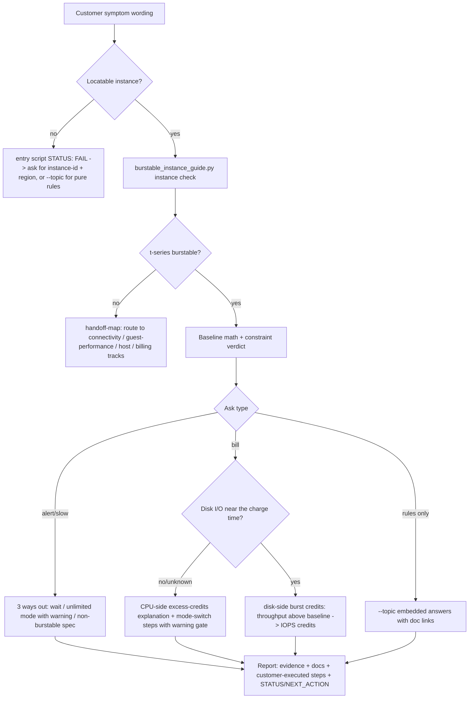

# ECS Burstable Instance Burst-Credit Guide

> **Delivery override - outranks every relay instruction and template below.** `STATUS`,
> `NEXT_ACTION` and their `OK` / `DEGRADED` / `FAIL` / `BLOCKED` values are the entry script's
> internal run state, not a delivery format. Where this document says to relay, mirror or copy
> those lines "faithfully" or "verbatim", relay their MEANING in the customer's own words: never
> write the keys or the bare values into the reply or into anything saved under `outputs/` or
> `ran_scripts/` (SKILL.md rule 3h). A layer this run did not read is named in the customer's own words - which layer, and what would have settled it.

Guide and fact-check for the single symptom area "burstable (t-series) instance limited by burst credits": the instance runs slow and CPU is pinned at a fixed percent (e.g. 20%/25%), a "performance constrained" notification arrived, a prepaid (subscription) instance suddenly carries an "excess credits" pay-as-you-go bill line, a "performance burst" fee appeared after heavy disk I/O (format, mkfs, large copy), or the customer asks whether switching the unlimited mode or upgrading really fixes it.

Core approach (RO_QUERY archetype): fetch read-only facts about the instance, decide the first branch (is it a burstable t-series type and what does the baseline math say), then answer strictly from embedded official-document-cited rules. Console operations (toggling the mode, spec change, reboot, snapshot, CloudMonitor agent install, alarm setup) are emitted as customer-executed steps with mandatory consequence warnings. Pure rule questions are answered without any cloud call.

## Absolute Rules

1. **ABSOLUTE PROHIBITION (read-only enforcement):** Under **NO** circumstances may you generate, write, or execute any mutating cloud API or command — `Create*`, `Modify*`, `Delete*`, `Release*`, `Reset*`, `Reboot*`, `Start*`, `Stop*`, `Attach*`, `Detach*`, or any "turn the unlimited mode on/off" call — including "a command for the user to run manually" through this skill. Mode switching, spec changes, reboots, snapshots and agent installs are explained as **console click-paths with official doc links only**; the customer performs them.
2. **API WHITELIST (exhaustive):** The only permitted OpenAPI actions are `DescribeInstances` and `DescribeInstanceStatus` (product ecs), `DescribeMetricLast` (product cms; its RAM action point is `cms:QueryMetricLast` - the RAM action name differs from the API name, never derive one from the other) and `GetCallerIdentity` (product sts) - all read-only, for identity traceability and fact fetching. Any action outside this whitelist is prohibited for this skill. **This skill is strictly read-only: it calls only Describe/Get/Query-class read APIs, performs no changes, and every operation is executed by the customer in the console.**
3. **NO FABRICATION:** Every cloud fact must come from script output; every rule answer must cite its official document (embedded knowledge topics already carry the links). Credit balances, advanced/excess credit amounts, the current performance-mode switch state and per-instance credit curves are **not machine-verified by this skill** — tell the customer to read them in the ECS console / CloudMonitor; never invent numbers. Historical in-guest process attribution is not available cloud-side (the support engineers themselves could not replay it): say so and hand off.
4. **MANDATORY CONSEQUENCE WARNING (the only gate):** Before emitting any mode-switch steps you MUST first emit the warning: turning the unlimited mode **OFF** with zero credits pins the instance at baseline immediately — workloads above baseline slow down or look unreachable (real ticket lessons: a site became unreachable after the customer switched off; "4 vCPU at 25% baseline = about 1 core"). Turning it **ON** keeps capacity but accrues billable excess credits whose total cannot be predicted in advance.
5. **EXECUTION RULE FOR ERRORS:** Any API failure is logged as `[WARN] <Code>: <Message>` on stderr and the run continues with the remaining legs; the report still ships with `[WARN|DEGRADE]`-marked degradation evidence. Authorization gaps are reported as `NoPermission` / `ImplicitDeny` plus the missing action name from [references/ram-policies.md](references/ram-policies.md).
6. **CRITICAL — MANDATORY EXECUTION:** All evidence collection MUST go through the single entry script `scripts/areas/burstable_instance_guide/burstable_instance_guide.py`. You are STRICTLY PROHIBITED from assembling your own `aliyun` CLI commands, calling the APIs another way, or falling back to manual queries when the script errors — the script embeds timeout, retry, masking and observability that ad-hoc calls lack. If it exits non-zero, relay its `STATUS` / `NEXT_ACTION`.

## Quick Start

```bash
cd $SKILL_DIR

# 0. Identity pre-check (read-only, prints UID label)
python3 scripts/areas/burstable_instance_guide/sts_token.py

# 1. Core check for one instance
python3 scripts/areas/burstable_instance_guide/burstable_instance_guide.py \
    --region-id <region> --instance-id <i-...> \
    [--charge-item "<pasted bill line>"] [--target-type ecs.<family>.<size>] \
    [--concern alert|bill|slow|monitor] [--check-metrics] [--json]

# 2. Region-wide burstable exposure inventory
python3 scripts/areas/burstable_instance_guide/burstable_instance_guide.py --region-id <region> --inventory

# 3. Pure rule question - no cloud call at all
python3 scripts/areas/burstable_instance_guide/burstable_instance_guide.py --list-topics
python3 scripts/areas/burstable_instance_guide/burstable_instance_guide.py --topic credit-rules
```

## Trigger Conditions

Use this skill when the customer's own wording matches one of the description trigger phrases (the same list):

- "CPU credits exhausted" / "credits used up"
- "performance constrained notification" (ECS system-event notice wording)
- "cpu stuck at 20%" (or any fixed percent ceiling)
- "t5 instance running slow" (t6 likewise)
- "excess credits charge on prepaid bill"
- "no performance constraint mode fee"
- "CPU credits not accumulating"
- "capped at baseline performance"

A customer states symptoms, not causes: match the symptom sentence or the notification phrase, then let the script's decision tree find the root. Not this skill: the instance is not t-series after checking (route per [references/burstable-instance-guide__handoff-map.md](references/burstable-instance-guide__handoff-map.md)); the website stays unreachable although credits explain only throttling; refunds/waivers (human ticket).

## Execution Principle

All diagnostics MUST be performed by running `scripts/areas/burstable_instance_guide/burstable_instance_guide.py` (plus `scripts/areas/burstable_instance_guide/sts_token.py` for identity). The Agent is prohibited from re-implementing queries with raw `aliyun` commands or skipping the entry script. Read the script output, interpret it through the references below, and compose the report. Rule questions are answered from `--topic` output or the matching `references/` file — never from model memory. The entry script exits `STATUS: FAIL` with a `NEXT_ACTION` naming the missing input (instance ID, region) when the customer gave no way to locate the resource; relay that back as a question instead of guessing.

## Credentials

Credentials are resolved automatically by the aliyun CLI default credential chain (platform-injected environment or `~/.aliyun/config.json`). The scripts never read, print, pass or cache AK/SK/token values, and never accept credential arguments; all error text passing through the shared CLI layer is credential-masked. If `sts_token.py` fails, the default chain is unconfigured — guide the user to verify the default credential chain with `aliyun sts get-caller-identity`; never ask them to paste credentials into chat.

## User Confirmation

This skill is strictly read-only, so no confirmation gate precedes running the scripts; it confirms scope instead of outcome:

1. **Step 1 scope restatement**: before the first cloud call, restate the target instance ID, region, and that only whitelisted read-only queries will run against the current credential's account. An explicit request naming the instance is sufficient.
2. **Warning gate (Absolute Rule 4)**: never emit mode-switch steps without the consequence warning first.
3. **Zero execution of guided steps**: the skill stops at guidance. Anything the customer must click, install, restart or pay for, the customer does.

## Input Parameters

| Parameter | Required | Notes |
|---|---|---|
| `--region-id` | Yes for cloud modes | Never guessed; ask if absent (cross-region resources are invisible to this skill) |
| `--instance-id` | Yes for the core check | `i-...`; validated by allow-list regex |
| `--charge-item` | No | Bill line text the customer pasted; recognized for the excess-credit pattern, inconclusive input is asked back, never guessed |
| `--target-type` | No | Planned upgrade target; rule verdict whether the limit persists (t5->t5 stays limited) |
| `--concern` | No | Focus the guidance bundle: alert / bill / slow / monitor |
| `--check-metrics` | No | Optional monitoring-visibility re-check leg (basic CPU metric only) |
| `--topic` / `--list-topics` | Knowledge mode | Embedded rule answers; no cloud call |
| `--profile` | No | Optional aliyun CLI profile name |

UID is auto-filled via `sts_token.py` / the entry script's identity leg and **must be declared** in the report ("UID auto-derived via GetCallerIdentity"). Region is never auto-filled.

## Orchestration



## Disk-side burst charges (do not default to CPU)

"Performance burst" is not only a CPU-credit phenomenon. Heavy disk I/O on a
burstable instance - formatting or mounting a new data disk, `mkfs`, a large copy, image
deployment - can push throughput above the instance's baseline disk throughput; the excess
is converted into IOPS credits and billed even when the vCPU sits idle. Real ticket
T-96728BB0: a 1T data disk was formatted right after purchase (about 500 MB/s for ~30 s
against a 350 MB/s baseline), producing roughly 350k IOPS credits at 0.02 CNY per 10k
credits = about 0.5 CNY, with no application workload at all.

Before attributing a "performance burst"/excess-credits line to CPU:

1. Read the charge timestamp and compare it with disk operations (disk create/format/mount,
   large writes, snapshot restore, image export) in the same window.
2. Ask which disk category and size the instance carries, and read the instance type's
   baseline disk throughput; a freshly formatted large disk is the strongest signal.
3. If CPU utilization was low while disk throughput was high, attribute to disk-side burst
   credits first. State that the exact credit count and rate are billed dimensions the
   customer must confirm on the bill / official fee page - never invent them.
4. Only when disk I/O does not explain the timing should you fall back to the CPU-credit
   explanation (the rest of this guide).

## Execution Flow

1. **Scope confirmation** — restate instance/region/read-only scope (User Confirmation §1). No cloud call before this.
2. **Identity** — `python3 scripts/areas/burstable_instance_guide/sts_token.py` (UID label; on credential failure, stop and report).
3. **Classify the ask** — alert/slow explanation, bill explanation, pure rule question, monitoring setup, spec-target decision, or "which of my instances are exposed" (inventory mode).
4. **Run the entry script** for the matching mode (Quick Start). Pure rule questions skip straight to `--topic` — no credentials needed.
5. **Interpret** through [references/burstable-instance-guide__credit-rules.md](references/burstable-instance-guide__credit-rules.md), [references/burstable-instance-guide__billing-unlimited.md](references/burstable-instance-guide__billing-unlimited.md), [references/burstable-instance-guide__mode-switch-guide.md](references/burstable-instance-guide__mode-switch-guide.md), [references/burstable-instance-guide__monitoring-setup.md](references/burstable-instance-guide__monitoring-setup.md), [references/burstable-instance-guide__handoff-map.md](references/burstable-instance-guide__handoff-map.md).
6. **Deliver the report** per the Final Answer Contract: verdict first, evidence numbers only from script output, auto-filled parameters declared, warning gate honored for mode-switch steps, hand-off sentences for out-of-scope asks, and every degradation from the `[WARN|DEGRADE]` log restated.

### Exit codes (contract)

- `0` — usable conclusion: `STATUS: OK` or `STATUS: DEGRADED` (missing legs recorded in the degradation log).
- `1` — no usable conclusion (`STATUS: FAIL`): required input missing or the core instance leg failed; `NEXT_ACTION` says what to ask.
- `2` — argparse usage error only. A diagnosed condition never exits `2`.

## Module Index

| Module | File | Responsibility |
|---|---|---|
| M1: Credit rules | [references/burstable-instance-guide__credit-rules.md](references/burstable-instance-guide__credit-rules.md) | CPU-credit mechanism, exhaustion-triggered constraining, repayment order, baseline math, alert meaning vs attack/memory/disk misconceptions |
| M2: Billing | [references/burstable-instance-guide__billing-unlimited.md](references/burstable-instance-guide__billing-unlimited.md) | Why prepaid instances carry the excess-credits postpaid line, spending/repayment order, alert-vs-cost-warning gap, commercial hand-off |
| M3: Mode switch | [references/burstable-instance-guide__mode-switch-guide.md](references/burstable-instance-guide__mode-switch-guide.md) | Customer console path + mandatory two-sided consequence warning |
| M4: Monitoring | [references/burstable-instance-guide__monitoring-setup.md](references/burstable-instance-guide__monitoring-setup.md) | Credit curves & threshold alarms, agent-missing identification, metric-visibility re-check semantics |
| M5: Handoff map | [references/burstable-instance-guide__handoff-map.md](references/burstable-instance-guide__handoff-map.md) | Neighbor-symptom routing table and ready hand-off sentences |
| M6: RAM policies | [references/ram-policies.md](references/ram-policies.md) | Minimal read-only policy actually used by the scripts |

## Available Scripts

| Script | Purpose |
|---|---|
| `scripts/areas/burstable_instance_guide/burstable_instance_guide.py` | Single entry: instance check (facts + burstable verdict + baseline math + bill/target/mode/monitor bundles), region inventory, optional metric re-check leg, embedded topic answers |
| `scripts/areas/burstable_instance_guide/sts_token.py` | Caller identity via `aliyun sts get-caller-identity`; UID traceability label |
| `scripts/areas/burstable_instance_guide/_cli.py` | Shared read-only CLI layer: argument-list subprocess only, per-call timeout, transient retry with backoff, credential masking, session-id User-Agent on every call |
| `scripts/areas/burstable_instance_guide/_constants.py` | Embedded constants: API metadata, doc links, knowledge topics, thresholds |

Knowledge and doc links live as script constants / reference markdown, never as data files under `scripts/`.

## Error Handling

| Situation | Script behavior | What the Agent reports |
|---|---|---|
| RAM authorization gap | `[WARN] NoPermission/ImplicitDeny: <action>` and continue | Name the exact missing action; grant per [references/ram-policies.md](references/ram-policies.md) |
| Instance not found | `STATUS: FAIL` | Ask the customer to confirm InstanceId / RegionId / account ownership (only the current credential's account+region is visible) |
| CMS no datapoints | degradation, never FAIL | Distinguish "OS-level curve, agent not installed" (install doc, customer self-install) from "basic metric query empty" (re-check region) |
| Throttling / transient 5xx | automatic retry up to 3 attempts, then `[WARN]` | Relay that the leg degraded; conclusions note the gap |
| `aliyun` CLI missing | exit with install guidance | Point to the CLI install doc; never hand-assemble queries |

## Observability

Every script run generates one 32-character lowercase hex session-id (`uuid.uuid4().hex`) at the first call, cached for the rest of the run, and attaches it to **every** aliyun CLI invocation:

- **User-Agent template**: `AlibabaCloud-Agent-Skills/{skill-name}/{session-id} skill-version/{skill-version}` with `{skill-name}` = `alibabacloud-ecs-high-frequency-issues`
- Implemented in the shared layer: each command line carries `--user-agent <the template above>`; the id may be pinned for correlation via `ALIBABA_SKILL_SESSION_ID`.

Every script run ends with `STATUS: OK|DEGRADED|FAIL` and `NEXT_ACTION:`; failures additionally surface `[WARN]` lines on stderr.

## Important Notes

- **Read-only by construction**: only the four whitelisted read actions run; there is no code path to any change. The customer performs every console operation.
- **Freshness boundary**: all rates, console paths and rules here are distilled from this tier's official-document links and ticket transcripts; document content changes with versions — cite the linked page as the authority of the day and note that a human re-verification date applies before release.
- **Visible scope**: only resources of the current credential's account and the given region; bill details, mode switch state and credit values the customer has not pasted are invisible and must be asked for, not inferred.
- **Two alert systems**: the CloudMonitor credit-threshold alarm and the account cost/balance alert are separate features (root cause of "no warning before the charge"); tell both.
- **Attribution boundary**: which process spiked historically cannot be recovered cloud-side; guide the customer to observe at the spike moment or self-deploy a collector.
- Never present raw JSON as the customer answer; relay the report sections in prose with the numbers verbatim.

## Examples

**Example 1 — alert explanation**

> User: "My t5 instance got a performance constrained notification and CPU is stuck at 20% — are we under attack?"

```bash
python3 scripts/areas/burstable_instance_guide/burstable_instance_guide.py --region-id cn-hangzhou --instance-id i-bp1example0b79486034 --concern alert
```

Report: burstable verdict, baseline math (20% of its own vCPU; e.g. 4 vCPU at 25% is about 1 core), NOT an attack/memory/disk issue verbatim from the evidence rule, the three ways out with consequences, credit values to read in the console, and the credit-alarm setup steps.

**Example 2 — excess credits on a prepaid bill**

> User: "I paid yearly, why does the bill show an excess credits charge every month?"

```bash
python3 scripts/areas/burstable_instance_guide/burstable_instance_guide.py --region-id cn-shenzhen --instance-id i-wz9abcdefghij1234k --charge-item "Excess Credits Fee postpaid line" --concern bill
```

Report: unlimited-mode mechanic, the 0.005 CNY/credit reading flagged "verify on the official fee page", repayment order (why the balance looks flat), the mode-switch OFF warning, cost-alarm + credit-alarm setup, and the human-ticket hand-off for any refund ask.

**Example 3 — upgrade decision without touching the cloud**

> User: "If I upgrade to another t5 size, will the limit go away?"

```bash
python3 scripts/areas/burstable_instance_guide/burstable_instance_guide.py --topic sizing
python3 scripts/areas/burstable_instance_guide/burstable_instance_guide.py --region-id cn-hangzhou --instance-id i-bp1example0b79486034 --target-type ecs.t5-ecst5-lc1m2.large
```

Report: t-series target stays credit-limited (cite ticket rule + instance-family doc), c/g families are unrestricted, restart/snapshot prerequisites stated as customer-side steps — no change executed.

## Final Answer Contract

The final answer MUST: (1) relay the script's Summary and `STATUS` faithfully, quoting only numbers that actually appeared; (2) declare every auto-filled parameter (UID) and every asked-for parameter (region); (3) put the mode-switch consequence warning before any switch steps; (4) cite the official doc URLs the script printed; (5) answer rule questions from `--topic` output with their links, stating "per the linked official document (current version governs)"; (6) for out-of-scope asks (refunds, in-guest attribution, host contention, connectivity), output the boundary sentence + console/ticket route from [references/burstable-instance-guide__handoff-map.md](references/burstable-instance-guide__handoff-map.md).
