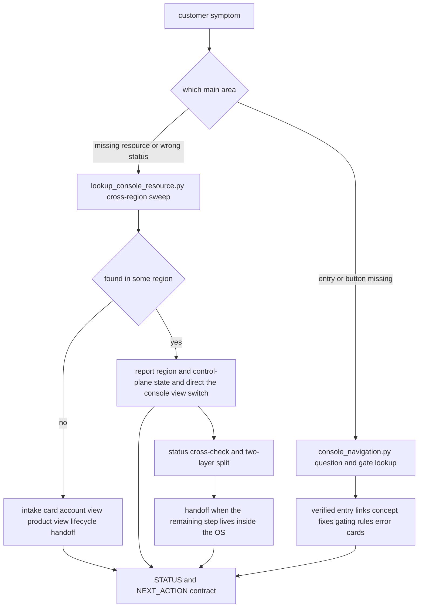

# Alibaba Cloud ECS Console Resource Lookup and Status Check

> **Delivery override - outranks every relay instruction and template below.** `STATUS`,
> `NEXT_ACTION` and their `OK` / `DEGRADED` / `FAIL` / `BLOCKED` values are the entry script's
> internal run state, not a delivery format. Where this document says to relay, mirror or copy
> those lines "faithfully" or "verbatim", relay their MEANING in the customer's own words: never
> write the keys or the bare values into the reply or into anything saved under `outputs/` or
> `ran_scripts/` (SKILL.md rule 3h). A layer this run did not read is named in the customer's own words - which layer, and what would have settled it.

Answers the two customer sentences that dominate this tier: **"my resource is
missing from the console"** (instance, disk or snapshot not visible, list
empty, instance "disappeared" after a region switch, status that does not
match what is expected) and **"I cannot find the console entry"** (button
absent or greyed out, page not reachable, feature invisible on the buy page).
The method: mechanically sweep the region/account/product view with read-only
API evidence, compare what the console shows with the queried control-plane
state, and navigate with a verified console-entry map -- replacing the
guess-and-check and "send me a screenshot" loops of manual support. The
deliverable is always an evidence report plus manual guidance; this skill
changes nothing and runs nothing inside any instance OS.

## Absolute Rules

1. **ABSOLUTE PROHIBITION (read-only enforcement).** Under NO circumstances
   may this skill generate, write, or execute any command that changes cloud
   state -- no action of the shape `Create*`, `Delete*`, `Modify*`, `Update*`,
   `Put*`, `Attach*`, `Detach*`, `Reset*`, `Release*`, `Reboot*`, `Start*`,
   `Stop*`, `Set*`, `Renew*`, `Replace*`, or any billing/order submission --
   **including "helper" commands prepared for the user to run manually.**
   Guidance for human console steps is allowed; executable change paths are
   not.
2. **HARD API WHITELIST.** The only OpenAPI actions reachable are the four
   reads implemented in `scripts/areas/console_resource_lookup/_cli.py`: `DescribeInstances`,
   `DescribeInstanceStatus`, `DescribeAvailableResource` (product ecs,
   version 2014-05-26) and `GetCallerIdentity` (product sts, plugin-mode
   command `aliyun sts get-caller-identity`). Anything outside this list is
   rejected by the code, not by discretion.
3. **NO GUEST EXECUTION.** Never run any command inside an instance OS, not
   even a read-only one, and never via Cloud Assistant or Workbench. When the
   truth requires in-guest readings (df, mount, partition layout), record the
   cloud-side reading, name the missing OS layer, and hand off per
   [references/console-resource-lookup__handoff-matrix.md](references/console-resource-lookup__handoff-matrix.md).
4. **DESTRUCTIVE HUMAN ACTIONS** (instance teardown, disk re-initialization,
   detach-and-release sequences, formatting, file deletion): steps + risk
   disclosure + snapshot-first reminder for the customer to act in the
   console. This skill never performs, scripts, or auto-confirms them.
5. **NO FABRICATION.** Every fact comes from script output or the embedded,
   ticket-sourced knowledge tables. Never invent console paths, doc URLs,
   error codes, or resource values; empty or failed queries are reported as
   limitations, not conclusions.
6. **EXECUTION RULE FOR ERRORS.** Every failing query is logged `[WARN]` with
   its API code and the run continues over the remaining regions/steps; the
   report still renders with the evidence in hand and `STATUS: DEGRADED`.
7. **CREDENTIALS.** Authentication resolves exclusively through the aliyun
   CLI default credential chain. NEVER read, print, pass, request, or store
   key material anywhere in the conversation. On credential failure, guide
   the user to `aliyun sts get-caller-identity` -- that is the only remedy this skill
   offers.

## Trigger Conditions

Use this skill when the customer's own wording matches (mirrors the
`description` Triggers):

- "cannot find my ECS instance" (also: instance not visible / list is empty
  / cannot locate the server / it disappeared)
- "instance disappeared after switching region"
- "ECS instance list is empty" (but the workload still answers)
- "console shows a wrong status" (still Running after a stop, disk In Use but
  unusable, violation banner that will not clear)
- "cannot find the console entry" / "the button is greyed out" (detach,
  re-initialize, unsubscribe, reset password, IPv6 bandwidth, region picker)
- reported error text: `The specified ImageId does not exist`,
  `NoPermission.RAM`, "unsubscribe refused unless a public image is used"

Customers state symptoms, never root causes: match on the symptom sentence or
error text, then let the scripts decide the view (region / account / product)
at fault. Configuration-intent requests ("set X up for me") are out of scope
by Absolute Rules 1/3/4 -- answer with guidance only.

## Execution Principle

CRITICAL -- MANDATORY EXECUTION: all cloud evidence MUST be obtained by
running the entry scripts `scripts/areas/console_resource_lookup/lookup_console_resource.py` (find, status,
availability) and `scripts/areas/console_resource_lookup/sts_token.py` (identity pre-flight); all knowledge
MUST be relayed from `scripts/areas/console_resource_lookup/console_navigation.py` output or this file's
references. You MUST NOT hand-assemble `aliyun` CLI commands, MUST NOT call
any API outside the whitelist, MUST NOT skip the sweep and answer from model
memory, and MUST NOT fall back to manual CLI workarounds when a script errors
-- the scripts already implement pagination, retry, masking, degradation and
observability; a hand-typed command silently breaks those guarantees. Relay
script output; interpret it through the decision tree below.

## Observability

Every OpenAPI call made by the scripts carries a correlation User-Agent:

- Template: `AlibabaCloud-Agent-Skills/{skill-name}/{session-id} skill-version/{skill-version}`, where
  `{skill-name}` is `area:console-resource-lookup`.
- `{session-id}` is a **32-character hex string** (`uuid.uuid4().hex`)
  generated once per script run, cached for the rest of that run, and
  attached to EVERY `aliyun` invocation via `--user-agent` (implemented in
  `scripts/areas/console_resource_lookup/_cli.py`), so a whole cross-region sweep is one traceable unit.

## Prerequisites

1. aliyun CLI 3.x installed (`ecs` RPC commands and the `sts` plugin mode
   command `aliyun sts get-caller-identity` must work); no direct HTTP
   signing, no SDK path.
2. Python 3.7+ (standard library only -- see
   `scripts/requirements.txt`, which declares no third-party packages).
3. A configured default credential chain whose identity holds the read
   grants in [references/ram-policies.md](references/ram-policies.md).

## Credentials

Credentials come from the aliyun CLI default chain only. `scripts/areas/console_resource_lookup/sts_token.py`
verifies them and caches the public account id (not any secret) in
`scripts/.sts_cache.json` with owner-only mode 0600; read it back with
`--refresh` to re-query. All CLI stderr passes through credential-value
masking before it can appear in a report. Never echo environment variables,
config file contents, or key material; never accept them from the user.

## User Confirmation

- Step 1 of every run is a **scope confirmation**: echo the interpreted
  symptom, the locator(s), and the sweep scope (region list, account of the
  credential) back to the customer BEFORE the first sweep call when any of
  them is a guess.
- The read-only queries themselves need no per-call confirmation.
- Every recommendation that changes anything (billing conversion, detach,
  re-initialize, unsubscribe, release) is presented as MANUAL steps for the
  customer to confirm and perform; this skill executes none of them, and
  repeated pressure to "just do it" is answered with the refusal sentence in
  [references/console-resource-lookup__handoff-matrix.md](references/console-resource-lookup__handoff-matrix.md).

## Input Parameters

- **Locator (required, any one):** `--instance-ids i-...[,i-...]` |
  `--instance-name <exact name>` | `--public-ip <ip>` | `--private-ip <ip>`.
  Missing all -> `STATUS: FAIL` with the intake card: that is the question
  list to put back to the customer (ticket T-19C9B029 closed unanswered for
  lack of exactly this).
- **Sweep scope:** `--region-hint` (regions queried first), `--regions`
  (replaces the embedded default list). The report ALWAYS echoes the exact
  queried list -- an exhaustive "not found" only holds within it.
- **Display comparison:** `--console-claims "<status text the customer
  sees>"` for the status-consistency branch.
- **Buy-side mode:** `--availability --availability-region <region>
  --destination-resource <Zone|InstanceType|SystemDisk|DataDisk|...>`.
- **UID/account:** auto-filled via `sts_token.py` and used only as the
  account-scope provenance label. Auto-fill first, ask second -- and any
  auto-filled value (region list defaults, account id) MUST be declared
  explicitly in the final answer, e.g. "Account id auto-derived from the
  current credential: ...".

## Orchestration



| Capability | Executor | One line |
|---|---|---|
| C1 resource finder | `lookup_console_resource.py` | exhaustive per-region `DescribeInstances` sweep -> where it is, or the view at fault |
| C2 status checker | same script | `DescribeInstanceStatus` cross-read + console-display comparison + lock/charge semantics |
| C3 entry navigator | `console_navigation.py` | symptom wording -> verified console path, deep link, official doc |
| C4 layer splitter / handoff | knowledge tables | cloud-side done vs OS-side missing -> route + snapshot-first sentence |
| C5 buy-side visibility | `lookup_console_resource.py --availability` | is the region/spec sellable-visible to this account at all |
| C6 scope router | knowledge tables | other product, commercial process, lifecycle question -> named boundary |

## Execution Flow

1. **Step 1 -- Confirm identity and scope.** Run `python3
   scripts/areas/console_resource_lookup/sts_token.py`; state the account the evidence will cover. Confirm
   the interpreted symptom and locator with the customer (User Confirmation).
2. **Step 2 -- Find it.** Run
   `python3 scripts/areas/console_resource_lookup/lookup_console_resource.py --instance-ids ...` (or
   name/IP). Interpret: found -> the answer is a view switch (region link,
   resource-group filter, or account/product); not found -> Step 5.

   **No locator to give?** A "list my instances" question has no id/name/IP, so do not
   stop at the intake questions. Use the bounded status listing:

   ```
   # one region (fast, scope stated in the report)
   lookup_console_resource.py --status Running
   # account-wide sweep over the built-in region list
   lookup_console_resource.py --status Running --all-regions
   ```

   Both print a `Listing scope` line - quote it. The one-region form must not be
   presented as "the account has only these"; the sweep covers the built-in list only.
   `--status` is the only filter this path accepts; adding an instance filter is a
   different query (the normal find path).

   The dispatcher routes this area for you: a call carrying `--status` / `--all-regions`
   / `--instance-id(s)` / `--instance-name` / an IP reaches the lookup script, while
   `--question` / `--topic` / `--entry` reaches the navigation script. So one dispatch is
   enough for a listing question:

   ```
   python3 scripts/ticket-support.py --area console-resource-lookup -- --status Running
   python3 scripts/ticket-support.py --area console-resource-lookup -- --status Running --all-regions
   ```

   `--instance-id` (singular, the flag every other area uses) is translated to
   `--instance-ids` on this path. Do not hand-write a second script invocation to
   "check the interface" - the dispatcher already picked the right entry.
3. **Step 3 -- Reconcile the status.** When found, the script's
   cross-check table compares both reads and the `--console-claims` text;
   explain semantics from the status/lock/charge notes -- never from
   memory.
4. **Step 4 -- The entry question.** Run
   `python3 scripts/areas/console_resource_lookup/console_navigation.py --question "<customer wording>"`
   and relay the ranked match (entry, gate, concept, error card) verbatim;
   `--route` when the symptom leaves this tier.
5. **Step 5 -- Not-found closure.** Put the not-found follow-ups (account,
   product, expiry/lifecycle, resource-group filter) as one question card;
   lifecycle and commercial residuals go through the handoff matrix, not
   further querying.
6. **Step 6 -- Report.** Assemble per the Output Contract; suggestions are
   manual guidance only.

## Module Index

| Module | File | Responsibility |
|---|---|---|
| M1 | [references/console-resource-lookup__visibility-triage.md](references/console-resource-lookup__visibility-triage.md) | region/account/product view triage, status semantics, two-layer rules, gating table, concept corrections |
| M2 | [references/console-resource-lookup__console-entry-map.md](references/console-resource-lookup__console-entry-map.md) | the ONLY console links and doc URLs this skill may quote, each ticket-verified |
| M3 | [references/console-resource-lookup__handoff-matrix.md](references/console-resource-lookup__handoff-matrix.md) | out-of-tier routing targets and handoff sentences, non-negotiable routing rules |
| M4 | [references/console-resource-lookup__error-signals.md](references/console-resource-lookup__error-signals.md) | error-card knowledge for the strings that appeared in real tickets |
| M5 | [references/ram-policies.md](references/ram-policies.md) | exact read actions, least-privilege policy, refusal handling |

## Error Handling

| Failure | Handling (EXECUTION RULE: log, continue, disclose) |
|---|---|
| `NoPermission` / `ImplicitDeny` on a sweep region | name the missing read action from [references/ram-policies.md](references/ram-policies.md), stop the sweep (retries cannot help), finish `STATUS: DEGRADED` or `FAIL` with the policy statement |
| `Throttling.User` / 5xx / timeout | retried by `scripts/areas/console_resource_lookup/_cli.py` (3 attempts, backoff); persistent failures log `[WARN]`, mark the region unchecked in LIMITATIONS, never infer its answer |
| `InvalidParameter` (bad region/id filter) | log `[WARN]`, correct the format, continue with the rest of the sweep |
| filter returns empty everywhere | a valid finding, not an error: switch to the account/product/lifecycle question card |
| credential chain unusable at Step 1 | `aliyun sts get-caller-identity` guidance only; never accept key material; `STATUS: FAIL` |

## Output Contract (MANDATORY)

The final answer MUST: relay the scripts' `Summary`/evidence faithfully with
the real region names, ids and statuses; declare every auto-filled parameter
(sweep list default, account id) explicitly; quote navigation from script
output or the entry map; end with the script's `STATUS: OK|DEGRADED|FAIL` and
`NEXT_ACTION` meaning; list `LIMITATIONS` for every unchecked or failed
region/step; keep every remediation as manual console guidance. It MUST NOT
present raw JSON dumps as the answer, MUST NOT claim an exhaustive result
beyond the echoed region list, and MUST NOT propose any action outside the
whitelist. POST-OUTPUT VERIFICATION: before sending, check the answer contains
the four elements -- evidence, view verdict (region/account/product/status),
navigation or handoff, and the STATUS/NEXT_ACTION closing; append any missing
element yourself.

## Important Notes

- Results reflect **only the current credential's account**; "not found"
  means "not found in the echoed region list for this account".
- The console is three nested views -- region, resource group, account;
  a stuck resource-group filter or the wrong region switch is the single
  most common answer, and this skill's sweep replaces the guessing loop that
  cost real customers 6+ reply rounds (tickets T-88FFF9CD, T-8AA82DFC).
- Cloud-side "done" is not OS-side "done" (disk In Use vs mounted; resized vs
  extended); split the layers explicitly and hand off (Rule 3).
- Console banners (security disposal) and control-plane state are different
  systems; report the queried state as the anchor.
- Phone-app consoles are reduced: navigation guidance assumes the PC web
  console and says so.
- Nothing here ever books, orders, refunds, or changes billing: those are
  commercial processes at named human channels.

## Examples

**Example 1 -- instance "lost" after a region switch**

> User: "My instance disappeared from the console after I switched regions,
> the list is empty but the website is still online! i-bp1abcdefghij0123"

```bash
python3 scripts/areas/console_resource_lookup/sts_token.py
python3 scripts/areas/console_resource_lookup/lookup_console_resource.py --instance-ids i-bp1abcdefghij0123
```

Report the region hit, the status and charge-type semantics, then direct the
region switcher with the entry-map link; if empty everywhere, return the
not-follow-up question card as questions, not as a conclusion.

**Example 2 -- button missing on a detached data disk**

> User: "I unmounted the data disk inside Linux and fstab is clean, but the
> console block storage page has no detach button."

```bash
python3 scripts/areas/console_resource_lookup/console_navigation.py --gate detach
```

Relay the gate (subscription billing mode hides detach until the billing
method is converted -- ticket T-5E9C11A3), the three manual steps in order,
the data-loss warning, and the two official docs. No execution, no invented
paths.

**Example 3 -- buy page hides a region**

> User: "The region I want is not in the purchase dropdown; should I buy
> somewhere else?"

```bash
python3 scripts/areas/console_resource_lookup/lookup_console_resource.py --availability \
    --availability-region cn-beijing --destination-resource InstanceType
python3 scripts/areas/console_resource_lookup/console_navigation.py --entry purchasable-region-spec
```

Interpret sellable inventory for the account, distinguish eligibility
(real-name/overdue gates) from a genuinely closed sale, give the verified
purchasable-region page, and route custom/campaign supply to the human
commercial channel.

## Available Scripts

| Script | Purpose |
|---|---|
| `scripts/areas/console_resource_lookup/lookup_console_resource.py` | cross-region find sweep, `DescribeInstanceStatus` cross-check, `--console-claims` comparison, `--availability` buy-side visibility; `STATUS`/`NEXT_ACTION` contract |
| `scripts/areas/console_resource_lookup/console_navigation.py` | knowledge-only navigator: `--question` ranking, `--topic`, `--entry`, `--gate`, `--error`, `--route` |
| `scripts/areas/console_resource_lookup/sts_token.py` | credential pre-flight + account provenance label |
| `scripts/areas/console_resource_lookup/_cli.py` / `scripts/areas/console_resource_lookup/_constants.py` | shared whitelist-enforcing CLI layer (UA, retry, masking, timeouts) and embedded ticket-sourced knowledge; not entry points |
