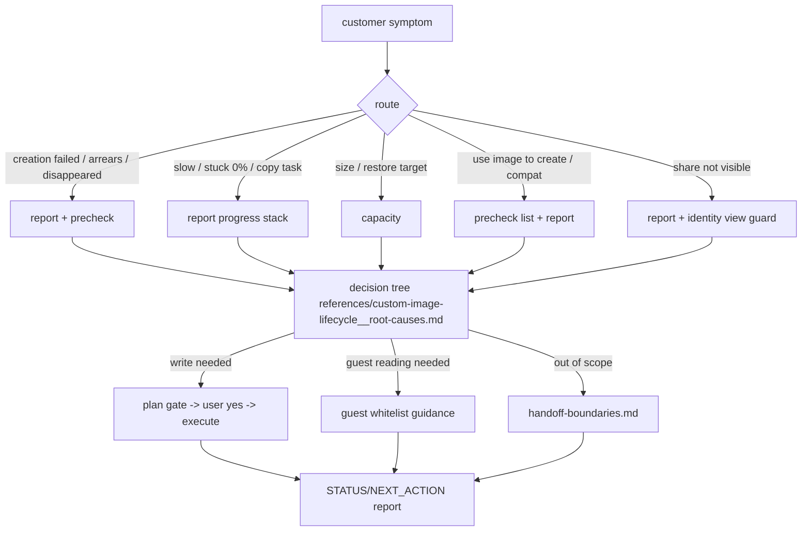

# ECS Custom Image Lifecycle Diagnosis

> **Delivery override - outranks every relay instruction and template below.** `STATUS`,
> `NEXT_ACTION` and their `OK` / `DEGRADED` / `FAIL` / `BLOCKED` values are the entry script's
> internal run state, not a delivery format. Where this document says to relay, mirror or copy
> those lines "faithfully" or "verbatim", relay their MEANING in the customer's own words: never
> write the keys or the bare values into the reply or into anything saved under `outputs/` or
> `ran_scripts/` (SKILL.md rule 3h). A layer this run did not read is named in the customer's own words - which layer, and what would have settled it.

Diagnose and guide the full custom-image chain on Alibaba Cloud ECS: "my
custom image creation failed", "the image has been at 0% for hours", "the
image is bigger than the target system disk", "I shared my image but the
other account cannot see it", "creating an instance from my image fails",
"my image copy task keeps failing", "can I make an image of an expiring
instance", "restore instance A onto instance B with an image".

Core approach: collect cloud evidence first (identity + image/snapshot/task/
disk/share queries through one entry script), route the symptom through the
decision tree in `references/custom-image-lifecycle__root-causes.md`, answer only from returned
values plus built-in knowledge, and run chain write actions ONLY through
the confirmation gate below. This skill never automates deletions or
commercial flows.

## Trigger Conditions

Mirrors the frontmatter (each phrase is one line, verbatim):

- "cannot create a custom image"
- "image stuck at 0% for hours"
- "image bigger than the system disk"
- "shared image not visible to receiver"
- "instance creation from my image fails"
- "image copy to another region fails"
- `IncorrectInstanceStatus`
- `QuotaExceeded.Snapshot`

Recognition-only signals that must NOT pull work into this skill (route per
`references/custom-image-lifecycle__handoff-boundaries.md`): Docker/ACR registry 401, marketplace
image vendor complaints, disk-space or inode exhaustion inside the guest,
instance start/stop state machine, refund/unsubscribe requests.

## Execution Principle (MANDATORY)

1. The agent MUST use `scripts/areas/custom_image_lifecycle/image_lifecycle_check.py` (single entry) for
   every cloud query and every gated action, and `scripts/areas/custom_image_lifecycle/sts_token.py` for
   a standalone identity check. The agent MUST NOT assemble `aliyun`
   command lines itself for this skill's data collection; a failing script
   degrades inside the script, it is not retried by hand-built calls.
2. Never conclude anything a query did not return. A failed or empty call
   becomes a limitation line, never a fabricated fact or a confident "does
   not exist" (run the view guards first, see Execution Flow).
3. Every final report ends with the script's `STATUS:` line value and its
   `NEXT_ACTION:` instruction, relayed faithfully.

## Credentials

- All authentication resolves through the aliyun CLI default credential
  chain. The scripts never read, print, cache or accept AccessKey/Secret
  material, and they never prompt for it. Do not add such parameters.
- If no credential is configured, tell the user to verify the default credential chain with `aliyun sts get-caller-identity`
  themselves; never ask them to paste keys into the chat.
- No credential cache file is created by this skill.

## User Confirmation (ABSOLUTE PROHIBITION on skipping the gate)

The five chain write actions -- `CreateImage`, `CopyImage`,
`ModifyImageSharePermission`, `ImportImage`, `ExportImage` -- may execute
ONLY like this:

1. Run `--mode plan --op <op>` WITHOUT `--confirm`. The script prints the
   gate card: WHAT runs (action + exact parameters), PURPOSE, IMPACT,
   REVERSIBILITY.
2. Relay that card to the user in your own words and ask "May I run this
   now?".
3. Only after an explicit yes: re-run the same command adding
   `--confirm USER-CONFIRMED`. One approval covers exactly one operation;
   any parameter change requires a fresh question.
4. Report the returned RequestId/ImageId/TaskId verbatim and read the
   result back with `--mode report`.

Preflight blocks (instance locked, snapshot not finished, same-source copy
task in progress, Windows image export, non-self-owned image) are final: a
blocked plan never executes, even with `--confirm`. Deleting images or
snapshots, cancelling tasks, starting/stopping instances, detaching or
releasing disks, refunding or unsubscribing are NEVER performed by this
skill, confirmed or not: give the console path and the risk notice
(deleted snapshots/images are unrecoverable; after deletion the instance
can no longer be re-initialized from that image) and let the human act.
The same gate covers in-guest commands (see In-Guest Rule below).

## API Whitelist (ABSOLUTE PROHIBITION on anything else)

Allowed, and only ever invoked from inside the entry script:

| Class | Actions (ECS, API version 2014-05-26; STS 2015-04-01) |
|---|---|
| Evidence queries (automatic) | DescribeImages, DescribeImageSharePermission, DescribeInstanceAttribute, DescribeDisks, DescribeSnapshots, DescribeTasks; STS GetCallerIdentity |
| Gated chain writes (plan mode + confirmed) | CreateImage, CopyImage, ModifyImageSharePermission, ImportImage, ExportImage |

Every other action of any product is strictly out of scope: the agent and
the scripts MUST NOT invoke it, including
delete/cancel/attach/detach/start/stop style verbs, and including writing
change commands "for the user to paste". The whitelist is mirrored
three-way in `related_apis.yaml` and `references/ram-policies.md`.

## In-Guest Rule

The scripts never execute anything inside a customer instance. When guest
readings are needed (mount state after a restore, data volume to explain
slow image creation), run `--mode guest`: it prints the inspection-only
whitelist (`df -h`, `df -i`, `du -sh`, `findmnt`, `stat`, `lsof +L1`;
Windows: `Get-Volume`, `Get-PSDrive`, inspection-only listings) and the rules:
tell the user what will run, that it changes nothing, get a yes per
command, then the user (or an approved console path) runs it and pastes
output. Anything outside the whitelist (NVMe driver presence, grub/EFI
inspection, sshd config, any mutation) is refused with manual steps from
`references/custom-image-lifecycle__console-guides.md` -- never pretend you looked. Windows
file-count conclusions carry the NTFS low-confidence note.

## Input Parameters

| Parameter | Meaning | If missing |
|---|---|---|
| region | source region of the image/instance | report/capacity/precheck auto-fill `cn-hangzhou` and DECLARE it; suggest `--all-regions` sweep |
| InstanceId | instance to image from / to inspect | precheck and capacity legs skipped; ask |
| ImageId | the image in question | needed for capacity, share checks, copy/export planning; ask |
| TargetInstanceId | instance being restored onto (capacity mode) | ask |
| DestRegion / DestName | copy-image target | ask |
| AccountIds | share-image receivers | ask (digit-string UID) |
| OS type | linux/windows for guest guidance | default linux, say so |
| OSS bucket/object | import/export targets | ask; export is additionally cost+licensing screened by preflight |

Declared auto-fills are mandatory in the report (region, destination image
name) per the anti-hallucination discipline.

## Orchestration

Module index (1:1 with `references/`):

| File | Content |
|---|---|
| references/custom-image-lifecycle__root-causes.md | scenario decision tables, hard rules, error-string table, anti-fabrication rules |
| references/custom-image-lifecycle__handoff-boundaries.md | boundary table, handoff phrases, shared-word arbitration |
| references/custom-image-lifecycle__console-guides.md | console entries, official docs map, import/export notes, in-guest command table |
| references/ram-policies.md | exact action list, minimal policies, grant guide |

## Execution Flow

### Step 1: Identity and view guard

Run `scripts/areas/custom_image_lifecycle/image_lifecycle_check.py --mode report --region <region>`
(with `--instance-id` / `--image-id` when known, `--all-regions` when the
customer says something "disappeared" or "not visible"). This also runs
the STS identity check internally.

### Step 2: Route the symptom

- creation failed / locked / arrears -> read report output, then
  `--mode precheck --instance-id <i>`.
- slow / progress -> report's three-layer stack (image status, snapshot
  progress, task rows); answer with the no-SLA mechanism text from the
  script findings; never an ETA.
- size question -> `--mode capacity --image-id  --target-instance-id
  <i> --region <r>`.
- use/compat question -> report + the compatibility precheck list in
  `references/custom-image-lifecycle__root-causes.md`; stock/offer questions degrade to the
  buy-page link.
- share not visible -> share evidence under the owner credential +
  `--image-owner-alias others` under the receiver credential.

### Step 3: Decide

Apply the tables in `references/custom-image-lifecycle__root-causes.md`. If the answer needs a
guest reading, `--mode guest`. If the answer is out of scope, the handoff
table.

### Step 4: Chain action (only if the customer wants one)

`--mode plan --op create-image|copy-image|share-image|import-image|export-image`
followed by the confirmation gate (see User Confirmation). Export of
Windows images and non-self-owned images is refused by design.

### Step 5: Report

Relay findings, evidence JSON, auto-fills, the degradation log, `STATUS`
and `NEXT_ACTION` (see Final Answer Contract).

## Observability

Every CLI invocation carries
`--user-agent AlibabaCloud-Agent-Skills/{skill-name}/{session-id} skill-version/{skill-version}` where
`{session-id}` is a random 32-character hex string (`uuid.uuid4().hex`)
generated once per script run, so all calls of one diagnosis correlate in
platform logs. The session-id is an anonymous run label: it contains no
account identifier, and nothing user-identifying is ever added to the UA.

## Data Flows and External Calls

This section declares every outbound data flow of the shipped code; the
skill contacts exactly these destinations and nothing else.

- **Alibaba Cloud ECS OpenAPI** (regional endpoints resolved by the CLI from
  the region parameter; plugin mode, API version 2014-05-26). The Python
  scripts never sign HTTP themselves: they invoke `aliyun` as a subprocess
  (argument list, never a shell string). What leaves the machine per call is
  the action name plus parameters (region id, resource ids, image names,
  receiver account UIDs for the gated share) and the per-run `--user-agent`
  observability label
  `AlibabaCloud-Agent-Skills/alibabacloud-ecs-high-frequency-issues/<session-id> skill-version/<skill-version>`
  (32-hex anonymous run id). Example command shape, built internally and
  never hand-assembled by the agent:

  `aliyun ecs describe-images --biz-region-id cn-hangzhou`

  Authentication is attached by the CLI from its own credential
  configuration; the scripts neither read, print, nor forward any key
  material, and every stderr envelope passes through a masking choke point
  (AccessKeyId/AccessKeySecret/SecurityToken/Signature values become ***).
- **Alibaba Cloud STS** (`sts.aliyuncs.com`, API version 2015-04-01,
  plugin-style lowercase-hyphenated product and action names). One identity
  check per run, no parameters, same User-Agent label, same masking. The
  exact command shape, built internally by the shared CLI layer:

  `aliyun sts get-caller-identity`

- No other network destination exists. Retry/timeout policy: 60 s per call,
  transient (throttling/5xx/timeout) errors retried 2x with backoff,
  everything else logged `[WARN] Code: Message` and the run continues.

## Error Handling

| Failure | Handling |
|---|---|
| `NoPermission` / `ImplicitDeny` | report exactly: "NoPermission - missing action: <action>; minimal policy snippet: references/ram-policies.md"; continue other legs; STATUS: DEGRADED |
| `IncorrectInstanceStatus` | state the lock/status evidence; never retry blindly |
| `QuotaExceeded.Snapshot` | snapshot inventory + manual cleanup guidance with dependency risk; never delete anything |
| `InvalidDiskId.NotFound` | re-check region/account view (identity line already in report) |
| Throttling / 5xx | auto-retried with backoff; if persistent, [WARN] line and DEGRADED |
| CLI missing / no credential | guided to `aliyun sts get-caller-identity`; STATUS: FAIL with the one-line fix |
| Script legs that failed | each becomes a limitation line; a never-fabricated rule, see Execution Principle 2 |

## Handoff Library (one line each; full table in references/custom-image-lifecycle__handoff-boundaries.md)

- OS-replace action itself failing -> area:instance-state-diagnosis
- disk full / inode exhausted -> area:disk-expand-diagnosis
- expanded disk not visible in OS -> area:disk-expand-diagnosis
- start/stop state machine -> area:instance-state-diagnosis
- image/snapshot bills, refunds -> billing & cost console flow (mechanism
  explanation stays here: images ride on billed snapshots)
- container registry auth/latency -> Container Registry product line
- marketplace image issues -> the image vendor
- delete anything -> never automated; console path + risk notice

## Final Answer Contract

The final answer MUST:

1. Start with the script Summary/Findings relayed faithfully, including the
   exact `STATUS:` value (OK | DEGRADED | FAIL).
2. Quote only ids/sizes/statuses/percentages that appear in the script
   output; never compute or invent.
3. Declare every auto-filled parameter (region, destination image name).
4. State which legs were not executed and why (confirmation pending,
   channel missing -> DEGRADED wording).
5. For any mutation: only via the confirmation gate; for out-of-scope
   requests: boundary sentence + console entry + handoff phrase instead of
   a fake fix.

## Important Notes

- An image is a view over snapshots: snapshots are billed by stored size;
  arrears beyond the retention window auto-release snapshots and dependent
  images die unrecoverably. The platform does not auto-back-up disks.
- Hard size law: target system disk >= image system-disk size; disks never
  shrink; replace-OS touches only the system disk (data disks remount
  manually); a NEW instance from an image carries the data disks selected
  at image creation; the list view shows only system size until done.
- Only ONE in-progress copy task per source image; the account concurrency
  counts different images; failed tasks may be invisible in the console --
  which is why `plan --op copy-image` pre-checks it.
- Creation/copy duration depends on data volume and regional snapshot peak
  load: explain, show live progress, promise no ETA (ticket-observed
  guidance: image an instance >=20 min after creation).
- Windows images cannot be exported for licensing reasons; export bills
  OSS storage; imports need the guest-internal precheck list because cloud
  queries cannot see drivers/boot mode.
- The script's decision functions carry boundary self-tests at import
  (asserts) so silent logic rot fails fast; keep them in any edit.

## Examples

1. User: "I clicked create image on my instance two days ago and it still
   says Creating, and yesterday the whole list showed nothing."
   -> `--mode report --region cn-shenzhen --instance-id i-... --all-regions`
   -> relay snapshot-progress findings, no-ETA mechanism, sweep result;
   STATUS from script.
2. User: "My old 100G image can't go onto the new 60G instance."
   -> `--mode capacity --region cn-hangzhou --image-id m-...
   --target-instance-id i-...` -> TOO_SMALL verdict with the GB delta;
   options per Important Notes.
3. User: "Copy my image to Singapore, it failed twice already."
   -> `--mode plan --region cn-hangzhou --op copy-image --image-id m-...
   --dest-region ap-southeast-1` -> same-source uniqueness preflight shown,
   gate card presented; execute only after the user says yes.

## Scripts

| File | Role |
|---|---|
| scripts/areas/custom_image_lifecycle/image_lifecycle_check.py | single entry: modes report / capacity / precheck / plan / guest; STATUS+NEXT_ACTION contract; argparse |
| scripts/areas/custom_image_lifecycle/sts_token.py | standalone identity check (plugin-mode command) |
| scripts/areas/custom_image_lifecycle/_cli.py | shared CLI layer: per-run 32-hex session-id User-Agent, timeouts, transient retry, credential masking, pagination |
| scripts/areas/custom_image_lifecycle/_constants.py | whitelists and embedded ticket-derived knowledge (no data files allowed under scripts/) |
| scripts/requirements.txt | standard library only |
