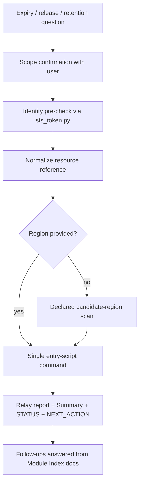

# ECS Expiry / Release / Data-Retention Diagnosis

> **Delivery override - outranks every relay instruction and template below.** `STATUS`,
> `NEXT_ACTION` and their `OK` / `DEGRADED` / `FAIL` / `BLOCKED` values are the entry script's
> internal run state, not a delivery format. Where this document says to relay, mirror or copy
> those lines "faithfully" or "verbatim", relay their MEANING in the customer's own words: never
> write the keys or the bare values into the reply or into anything saved under `outputs/` or
> `ran_scripts/` (SKILL.md rule 3h). A layer this run did not read is named in the customer's own words - which layer, and what would have settled it.

Answer lifecycle questions about Alibaba Cloud ECS instances that are
expiring, expired, stopped or released: when the instance stops, how long
its data is kept, what survives a release, whether billing continues, and
which options remain open. The skill is strictly read-only: it queries
live state with one entry script and explains rules and manual console
paths from `references/`; the customer performs every changing step.

## Execution Principle -- Absolute Rules

These rules override everything else in this file.

1. READ-ONLY BOUNDARY (ABSOLUTE PROHIBITION). The agent and every script
   of this skill only run Describe / Query / Get read operations. You are
   STRICTLY FORBIDDEN from executing, generating for execution, or
   scripting any mutating action -- verbs of the families Update*,
   Delete*, Disable*, Modify*, Create*, Rotate*, Set*, Release*, Renew*,
   Attach*, Detach*, Start*, Stop*, Reboot*, Reset*, Add*, Remove*,
   Unbind*, Revoke* -- against any instance, disk, snapshot, image or
   order. This prohibition also covers commands you might otherwise hand
   to the user: renewal, unsubscription, refund, expiry-extension and
   backup steps are explained from `references/` and performed by the
   customer in the console, never by this skill.
2. MANDATORY ENTRY POINT (CRITICAL -- MANDATORY EXECUTION). Every cloud
   query goes through `scripts/areas/expiry_release_retention/ecs_expiry_release_check.py` (identity
   helper: `scripts/areas/expiry_release_retention/sts_token.py`). You are STRICTLY FORBIDDEN from
   hand-building `aliyun` CLI calls, SDK snippets or direct HTTP requests
   for these APIs, and from switching execution backends. If a script
   run fails, DO NOT attempt manual workarounds or a CLI fallback -- the
   entry script already retries transient errors and degrades internally;
   report the failure instead.
3. EVIDENCE-BOUND REPORTING. Relay what the script prints; never invent
   identifiers, dates, prices or outcomes. Every lifecycle number keeps
   its source tag. The subscription post-expiry data-retention window is
   quoted only as "15 days [TO VERIFY: official confirmation pending]".
   It and the overdue-account snapshot-release rule are two DIFFERENT
   15-day rules and must never be mixed. Anything the API could not
   answer is reported as UNKNOWN, never as "none" or "no risk".
4. AUTO-FILL DECLARATION. Parameters the scripts auto-fill (account UID
   derived via STS, region found by the declared candidate-region scan,
   normalized resource id) must be restated in the final answer exactly
   where the script declares them (the "Auto-filled parameters" block).
   Ask the user when nothing can be auto-filled; never guess silently.

## Quick Start

```bash
# single instance / disk / snapshot check (region optional; a scan is declared)
python3 scripts/areas/expiry_release_retention/ecs_expiry_release_check.py --instance-ref <i-...|IPv4|name> [--region-id <region>] [--json]

# "what is expiring soon?" batch scan over subscription instances
python3 scripts/areas/expiry_release_retention/ecs_expiry_release_check.py --list-expiring --days 30 [--region-id <region>] [--json]

# parse a pasted expiry / release notification offline (no cloud calls)
python3 scripts/areas/expiry_release_retention/ecs_expiry_release_check.py --parse-notification "<notification text>" [--json]

# identity pre-check / account UID derivation
python3 scripts/areas/expiry_release_retention/sts_token.py [--json]
```

Every run ends with a `STATUS: OK|DEGRADED|FAIL` line and a `NEXT_ACTION:`
line. Exit codes: 0 = a conclusion exists (OK or DEGRADED); 1 = FAIL
(fix credentials or RAM grants, or supply the missing target, then
re-run); 2 = command usage error only.

## User Confirmation

Before running any script, confirm the scope with the user in one short
round: (a) the resource reference (instance id / IP / name, or a d-/s-/
m- id), (b) the region if known, (c) the question type (timeline,
charges, recoverability, point-in-time target, extension feasibility,
batch scan), and (d) state that the check is read-only and changes
nothing. Proceed only after the user confirms. A whole-account batch
scan (`--list-expiring`) is run only on explicit request.

## Credentials

Credentials are resolved exclusively by the aliyun CLI default credential
chain (environment variables or `~/.aliyun/config.json`) inside the
scripts' subprocess calls. The scripts never accept, read, print, cache
or transmit AccessKey pairs or STS tokens, and no explicit credential
handling exists in this skill: do NOT pass credential flags on any
command line, do NOT cat or echo profile files, and do NOT run
any command that prints credential or secret values.
Credential setup is a customer/platform-side step, never this skill's; when the identity
pre-check fails, the agent only hands over that guidance.

## Input Parameters

| Flag | Mode | Required | Notes |
|---|---|---|---|
| `--instance-ref` | single check | one target is required | instance id (`i-...`), public/private IPv4, or instance name |
| `--resource-ref` | single check | -- | disk `d-...`, snapshot `s-...` or custom image `m-...` entry; normalized to its instance where possible |
| `--region-id` | query modes | no | omitted => declared candidate-region scan; never a silent single default |
| `--target-time` | point-in-time | when asked | `YYYY-MM-DD[THH:MM[:SS]]`; naive input is treated as UTC and declared |
| `--intent` | single check | no | routing hint: expiry_timeline / stop_billing / recoverability / point_in_time / extension / backup_feasibility / unclassified |
| `--list-expiring` | batch | -- | explicit batch request only |
| `--days` | batch | no | window 1-365, default 30 |
| `--parse-notification` | offline | -- | pasted expiry / release notice; extracts ids / IPs / timestamps with no cloud calls |
| `--profile` | all | no | named aliyun CLI credential profile |
| `--json` | all | no | machine-readable report |

RAM prerequisites and the exact read-only action list:
[references/ram-policies.md](references/ram-policies.md).

## Trigger Conditions

Trigger this skill when a request involves any of: ecs expiry / expiring
soon, expired-and-stopped instance, instance released, vanished data
after release, data retention / retention window, recover after
release, snapshot survival, disk kept after release, auto-renew failed,
expired instance charging, stop billing after release, free trial ended,
spot instance reclaimed, expiry extension, unsubscription or refund
question about an expiring subscription instance. Do not use it for
new-purchase sizing, pure price quotes, network diagnosis, or OS-level
file recovery inside a running guest.

## Module Index

| File | Scope |
|---|---|
| [references/expiry-release-retention__lifecycle-rules.md](references/expiry-release-retention__lifecycle-rules.md) | Expiry -> stop -> retention -> release rules per billing form, with evidence tags |
| [references/expiry-release-retention__recoverability-matrix.md](references/expiry-release-retention__recoverability-matrix.md) | What survives a release (disks, snapshots, images, IPs) and the manual recovery paths |
| [references/expiry-release-retention__renewal-refund-extension.md](references/expiry-release-retention__renewal-refund-extension.md) | Renewal, unsubscription, refund and expiry-extension rules and manual console workflows |
| [references/expiry-release-retention__free-trial-and-spot.md](references/expiry-release-retention__free-trial-and-spot.md) | Free-trial package semantics and spot-instance reclamation / data retention |
| [references/ram-policies.md](references/ram-policies.md) | Minimal read-only RAM actions actually called by the scripts |

## Orchestration



## Execution Flow

1. Classify the intent and collect the resource reference; confirm the
   scope with the user as described in User Confirmation.
2. When identity or account scope is unclear, run
   `python3 scripts/areas/expiry_release_retention/sts_token.py`; on failure, give the user the
   credential / RAM guidance from the output and stop -- do not query on.
3. Run the single entry-script command that matches the request (Quick
   Start); pass `--target-time` for point-in-time questions and
   `--intent` when the customer's wording clearly maps to one.
4. Relay the script report to the user keeping its structure: header
   banner, numbered sections 1-13, the Graceful Degradation Log when
   present, the Auto-filled parameters block, the Summary, and the final
   STATUS and NEXT_ACTION lines.
5. Answer follow-up questions strictly from the Module Index files;
   keep each source tag with each quoted rule; route every changing
   action to its manual console workflow.
6. Before sending, verify the answer contains the relayed report
   sections, the declared auto-filled parameters and the STATUS /
   NEXT_ACTION lines; if any is missing, append it explicitly. Never
   present raw JSON unless the user asked for `--json` output.

## What the Script Does Internally (for understanding output only -- do not run manually)

The entry script verifies the caller via `aliyun sts get-caller-identity`
(plugin mode), then issues read-only queries -- DescribeInstances,
DescribeInstancesFullStatus, DescribeInstanceAutoRenewAttribute,
DescribeDisks, DescribeSnapshots -- and one billing-side expiry
cross-check, QueryAvailableInstances (its RAM action is
`bss:DescribeInstances`, see the RAM file). Every call carries the
observability header below, a bounded timeout, transient-error retries
(3 attempts) and pagination guardrails; failures degrade to UNKNOWN
with a logged warning.

## Observability

- Every cloud call runs through `scripts/areas/expiry_release_retention/_cli.py`, which appends
  `--user-agent AlibabaCloud-Agent-Skills/{skill-name}/{session-id} skill-version/{skill-version}` so
  all calls of one diagnosis correlate server-side.
- The session-id is a 32-character lowercase hex string produced by
  `uuid.uuid4().hex`, generated once per run and cached; the
  `SKILL_SESSION_ID` environment variable can pin one id across several
  runs of the same diagnosis.
- Degradations print `[WARN]` lines to stderr and stdout and are repeated
  in the report's "Graceful Degradation Log" section.
- Output contract: each run ends with `STATUS: OK|DEGRADED|FAIL` and
  `NEXT_ACTION:`; `--json` emits the structured report with the same
  fields.

## Historical Instance / Order Lookup (Product Limitation)

Ticket `T-C8616E0C` (2026-09): a customer who remembered only the public/private IP
address and the instance name of an already-released ECS instance could not locate
it in the console or in the order system, and the exported order data did not match
their records.

- Order management search accepts **order ID or instance ID only**. IP address and
  instance name are not search keys; telling the customer to search by IP or name
  sends them in a loop.
- Exported order rows print the instance ID in an abbreviated form. Match on the
  full instance ID (from the console instance list) or ask for the order ID.
- When only an IP or a name is available, explain the lifecycle and retention rules
  from this area, then ask for the order ID or instance ID. Never report "no such
  record" as a finding: the limitation is in the search key, not in the account.

## Important Notes

- Failure circuit-breaker: on exit code 1, stop and report; do not
  re-run in a loop and never fall back to hand-built CLI commands.
- Timeouts / bounds: every external call has a 60 s timeout
  (`DEFAULT_TIMEOUT` in `scripts/areas/expiry_release_retention/_constants.py`); pagination is capped
  (20 pages per ECS query family, 5 pages for the billing cross-check).
- The retention and extension constants (15-day retention window with
  its TO-VERIFY tag, the separate 15-day overdue snapshot release rule,
  the one-day / one-instance / once-per-year extension limit) live in
  `scripts/areas/expiry_release_retention/_constants.py`; quote them together with their tags.
- Cloud Backup (HBR) and custom-image inventories have no verified read
  API at this tier: the scripts never call them and always report
  UNKNOWN with console guidance.
- No intermediate files or caches are written; keep all output in the
  conversation.

## Examples

1. "My subscription instance i-2ze0example stopped yesterday right after
   it expired. How long do I have before its data is gone, and will I
   still be charged meanwhile?"
2. "I got an SMS saying my ECS free trial ends at 2026-09-03T23:59Z.
   Will the instance be deleted automatically, and what should I do
   beforehand? Message text: ..."
3. "Which of my subscription instances in cn-hangzhou expire within the
   next 30 days, and which ones have auto-renewal turned off?"
