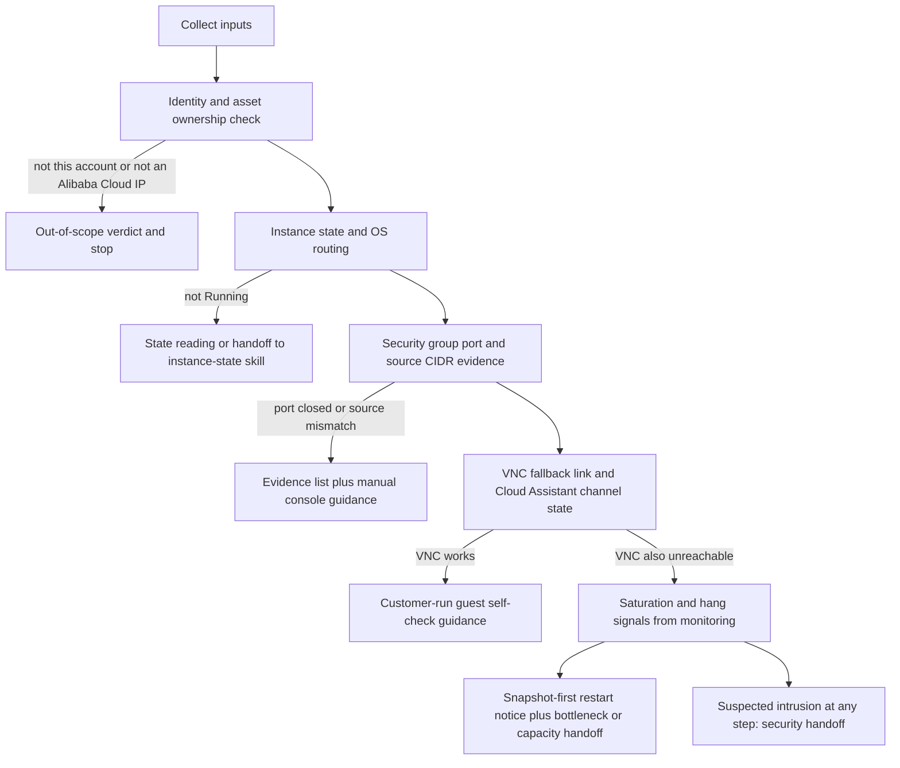

# ECS Remote Connection Entry Triage

> **Delivery override - outranks every relay instruction and template below.** `STATUS`,
> `NEXT_ACTION` and their `OK` / `DEGRADED` / `FAIL` / `BLOCKED` values are the entry script's
> internal run state, not a delivery format. Where this document says to relay, mirror or copy
> those lines "faithfully" or "verbatim", relay their MEANING in the customer's own words: never
> write the keys or the bare values into the reply or into anything saved under `outputs/` or
> `ran_scripts/` (SKILL.md rule 3h). A layer this run did not read is named in the customer's own words - which layer, and what would have settled it.

First-stop triage for "I cannot connect to my ECS instance" tickets where the customer does not name the protocol (SSH or RDP) or the failing layer. **Two core capabilities only:**

1. **Entry triage (protocol unspecified)** — collect six classes of read-only cloud evidence in one run, split by protocol (Linux -> SSH, Windows -> RDP), split by layer (asset ownership / instance state / security group / fallback channel / guest service / resource saturation), and emit an evidence-based first diagnosis with next-step guidance.
2. **Client-tool comparison triage** — structure the VNC / command-line / GUI-tool cross-test matrix (Xshell, FinalShell, MobaXterm, Xftp, WinSCP, PuTTY, bastion host cases) so tool-side and local-network-side causes are separated from cloud-side causes.

Deep-dive areas (instance state machine, disk IO, disk capacity, disk expansion, security incidents) are **identified and handed off**, never diagnosed here. This skill is strictly read-only on the cloud side and never executes anything inside the customer's instance or on the customer's computer: guest checks are printed as commands **for the customer to run themselves** and paste back.

## Absolute Rules

1. **CRITICAL — MANDATORY EXECUTION:** All evidence collection MUST go through the single entry script `scripts/areas/remote_connection_entry/ecs_remote_connection_triage.py`. You MUST NOT run individual `aliyun` CLI commands, hand-write helper scripts, or call APIs directly. If the script fails, report its error output — do NOT attempt manual workarounds; the entry script handles error recovery internally.
2. **ABSOLUTE PROHIBITION (read-only enforcement):** Never generate, write, or execute any command or script that calls a mutating or command-execution action — any `Create*`, `Delete*`, `Modify*`, `Update*`, `Put*`, `Attach*`, `Detach*`, `Add*`, `Remove*`, `Reset*`, `Release*`, `Import*`, `Revoke*`, `Bind*`, `Unbind*`, `Reboot*`, `Start*`, `Stop*`, `Run*`, `Invoke*` operation — including "change commands for the user to paste" produced through this skill. Adding security-group rules, restarting instances, resetting passwords and creating snapshots are **manual console actions by the customer only**; this skill outputs the steps plus the risk notice, nothing more.
3. **API WHITELIST (read-only):** The only permitted OpenAPI actions are `ecs:DescribeInstances`, `ecs:DescribeSecurityGroupAttribute`, `ecs:DescribeCloudAssistantStatus`, `ecs:DescribeInstanceVncUrl`, `sts:GetCallerIdentity` and the CloudMonitor read `cms:DescribeMetricLast` (its RAM permission point is named `cms:QueryMetricLast` — API name and RAM name differ). Anything outside this whitelist must never be called; the shared CLI layer rejects it structurally. The same six actions are declared identically in three places — `API_WHITELIST` in `scripts/areas/remote_connection_entry/_constants.py` (runtime guard), `related_apis.yaml` (registration), and `references/ram-policies.md` (the minimal policy) — and a disagreement between them is a defect. The monitoring pre-screen queries only the single well-documented `cpu_total` metric and never passes unverified metric names; `--skip-metrics` drops it entirely and the saturation check falls back to symptom evidence.
4. **ABSOLUTE PROHIBITION (credentials):** The skill never asks for, receives, stores, tests or uses the instance password, private key or any Alibaba Cloud AK/SK from the user. Credential problems are answered with console reset guidance only. Authentication uses the aliyun CLI default credential chain exclusively.
5. **NO FABRICATION:** Every conclusion must trace to a script output field, embedded reference knowledge, or a fact the customer pasted in. Missing data is reported as `N/A` with the reason — never invent API values, error codes, CIDRs or metric readings.
6. **EXECUTION RULE FOR ERRORS:** Any failed evidence call MUST leave a `[WARN] <Code>: <Message>` line on stderr (credentials masked) and the run MUST continue with the remaining evidence, ending in a `STATUS: DEGRADED` report. Never silently skip a step; never abort the whole diagnosis because one read-only query failed.

## Quick Start — the one sanctioned command

```bash
cd scripts && python3 ecs_remote_connection_triage.py \
  --region-id <region-id> --instance-id <i-instance-id> \
  [--public-ip <ip>] [--egress-ip <customer-egress-ip>] \
  [--port <22|3389|custom>] [--protocol ssh|rdp|auto] \
  [--client-tool <xshell|winscp|putty|finalshell|securecrt|xftp|mobaxterm|bastion>] \
  [--error-text "<error quoted by the customer>"] \
  [--console-ok] [--intrusion-suspect] [--skip-metrics] [--json]
```

Read the report, relay its `Summary`, verdict and `STATUS` / `NEXT_ACTION` lines verbatim. `python3 sts_token.py --json` may be run first for the account identity label.

## Execution Principle

The Agent only maps natural language to the entry-script flags and relays the script report. All API access lives inside `scripts/` (argument-list subprocess, per-call timeout, retry with backoff, credential masking, whitelist guard). No second entry point exists: helper modules `_cli.py` and `_constants.py` are internal (`_` prefix), `sts_token.py` is an identity pre-check, and the triage script is the only diagnostic runner. Empty or not-found results are valid findings — report them honestly and stop; never react to an empty result with a write.

## Credentials

- Credentials are resolved automatically by the aliyun CLI default credential chain (environment variables injected by the platform, or the local CLI config profile). Never read, print, pass or cache AK/SK/STS tokens explicitly, and never accept them from the user.
- Not allowed: any command that prints credential values, echoing any credential value, credential parameters on the command line. Error text from the CLI passes through one masking choke point that replaces credential key-value pairs with `***`.
- If `sts:GetCallerIdentity` fails with a credential error, abort and guide the user (or operator) to verify the default credential chain with `aliyun sts get-caller-identity` — that is the only sanctioned credential action in this skill's flow.

## User Confirmation

This skill performs read-only cloud queries only, so no per-call confirmation is required for evidence collection. Confirmation discipline applies at three gates:

1. **Scope restatement:** before the first run, restate the target (instance id / public IP, region) and that only read-only queries will be made against it. If the target or region is ambiguous, ask once and wait.
2. **Manual-change boundary:** whenever the fix is a change (add a security-group rule, restart the instance, reset the password, create a snapshot), output manual console steps plus the fixed risk notice (business off-peak, stop application writes and flush data first, snapshots bill separately, a stop normally finishes within 10-15 minutes without manual intervention) and let the customer act — the skill never triggers changes.
3. **Guest-command boundary:** guest checks are printed for the **customer to run inside their own session (e.g. via VNC)** and paste back; the skill never sends commands to the instance.

## Trigger Conditions

Mirror the `description` triggers — match the customer's symptom wording, not root-cause vocabulary:

- "cannot remotely connect to ECS" / "remote connection failed" / "can't connect to my server" (protocol never named)
- "SSH connection timed out", "connection refused", "Connection reset by peer"
- "Could not connect to ... (port 22): Connection failed" (Xshell/Xftp style)
- "Xshell MobaXterm failure", "WinSCP PuTTY login error", "FinalShell cannot connect", "SecureCRT / Termius fails"
- "bastion host cannot connect", "console can connect but local tool cannot"
- "remote desktop cannot connect" (RDP, Windows) — as long as the ask is "cannot connect", not instance boot trouble

## Input Parameters

| Parameter | Flag | Required | Description |
|---|---|---|---|
| region_id | `--region-id` | Yes | Region of the instance, e.g. `cn-hangzhou`. Ask when unknown; never guess. |
| instance_id | `--instance-id` | One of the pair | ECS instance id (`i-...`). |
| public_ip | `--public-ip` | One of the pair | Public IP to reverse-look-up when the customer only gives an IP. |
| egress_ip | `--egress-ip` | Recommended | Customer's local egress IP (guide `curl cip.cc`); used for the security-group source-CIDR match. |
| port | `--port` | No | Target port; defaults by OS (Linux SSH 22, Windows RDP 3389). Custom SSH ports (e.g. 10022) pass through. |
| protocol | `--protocol` | No | `ssh` / `rdp` / `auto` (auto = decide from OS type). |
| client_tool | `--client-tool` | No | Tool in use, routes the comparison matrix. |
| error_text | `--error-text` | No | Error string quoted by the customer; matched case-insensitively against the embedded English signature catalog. When the customer writes in another language, pass the equivalent documented English signature wording (see [references/remote-connection-entry__error-signatures.md](references/remote-connection-entry__error-signatures.md)) and carry the semantics with the explicit flags instead. |
| console_ok | `--console-ok` | No | Set when the customer confirms console/VNC login **does** work. This is the decisive fork: it separates tool-side and local-network causes from cloud-side ones, and enables the overdue-bandwidth signature. |
| intrusion_suspect | `--intrusion-suspect` | No | Set when the customer suspects an attack or reports an unknown login, in any language. Routes straight to the security handoff and hardening checklist instead of continuing connection triage; do not rely on English `--error-text` matching for this. |
| skip_metrics | `--skip-metrics` | No | Drop the CloudMonitor saturation pre-screen (e.g. the monitoring read is not authorized). Saturation is then judged from symptoms only and the report says so. |

**Auto-fill declaration:** any defaulted value (port, protocol) MUST be declared in the reply, e.g. "Port auto-defaulted to 22 from the Linux OS type". UID is auto-derived via the identity pre-check and is only a traceability label — auto-fill first, ask second.

## Orchestration



Numbered run order in the next section; every step degrades independently.

## Execution Flow

1. **Scope confirmation** — restate target and region; ask once if missing (see User Confirmation gate 1). No API call before this.
2. **Identity pre-check** — run `python3 scripts/areas/remote_connection_entry/sts_token.py --json` (or rely on the entry script's own step 1); on credential failure, guide them to verify the default credential chain with `aliyun sts get-caller-identity` and stop.
3. **Entry-script run** — `python3 scripts/areas/remote_connection_entry/ecs_remote_connection_triage.py ...` (single command, no `cd`; run from the skill root) with the flags from Input Parameters. The script performs, in order: caller identity, instance resolution (`ecs:DescribeInstances` by id, then by public IP, then by EIP), state/OS routing, security-group evidence (`ecs:DescribeSecurityGroupAttribute` per bound group), VNC fallback link (`ecs:DescribeInstanceVncUrl`), Cloud Assistant state (`ecs:DescribeCloudAssistantStatus`), and the latest CPU reading (`cms:DescribeMetricLast`).
4. **Relay the report** — verdict section, evidence section, degradation log, then `STATUS:` and `NEXT_ACTION:` lines. Relay them faithfully; add no invented numbers.
5. **Guidance output** — per verdict, print the matching next steps: manual console actions with the risk notice, and/or the customer-run guest self-check command list, and/or the client-tool comparison matrix, and/or the keepalive parameter template.
6. **Handoff output** — when the evidence points at another area, emit the handoff sentence naming the target check (instance-state / bottleneck / disk-expand / capacity) or the security channel.
7. **Interpret pasted-back output** — if the customer pastes guest command results, interpret them against `references/remote-connection-entry__guest-selfcheck-commands.md` and conclude; still no writes, ever.
8. **Script failure circuit breaker** — non-zero exit with `STATUS: FAIL`: report `NEXT_ACTION` (usually the missing input or the credential problem). Never fall back to hand-assembled CLI calls.

## What the Script Does (for understanding the report only — do not run manually)

Step 3 above already runs everything. The report fields mean: `instance` = lifecycle status, OS type, public/EIP/private addresses, bound security groups; `security_group` = per-rule port range, protocol, policy, priority and source CIDR with a `source_mismatch` flag when `--egress-ip` is given; `channels` = VNC URL and Cloud Assistant online/offline state; `monitoring` = latest `cpu_total` average with a saturation flag; `verdict` = the decision-tree leaf from `references/remote-connection-entry__triage-tree.md`; `degradations` = every `[WARN]` that occurred, with the missing RAM action where relevant.

## Module Index

| Module | File | Responsibility |
|---|---|---|
| M1: Triage tree | [references/remote-connection-entry__triage-tree.md](references/remote-connection-entry__triage-tree.md) | Full decision tree S0-S5 plus the handoff routing table and handoff sentences |
| M2: Error signatures | [references/remote-connection-entry__error-signatures.md](references/remote-connection-entry__error-signatures.md) | Customer-quotable error/symptom strings mapped to branches |
| M3: Security group checklist | [references/remote-connection-entry__securitygroup-checklist.md](references/remote-connection-entry__securitygroup-checklist.md) | Port + source-CIDR verification procedure and evidence reading |
| M4: Guest self-check commands | [references/remote-connection-entry__guest-selfcheck-commands.md](references/remote-connection-entry__guest-selfcheck-commands.md) | Read-only commands the CUSTOMER runs (sshd, firewalls, logs) and how to read them |
| M5: Help links | [references/remote-connection-entry__help-links.md](references/remote-connection-entry__help-links.md) | Official documentation links for connection methods, VNC, credentials, atop, swap, snapshots |
| M6: RAM policies | [references/ram-policies.md](references/ram-policies.md) | Minimal read-only RAM actions actually called by the scripts |

## Observability

All OpenAPI calls carry the User-Agent template `AlibabaCloud-Agent-Skills/{skill-name}/{session-id} skill-version/{skill-version}`, where `{skill-name}` is `alibabacloud-ecs-high-frequency-issues` and `{session-id}` is a **32-character lowercase hex string** (`uuid.uuid4().hex`) generated once per script run and attached to every CLI invocation of that run via `--user-agent`, so all calls of one diagnosis correlate server-side. The shared CLI layer implements this automatically (lazy generation, cached for the run); no per-script option can disable it.

## Error Handling

**EXECUTION RULE FOR ERRORS:** every error below is logged `[WARN] <Code>: <Message>` to stderr (masked), evidence collection continues, and the report ends `STATUS: DEGRADED` with the gap named.

| Symptom / code | Meaning | Handling |
|---|---|---|
| `NoPermission` / `ImplicitDeny` | Missing RAM read action | Name the missing action, point to [references/ram-policies.md](references/ram-policies.md), continue with remaining evidence |
| `InvalidInstanceId.NotFound` | Id wrong, wrong region, or wrong account | Ask the user to recheck region/account; do not search other regions silently |
| Credential chain failure | CLI not configured | Guide `aliyun sts get-caller-identity`; never collect AK/SK |
| `Throttling.User`, `InternalError`, `ServiceUnavailable` | Transient | Auto-retried up to 3 attempts with backoff; then degrade with `[WARN]` |
| VNC link unavailable | Instance not Running or permission gap | Skip the fallback channel section, state why |
| `cms:DescribeMetricLast` failure | Monitoring gap | Saturation check falls back to symptom-based judgment, stated in the report |

## Output Contract (MANDATORY)

The final answer MUST: (1) lead with the script `Summary`; (2) quote only values present in the script output or customer input, with `N/A` where absent; (3) declare every auto-filled parameter and its source; (4) end with the script's `STATUS: OK|DEGRADED|FAIL` and `NEXT_ACTION:` lines relayed verbatim; (5) keep every remediation as manual guidance — never claim a change was made. If the four contract elements are missing from a draft answer, append them before sending.

## Important Notes

- **Read-only scope:** only the whitelisted `Describe*` / `GetCallerIdentity` / `DescribeMetricLast` queries run; the whitelist is enforced in code, not just in prose.
- **Never collect passwords or keys.** The support-desk pattern "send me the password privately and I test it" is explicitly out of bounds; guide the customer to the console credential reset instead, and note that some credential changes take effect only after an in-console restart.
- **Asset ownership first.** An IP that resolves to no instance under the caller's account/region ends the diagnosis with the out-of-scope sentence (it may belong to another provider or another account) — do not query other regions to hunt for it.
- **Console-vs-local is the decisive fork:** "VNC works, local tool fails" routes to tool/local-network causes; "nothing works" routes to cloud-side layers. The script output feeds this matrix.
- **Stop-stuck reading:** a stopping instance normally finishes within 10-15 minutes without manual intervention; beyond that is the instance-state area, hand off.
- **Snapshot-first before any restart advice:** always include that snapshots bill separately and the restart is done by the customer in the console.
- **Suspected intrusion** (unknown logins, "we are attacked"): do not continue connection triage as the narrative; emit the hardening checklist and the security-channel handoff in `references/remote-connection-entry__triage-tree.md`.
- **Account-overdue pattern** (console login fine, public SSH/RDP dead, pay-as-you-go bandwidth): guide the customer to check the billing console balance themselves; this skill has no overdue-query API and never asserts the cause as fact.

## Examples

**Example 1 — generic failure, protocol unnamed**
> User: "I can't connect to my server i-bp1abcdef in cn-hangzhou, it just times out."

Run the Quick Start command with `--region-id cn-hangzhou --instance-id i-bp1abcdef --error-text "SSH connection timed out"`, relay the verdict (e.g. security-group source mismatch), list the evidence, and give the manual fix steps.

**Example 2 — client tool only**
> User: "Xshell says Could not connect to 39.108.190.9 (port 22): Connection failed, but the console VNC is fine."

Run with `--public-ip 39.108.190.9 --client-tool xshell --protocol ssh`; the OS-type split, security-group evidence and the comparison matrix (VNC ok + CLI ok + tool fails -> tool/local side: proxy/VPN/hotspot test, alternate client, keepalive template) are relayed from the report.

**Example 3 — saturation hang**
> User: "SSH times out and every panel is dead, cpu was pinned yesterday."

Run with the instance id; when the report shows the CPU saturation flag plus "all ports unreachable" symptoms, relay the snapshot-first restart guidance and the handoff sentence to `area:resource-bottleneck`.

## Available Scripts

| Script | Purpose |
|---|---|
| `scripts/areas/remote_connection_entry/ecs_remote_connection_triage.py` | Single entry point: full read-only evidence collection + verdict report (`STATUS` / `NEXT_ACTION` contract) |
| `scripts/areas/remote_connection_entry/sts_token.py` | Caller identity pre-check via `aliyun sts get-caller-identity`; derives the UID traceability label |
| `scripts/areas/remote_connection_entry/_cli.py` | Internal shared CLI layer (whitelist guard, UA, retry, timeout, masking) — imported only |
| `scripts/areas/remote_connection_entry/_constants.py` | Embedded constants (API whitelist, ports, metric names, signature catalog) — imported only |

Exit codes: `0` = report produced (`STATUS: OK` or `STATUS: DEGRADED`), `1` = no usable conclusion (`STATUS: FAIL`, `NEXT_ACTION` says what is missing), `2` = argparse usage error only.
