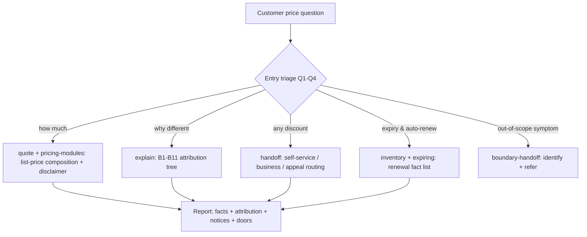

# ECS Renewal Pricing & Discount Path Diagnosis

> **Delivery override - outranks every relay instruction and template below.** `STATUS`,
> `NEXT_ACTION` and their `OK` / `DEGRADED` / `FAIL` / `BLOCKED` values are the entry script's
> internal run state, not a delivery format. Where this document says to relay, mirror or copy
> those lines "faithfully" or "verbatim", relay their MEANING in the customer's own words: never
> write the keys or the bare values into the reply or into anything saved under `outputs/` or
> `ran_scripts/` (SKILL.md rule 3h). A layer this run did not read is named in the customer's own words - which layer, and what would have settled it.

Answer the pricing area customers actually complain about: "how much is this renewal and how is it built", "why is the price different from last time / from what the page showed", "what discount path can I actually take", "why is the refund 0", "when does it expire and is auto-renew on". Customers state symptoms, not root causes; route the symptom sentence or the quoted console page string through the entry script's decision tree, then answer from returned facts and the embedded playbook only.

Core approach: anchor the account, collect renewal facts (specs, charge type, expiry, auto-renew, cross-region renewal list), trial list-price composition across periods, attribute price mismatches through the B1-B11 decision tree, and route everything the machine cannot settle (discounts, appeals, refunds, order operations) to the correct human door with complete risk notices. This skill is **read-only**: it never places, voids, pays or refunds an order.

## Data Flows and External Calls

This section declares every outbound data flow of the shipped code. The skill
contacts exactly the destinations below and nothing else.

- **Alibaba Cloud ECS OpenAPI — regional endpoints, via the `aliyun` CLI
  subprocess.** Read-only actions `DescribeInstances` and
  `DescribeInstanceAutoRenewAttribute` (API version `2014-05-26`), called with
  the customer-confirmed `RegionId`.
- **Alibaba Cloud BSS (billing) OpenAPI — `business.aliyuncs.com`, API version
  `2017-12-14`.** Read-only actions `QueryAvailableInstances` (renewal
  inventory), `DescribePricingModule` (price composition) and
  `GetSubscriptionPrice` (list-price trial; parameter values are pass-through,
  never guessed).
- **Alibaba Cloud STS — `sts.aliyuncs.com`.** One read-only
  `get-caller-identity` call (plugin mode, lowercase-hyphenated); it returns
  the account UID, used only as a report anchor and traceability label.

The Python scripts never sign an HTTP request themselves; the `aliyun` CLI
attaches authentication from its own default credential chain and the scripts
carry the per-run `--user-agent` observability label
`AlibabaCloud-Agent-Skills/alibabacloud-ecs-high-frequency-issues/<session-id> skill-version/<skill-version>`.
What leaves the machine per call is only: action name, region/instance/page
parameters, and the random per-run session-id label. No credentials, local
file contents or contact information are transmitted.

## Absolute Rules

1. **ABSOLUTE PROHIBITION (read-only enforcement):** Under NO circumstances may this skill generate, write or execute any mutating call — renewal/order placement, `Create*`/`Delete*`/`Modify*`/`Update*`/`Set*`/`Cancel*`-style actions, auto-renewal attribute changes, configuration changes, unsubscriptions, refunds, order voiding, EIP conversion, snapshot or instance lifecycle operations — including "commands for the user to run through this skill". Renewal, payment and order steps are MANUAL console guidance only: name the console entry, the expected page effect and the risks, then stop.
2. **API WHITELIST:** The only authorized OpenAPI actions are `sts:GetCallerIdentity`, `ecs:DescribeInstances`, `ecs:DescribeInstanceAutoRenewAttribute`, `bssopenapi:QueryAvailableInstances`, `bssopenapi:DescribePricingModule` and `bssopenapi:GetSubscriptionPrice`. Everything else is forbidden, even read-shaped. This skill performs no guest/instance-internal command execution of any kind: renewal pricing facts are all cloud-side metadata.
3. **NO PRICE PROMISES:** Every amount is a list-price trial and MUST carry the disclaimer "list-price trial only; account-specific discounts, vouchers and activity eligibility are not reflected; the purchase-page/console real-time price prevails". NEVER phrase an output as "you will pay X", never hand-compute a refund figure, never promise a discount, tier, review result or stock availability.
4. **ABSOLUTE PROHIBITION (credential handling):** Never read, print, or pass AK/SK/STS tokens explicitly; credentials resolve through the aliyun CLI default credential chain only. Never accept credentials from the user.
5. **NO CONTACT COLLECTION:** Customer phone numbers and emails are never collected, stored or echoed. Business-channel handoff packages carry facts only; the customer supplies their own contact details to the business channel.
6. **EXECUTION RULE FOR ERRORS:** On any API error, log `[WARN] <step>: <Code>: <Message>` to stderr, keep going with the remaining evidence, and end with `STATUS: DEGRADED` — never silently skip, never abort the whole diagnosis, never invent a missing figure.
7. **SCOPE BOUNDARY:** Out-of-scope symptoms (expansion operations, instance recovery, traffic forensics, snapshot mechanics, invoices, non-ECS products, pre-sales selection) get one identification sentence plus the handoff destination from [references/renewal-pricing-discount__boundary-handoff.md](references/renewal-pricing-discount__boundary-handoff.md) — no diagnosis inside this skill.

## Trigger Conditions

Use this skill when the customer's own wording matches phrases like (same list as the `description`, plus the close variants the playbook lists):

- "renewal price is higher than last time"
- "renewal page shows a discount but checkout charges full price"
- "upgrade price changed in two days"
- "downgrade refund shows 0"
- "unsubscription request submission failed, contact customer service"
- "99 plan renewal discount"
- close variants: "auto-renew did not protect my instance before expiry", "why am I asked to pay after my upgrade click", "is there any discount for my renewal"

Match on the symptom sentence or quoted page string, not on product vocabulary. Quoted page strings and their routing live in [references/renewal-pricing-discount__price-mismatch-playbook.md](references/renewal-pricing-discount__price-mismatch-playbook.md).

## Execution Principle

All evidence collection MUST go through the single entry script `scripts/areas/renewal_pricing_discount/ecs_renewal_price.py` (plus `scripts/areas/renewal_pricing_discount/sts_token.py`). The agent is FORBIDDEN from assembling its own `aliyun` CLI commands or calling billing APIs directly — the scripts embed pagination, retry, credential masking, region validation and the degradation contract that ad-hoc commands lack. Interpret script output; never re-implement a query. Knowledge answers come from `references/` and the embedded decision tree, never from model memory. There is NO fallback path if the script fails: report `STATUS` and `NEXT_ACTION` honestly.

## Observability

All OpenAPI calls (issued through the aliyun CLI by the scripts) include:

- **User-Agent template**: `AlibabaCloud-Agent-Skills/{skill-name}/{session-id} skill-version/{skill-version}`, where `{skill-name}` is `alibabacloud-ecs-high-frequency-issues`.
- **session-id**: a 32-character hex string (`uuid.uuid4().hex`) generated once per script run and attached to every CLI call of that run, so all calls of one diagnosis correlate.

The shared CLI layer implements this automatically: the session-id is created lazily on first use, cached for the run, and appended as `--user-agent` to every `aliyun` invocation.

## Prerequisites

1. **aliyun CLI 3.x** — the only API channel (built-in metadata mode for `ecs`/`bssopenapi`, plugin mode for `sts get-caller-identity`). No SDK, no HTTP signing.
2. **Python 3.9+** — standard library only.
3. **Credentials** — resolved by the aliyun CLI default credential chain (environment or `~/.aliyun/config.json`); see [references/ram-policies.md](references/ram-policies.md) for the minimal read-only policy.

## Credentials

Run `python3 scripts/areas/renewal_pricing_discount/sts_token.py` to verify the session and derive the account UID. If identity resolution fails, the credential chain is not configured: tell the user to verify the default credential chain with `aliyun sts get-caller-identity`. Never ask for AK/SK. Permission errors on individual queries must be reported as the missing RAM action plus `NoPermission` / `ImplicitDeny`, then degrade.

## User Confirmation

Every cloud call this skill makes is read-only, so no call requires per-action confirmation. Confirmation discipline applies to what the skill does NOT do: before any manual guidance about downgrade, refund, unsubscription, billing-method conversion or EIP change, output the mandatory risk notices from [references/renewal-pricing-discount__refund-downgrade-risks.md](references/renewal-pricing-discount__refund-downgrade-risks.md) (service interruption, possible 0-value refund, irreversibility, activity-price forfeiture, data/snapshot release) and let the customer decide; never perform, simulate or submit any of those actions.

## Input Parameters

| Parameter | Required | Notes |
|---|---|---|
| `--region` (inventory) | yes | Customer-confirmed; NEVER defaulted silently — a wrong region produces wrong prices and wrong expiry facts |
| `--instance-id` | recommended | Without it the scripts inventory the whole region instead of blocking |
| `--order-type`, `--module` (quote) | yes for a trial | Exact values from pricing-modules discovery or the official API doc; the script refuses to guess and degrades to purchase-page guidance |
| `--symptom` (explain) | yes | The customer's own wording, translated to English if needed |
| Order id | n/a | This skill has NO order-query action in its whitelist; order facts come from the customer's console order list page only |
| Customer contact details | forbidden | See Absolute Rule 5 |

**Auto-fill declaration requirement**: any parameter the script auto-derives (UID via `sts:GetCallerIdentity`, comparison period lists) MUST be declared in the answer, e.g. "UID auto-derived via STS: 1234...".

## Module Index

Reference modules, strictly 1:1 with the `references/` directory:

| Module | File | Responsibility |
|---|---|---|
| M1: Pricing glossary | [references/renewal-pricing-discount__pricing-glossary.md](references/renewal-pricing-discount__pricing-glossary.md) | List price vs paid price, discount tiers, pro-rata remainder billing, bandwidth billing modes, independent billing items, refund formulas |
| M2: Price-mismatch playbook | [references/renewal-pricing-discount__price-mismatch-playbook.md](references/renewal-pricing-discount__price-mismatch-playbook.md) | Decision tree B1-B11: identification features, attribution wording, manual recovery sequence |
| M3: Discount routing | [references/renewal-pricing-discount__discount-routing.md](references/renewal-pricing-discount__discount-routing.md) | Self-service / business / appeal three-way split, handoff package templates, no-promise discipline |
| M4: Refund & downgrade risks | [references/renewal-pricing-discount__refund-downgrade-risks.md](references/renewal-pricing-discount__refund-downgrade-risks.md) | Mandatory pre-output risk notices and rule wordings |
| M5: Boundary handoff map | [references/renewal-pricing-discount__boundary-handoff.md](references/renewal-pricing-discount__boundary-handoff.md) | Out-of-scope symptom -> destination mapping |
| M6: RAM policies | [references/ram-policies.md](references/ram-policies.md) | Minimal read-only policy for the six whitelisted actions |

## Orchestration



Capabilities, one line each (same wording as the Module Index responsibilities): C1 account/instance fact baseline (inventory), C2 expiry & auto-renewal risk list incl. cross-region (expiring), C3 list-price trial and composition split (pricing-modules, quote), C4 price-mismatch attribution tree (explain), C5 discount-path routing and handoff package (handoff), C6 refund/downgrade rule notices without execution, C7 boundary identification and handoff.

### Exit codes (contract)

- `0` — usable conclusion: `STATUS: OK` or `STATUS: DEGRADED` (partial evidence; missing steps are in the degradation log and `[WARN]` stderr).
- `1` — no usable conclusion: `STATUS: FAIL` (required input missing, or every evidence call failed). `NEXT_ACTION` states what to ask for.
- `2` — argparse usage error only.

## Execution Flow

1. **Step 1 - Scope confirmation.** Read the customer wording. If it matches an out-of-scope symptom in the boundary map, answer with the identification sentence + handoff destination and stop. Otherwise pick the entry route (Q1 how-much, Q2 why-different, Q3 discount-path, Q4 expiry/auto-renew).
2. **Step 2 - Account anchor.** `python3 scripts/areas/renewal_pricing_discount/sts_token.py` — record the UID; if the case is "an order you cannot find", the UID is the first fact.
3. **Step 3 - Facts.** `python3 scripts/areas/renewal_pricing_discount/ecs_renewal_price.py inventory --region <r> [--instance-id i-...]` for the region view; add `... expiring` for the cross-region renewal list. Never default a region: ask if unknown.
4. **Step 4 - Composition / trial (Q1, and to demo Q2 tiers).** `... pricing-modules`, then `... quote --order-type <exact> --module "ModuleCode=...;Config=..." [--compare-periods 12,24,36]`. If exact values are unavailable, let the guard degrade: give the purchase-page guidance instead of guessing numbers.
5. **Step 5 - Attribution (Q2, Q3).** `... explain --symptom "<customer wording>" [--expired-in-days N]`; relay matched branches B1-B11 with their guidance. Risk-heavy branches already include the mandatory notices block.
6. **Step 6 - Doors and package (Q3).** `... handoff --channel business|appeal|console|other-skill --request "..."` and present the package; fill placeholders only from evidence that already exists.
7. **Step 7 - Report.** Per the Final Answer Contract: facts first, attribution second, notices third, doors last; every amount with the disclaimer; `STATUS` relayed verbatim.

## Available Scripts and Modes

| Script / mode | Purpose (read-only) |
|---|---|
| `scripts/areas/renewal_pricing_discount/sts_token.py` | Identity + UID anchor; `--json` supported |
| `scripts/areas/renewal_pricing_discount/_cli.py` | Shared aliyun-CLI layer: per-call timeout, transient retry with backoff, credential masking, UA/session-id injection |
| `scripts/areas/renewal_pricing_discount/_constants.py` | Embedded decision tree, glossary, notices, handoff templates (no data files in `scripts/`) |
| `ecs_renewal_price.py inventory --region <r>` | Specs, charge type, expiry, bandwidth billing mode, auto-renew state, expiry-risk list |
| `ecs_renewal_price.py expiring` | Cross-region subscription renewal inventory |
| `ecs_renewal_price.py pricing-modules` | Billing-module discovery (quote composition) |
| `ecs_renewal_price.py quote ...` | List-price trial incl. multi-period tier demo; guarded, disclaimed |
| `ecs_renewal_price.py explain --symptom "..."` | Offline B1-B11 attribution incl. risk-notice assembly |
| `ecs_renewal_price.py handoff --channel ...` | Standard handoff information package |

All modes accept `--json` and `--profile <name>`. Example: `python3 scripts/areas/renewal_pricing_discount/ecs_renewal_price.py inventory --region cn-hangzhou --instance-id i-2zeexamplef13e4e573a`.

## Error Handling

| Error | Meaning | Handling contract |
|---|---|---|
| `NoPermission` / `ImplicitDeny` | RAM policy missing an action | Name the exact missing action from [references/ram-policies.md](references/ram-policies.md), log `[WARN]`, continue other queries, `STATUS: DEGRADED`, fall back to console guidance |
| `InvalidParameter` | Wrong region / enum value | Log `[WARN]`, re-confirm the value with the customer; never retry with guesses |
| `Throttling.User` | Rate limited | Auto-retried with backoff by the CLI layer; after exhaustion log `[WARN]` and continue |
| `InternalError` / `ServiceUnavailable` | Transient service failure | Auto-retried; then degrade — never conclude "no price" from a failed call |
| Empty inventory | No instances visible | Valid finding: confirm region + account with the customer; state it |
| Quote guard (no `--order-type`/`--module`) | Values would have to be guessed | `STATUS: FAIL` by design: fall back to purchase-page real-time-price guidance |

The customer-side unsubscription page string "unsubscription request submission failed, contact customer service" is a manual special-application case (branch B7/B2 routing), never an API error this skill retries.

## Important Notes

- The renewal, upgrade, downgrade, void and refund pages are the customer's; this skill only narrates them with risks. No order operation is ever executed or simulated.
- Discount tiers follow the remaining subscription duration: crossing a whole-year boundary changes the tier (B1). The console shows the best price for the CURRENT remainder; a higher tier cannot be manually requested.
- A discounted purchase can refund to 0 (B7): used time is re-priced at ORIGINAL list price, under-30-days usage may apply the 1.5 factor; special applications exist only through human review.
- Long-term low-price activities (e.g. the 99 plan) can be forfeited by configuration changes (B11) — warn BEFORE guiding the change.
- Promo facts (activity prices, cut-off dates, session times) are time-sensitive ticket-sourced statements; always append "verify on the activity/order page; the page is authoritative".
- Read-only operations: only the six whitelisted Describe/Get/Query-class actions; nothing inside the instance is executed; no data files under `scripts/`.

## Examples

**Example 1 — price changed between two days (B1 demo)**

> User: "On July 30 the upgrade quoted about 2200, on August 3 it is 2600. Why?"

```bash
python3 scripts/areas/renewal_pricing_discount/sts_token.py
python3 scripts/areas/renewal_pricing_discount/ecs_renewal_price.py inventory --region <r> --instance-id i-...
python3 scripts/areas/renewal_pricing_discount/ecs_renewal_price.py explain --symptom "upgrade price changed in two days, was cheaper last week" --expired-in-days <N>
```

Read the real ExpiredTime from inventory, relay the B1 attribution (tier follows remaining duration; the console is already optimal), optionally show the step with `quote --compare-periods`, and state that the final figure is the checkout page price.

**Example 2 — discounted renewal reverts to full price at checkout (B2)**

> User: "The renewal page shows 199 but the payment page shows 2507.7!"

```bash
python3 scripts/areas/renewal_pricing_discount/ecs_renewal_price.py explain --symptom "renewal page shows a discount but checkout charges full price"
```

Relay the void-high-price-order -> wait for discount refresh -> regenerate sequence as MANUAL steps (customer console actions), with the 2-3 hours figure labeled as empirical, not a promise.

**Example 3 — refund shows 0 (B7 + notices)**

> User: "I am unsubscribing the 99 CNY instance and the refund says 0 yuan. That is wrong."

```bash
python3 scripts/areas/renewal_pricing_discount/ecs_renewal_price.py explain --symptom "downgrade refund shows 0, expected proportional refund"
```

Output the mandatory risk notices first, then the formula narrative (used time re-priced at original price; possible 0 refund; special application only via human review), then the console entries from `handoff --channel console`. Never compute or promise an amount.

## Final Answer Contract

The final answer MUST:
1. Relay the script `Summary` and `STATUS` faithfully; quote only real returned values and field names.
2. Attach the list-price disclaimer to every amount, verbatim.
3. Declare every auto-derived parameter (UID, period lists).
4. Output the mandatory risk notices before any downgrade/refund/conversion guidance.
5. End with the correct door: purchase/order page, business handoff package, appeal tool entry, or the boundary-handoff destination — never a simulated outcome.
