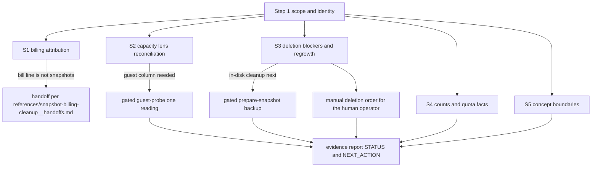

# ECS Snapshot Billing Attribution and Cleanup

> **Delivery override - outranks every relay instruction and template below.** `STATUS`,
> `NEXT_ACTION` and their `OK` / `DEGRADED` / `FAIL` / `BLOCKED` values are the entry script's
> internal run state, not a delivery format. Where this document says to relay, mirror or copy
> those lines "faithfully" or "verbatim", relay their MEANING in the customer's own words: never
> write the keys or the bare values into the reply or into anything saved under `outputs/` or
> `ran_scripts/` (SKILL.md rule 3h). A layer this run did not read is named in the customer's own words - which layer, and what would have settled it.

This skill answers four connected customer questions with cloud-side evidence:
why ECS snapshots keep being charged, which region, disk and snapshot entries
the invoice line bills, whether a snapshot can be deleted, and why capacity
keeps coming back after a deletion. The invoice line carries the label
`SnapshotLink Capacity (Size)` (customers also call it "snapshot chain
capacity"); the report maps that label onto per-region, per-disk evidence.

This skill is NOT limited to observation: besides the five list calls it can
perform exactly two confirmation-gated actions (one snapshot backup of one
named disk, one information-only guest reading through Cloud Assistant). It
never removes, releases, uninstalls or otherwise destroys anything: snapshot,
image and policy removal always stays a human console action, matching how
support engineers handle these cases. Match on customer symptom wording and
quoted error strings; the script's decision tree does the routing.

## In-Scope Customer Symptoms

| What the customer says | Branch |
| --- | --- |
| "Snapshots are charged every month / how is the snapshot fee calculated" | S1 billing attribution |
| "The bill shows snapshot chain capacity but I find no snapshots" | S1 + no-snapshot proof |
| "My disk shows X GB used, why does the snapshot take many times more" | S2 capacity lenses |
| "Can't delete snapshot / the delete button is greyed out" | S3 deletion blockers |
| "Deleted the snapshots but the charge is back / still coming" | S3 regrowth sources |
| "There are 1000+ snapshots on one disk / is every one billed" | S4 counts and quota facts |
| "Is a snapshot the same as a backup, image, file backup, OSS copy" | S5 concept boundaries |
| "My OSS resource package does not cover the snapshot bill" | S1 deduction facts |

## ABSOLUTE PROHIBITION: destructive operations are never executed here

This skill MUST NOT generate, write, execute, suggest-as-executable or
otherwise cause any destroying or reconfiguring cloud call. The prohibited
classes include `Delete*`, `Deregister*`, `Cancel*`, `Modify*`, `Release*`,
`Reset*`, `Replace*`, `Rollback*`, `Attach*`, `Detach*`, `Revoke*`,
`Terminate*`, `Reboot*`, `Start*`, `Stop*`, `Invoke*` and every other action
outside the whitelist rendered in the table below. This holds even when the
customer insists "just delete them all for me".

Equally prohibited:

* Any guest-side change: file removal, truncation, moving, unmounting,
  releasing, formatting, partitioning, service or process control, reboots.
  Requests containing `rm`, `mv`, `dd`, `truncate`, `kill`, `systemctl`,
  redirection `>` or command chaining are rejected by the scripts themselves.
* Wrapping a human-only console step inside a runnable command. Deletion
  guidance is printed as prose steps with console entry, never as a command.
* Commercial actions: arrears waiver, coupons, quotations, cancellation,
  back-office batch removal. These are recognized and routed to human staff.

Only two non-observation dispatches exist, both behind the confirmation gate
of the User Confirmation section:

| Product | Action | Version | Class | Purpose |
| --- | --- | --- | --- | --- |
| ecs | `DescribeSnapshots` | 2014-05-26 | evidence | enumerate entries per region/disk |
| ecs | `DescribeDisks` | 2014-05-26 | evidence | disk-size lens, orphan detection |
| ecs | `DescribeInstances` | 2014-05-26 | evidence | region, OS kind, instance state context |
| ecs | `DescribeImages` | 2014-05-26 | evidence | which custom image blocks a deletion |
| ecs | `DescribeInvocations` | 2014-05-26 | evidence | fetch ONE gated guest reading result |
| ecs | `CreateSnapshot` | 2014-05-26 | gated backup | pre-cleanup safety net on one disk |
| ecs | `RunCommand` | 2014-05-26 | gated dispatch | ONE whitelisted guest reading |
| sts | `GetCallerIdentity` | 2015-04-01 | identity | account proof, traceability label |

## Execution Principle (MANDATORY)

* The ONLY permitted way to touch the cloud in this skill is
  `python3 scripts/areas/snapshot_billing_cleanup/snapshot_billing_report.py`. The agent MUST NOT hand-assemble
  `aliyun` commands, invent action or parameter names, or probe with trial
  calls. Actions are PascalCase API names passed by the script; product codes
  stay lowercase (`ecs`, `sts`) as the script emits them.
* The scripts refuse anything outside the eight-action whitelist before
  execution, so a bypass attempt fails closed.
* Evidence-first: every conclusion quotes API-returned values only. A field
  that did not come back renders as `not returned`; reasonable defaults are
  not allowed. Every parameter the run auto-filled is declared in the report.
* No price estimates, quotations or forecasts, even when asked directly: the
  official billing document and the price calculator entry are relayed
  instead. Fee existence, region and owner are proven from evidence; amounts
  stay on the human bill pages.
* The three capacity lenses (billed chain capacity / provisioned disk size /
  file-system visible usage) are labeled on every line that uses one.
* "Snapshot" and a backup point of another product are never mixed in one
  statement.

## Credentials

Credential material is never requested, read, stored, echoed or passed by
this skill. The locally configured CLI resolves the principal through its
default chain, and `aliyun sts get-caller-identity` (run by the operator) is the only
refresh path, including its credential-free assistant modes. A failed or
mismatched identity surfaces as the account label plus manual guidance; the
run never asks a customer for keys. Reports carry the account label with only
the last four digits of the account id, so they can be pasted into a case
without leaking data.

## User Confirmation

The gate in `scripts/areas/snapshot_billing_cleanup/snapshot_billing_report.py` is deterministic and MUST be
respected:

1. Before any gated dispatch, the agent presents the notice the script prints
   (what runs, which region, which instance or disk, whether it only reports
   information, whether and how it is reversible).
2. The customer explicitly approves that exact notice.
3. Only then the identical command line is re-run with `--user-confirmed`
   plus `--confirmation-scope "<region> <target> <action> approved"`. The
   script verifies the scope text names this run's region and target.
4. One approval authorizes exactly one action. Approvals are never cached,
   reused or broadened. A declined or unanswered notice means the degraded,
   manual-guidance path only.

The same notice-then-confirm discipline applies to writing the optional
candidate list file under `/tmp` (new file only; existing files are refused).

## Trigger Conditions

Use this skill when the customer wording matches (or translates to) any
phrase below; all eight phrases mirror the description and MUST stay in sync
with it:

* snapshot charged every month
* can't delete snapshot, delete button greyed out
* still charged after deleting snapshots
* snapshot size larger than disk used space
* snapshot chain capacity billing item
* OSS resource package not deducting snapshots
* too many snapshots, snapshot count limit
* rejected with IncorrectInstanceStatus

Inode wording is only an accessory: accept `inode exhausted`, `file count
limit` and `cannot create new file` as guest-usage cross-check hints, and
route inode cleanup itself to `area:disk-expand-diagnosis`.

## Input Parameters

| Parameter | Required | Notes |
| --- | --- | --- |
| `--region-id` (repeatable) | yes (except `--check-auth-only`) | never guessed; for "all regions" asks, first check the ECS overview page listing every region holding snapshots, then pass each region |
| `--instance-id` | no | narrows evidence; needed by guest-probe mode |
| `--disk-id` | no | narrows evidence; needed by prepare-snapshot mode |
| `--snapshot-id` | no | analyze one specific entry |
| `--scope` | no | auto/region/instance/disk |
| `--billing-cycle` | no | `YYYY-MM`, a human cross-check label only; no billing API is called |
| `--symptom` | no | billing / delete / size-gap / quota / concepts routing hint |
| `--mode` | no | report (default) / guest-probe / prepare-snapshot |
| `--user-confirmed`, `--confirmation-scope` | gated modes | see User Confirmation |

The agent MUST ask the customer for a missing region instead of inventing one.

## Orchestration

The entry script owns every branch decision above; the agent only maps the
customer sentence onto parameters and relays the script output.

## Execution Flow

1. Confirm scope: region(s) (never guessed), the account in question (identity
   line settles "wrong account" suspicion), and which symptom branch applies.
2. Run the entry script in report mode for the named regions.
3. Relay the rendered sections: per-region evidence, per-disk chains, deletion
   blockers, regrowth assessment, fact anchors, quota notes.
4. If, and only if, the file-system lens is contested, walk the User
   Confirmation gate, then run guest-probe mode for ONE whitelisted reading.
5. If in-disk cleanup will follow to shrink future usage, run the
   prepare-snapshot gate first (one disk). For snapshot removal itself, no
   backup is created: deliver the delete/keep lists plus the human
   double-check instead.
6. End with the script's `STATUS:` and `NEXT_ACTION:` lines copied verbatim;
   route every out-of-scope thread with the handoff sentences.

## Observability

Each skill run generates one session id, a 32-character lowercase hex string
from `uuid.uuid4().hex`, and attaches it to EVERY single CLI call through the
CLI's own `--user-agent` parameter (the script appends it automatically; the
agent never builds these commands).

* **User-Agent template**:
  `AlibabaCloud-Agent-Skills/{skill}/{session-id} skill-version/{skill-version}`
* **Resolved example** for this skill:
  `AlibabaCloud-Agent-Skills/alibabacloud-ecs-high-frequency-issues/3f2b7c9d4e1f8a6b5c0d9e2f1a6b5c0d`
* The session id and the full User-Agent value appear in the report's
  collected-parameters section; `python3 scripts/areas/snapshot_billing_cleanup/snapshot_billing_report.py
  --check-auth-only` prints the identity plus a sample of the UA value, which
  is enough to verify the mechanism.

## Report Contract

The script renders the final answer banner (skill name + session id), the
collected parameters, the evidence sections and closes with exactly one
status line and one action line:

| Status | Meaning | Exit code |
| --- | --- | --- |
| `OK` | all needed evidence collected | 0 |
| `DEGRADED` | partial evidence, pending gate, paging or assistant gaps (`[WARN]` explains) | 1 |
| `FAIL` | invalid parameters, total collection failure, refused dispatch | 2 |

Missing values render as `not returned`. Suggestions are always manual
console guidance; nothing in the report is an executable cloud change.

## Error Handling

* Permission denial: reported with the literals `NoPermission` or
  `ImplicitDeny`, naming the missing action; recovery is the minimal policy
  fragment in [references/ram-policies.md](references/ram-policies.md), then
  re-run the identical command.
* Bill shows snapshot charges, enumeration returns nothing: the no-snapshot
  proof section combines the account label with the empty result and points
  to remaining regions or the ECS overview page; account-ownership questions
  are routed out.
* A gated backup refused because the instance is in a transitional state
  (customer-visible string `IncorrectInstanceStatus`): the error is reported
  verbatim, the run stops, and the instance-state handoff sentence applies.
* Cloud Assistant unavailable or guest reading unsupported: `DEGRADED` plus
  the operator-paste fallback (ask the customer to run `df -h` and paste).
* Feature wording the documentation does not settle (policy cross-region
  capability, archive or cold snapshot types): the skill states only what
  references/ proves and routes the rest per handoffs.

## Module Index

* [references/snapshot-billing-cleanup__snapshot-billing-decision-tree.md](references/snapshot-billing-cleanup__snapshot-billing-decision-tree.md)
  -- S0-S5 branch rules, the three capacity lenses, billing vocabulary and the
  unit-price citation policy.
* [references/snapshot-billing-cleanup__snapshot-dependency-and-deletion.md](references/snapshot-billing-cleanup__snapshot-dependency-and-deletion.md)
  -- deletion blocker mapping, the manual unblocking order, delete/keep list
  templates, the four "still charging after deletion" causes.
* [references/snapshot-billing-cleanup__resource-package-deduction.md](references/snapshot-billing-cleanup__resource-package-deduction.md)
  -- what deducts snapshot storage, in which order and with which limits.
* [references/snapshot-billing-cleanup__guest-diagnostics.md](references/snapshot-billing-cleanup__guest-diagnostics.md)
  -- the guest-reading whitelist, one-per-call rule, notices and the
  degraded fallback.
* [references/snapshot-billing-cleanup__concept-boundaries.md](references/snapshot-billing-cleanup__concept-boundaries.md)
  -- snapshot vs image vs backup vs file backup vs OSS, quota existence facts.
* [references/snapshot-billing-cleanup__handoffs.md](references/snapshot-billing-cleanup__handoffs.md) -- out-of-scope signals
  with ready handoff sentences.
* [references/ram-policies.md](references/ram-policies.md) -- exact action
  list, minimal policy, denial recovery.
* [related_apis.yaml](related_apis.yaml) -- the verified API manifest the
  scripts actually call.
* `scripts/areas/snapshot_billing_cleanup/snapshot_billing_report.py` -- single entry point and report
  renderer.
* `scripts/areas/snapshot_billing_cleanup/sts_token.py` -- identity check and account traceability label.
* `scripts/areas/snapshot_billing_cleanup/_cli.py` -- shared transport layer: observability, retry, masking, timeout.
* `scripts/areas/snapshot_billing_cleanup/_constants.py` -- decision-tree tables and whitelists, embedded as
  constants rather than data files.

## Important Notes

1. Snapshots bill by capacity and duration, per region; released or stopped
   instances do not clean them up automatically.
2. Chain capacity is not the sum of entries; entries are not the disk usage;
   disk usage is not file-system usage. Every report line names its lens.
3. The billed chain total per disk is read from the console chain view or
  the ECS overview; this skill never fabricates it from entry counts.
4. A custom image is built on snapshots: image creation adds snapshot entries
   silently, and image removal without its linked snapshots keeps the bill.
5. Deleting a snapshot is irreversible; the skill outputs lists and order, a
   human double-checks and deletes in the console, region by region.
6. Policy existence, policy-disk attachment and retention together decide
   whether deleted capacity regrows; all three are checked before recommending
   any batch removal.
7. Deduction follows: standard-LRS OSS storage package first, then SCU, then
   pay-as-you-go; same region, standard snapshots only, usage after purchase
   only; savings plans never deduct snapshots.
8. The 100 GiB free quota belongs to the file backup essential edition, not
   to snapshots.
9. No service switch exists to "close" snapshots; the charge stops when the
   last entry is gone.
10. Cross-region replication fees and policy frequency changes are other
   tiers' territory: identify, then hand off.
11. `STATUS:` and `NEXT_ACTION:` must be relayed verbatim; the agent must not
   reinterpret them.
12. The optional candidate file never overwrites: a fresh
   `/tmp/snapshot-cleanup-candidates-<name>.json` path or nothing.

## Examples

* "My bill shows a snapshot chain capacity charge every month but I already
  deleted everything last week." -> report mode over the candidate regions,
  `--symptom delete`; the regrowth section names the surviving region, the
  auto-type regrowth source or the settlement lag.
* "Why is my 200 GB snapshot only 12 GB of files inside?" -> report mode with
  `--disk-id`, then one gated `df -h` guest reading to complete the
  three-lens table.
* "There are 1200 snapshots on one disk, which ones can I safely remove?" ->
  report mode `--symptom quota`; chains plus blockers drive the delete/keep
  lists; removal itself is manual, in the documented order.
