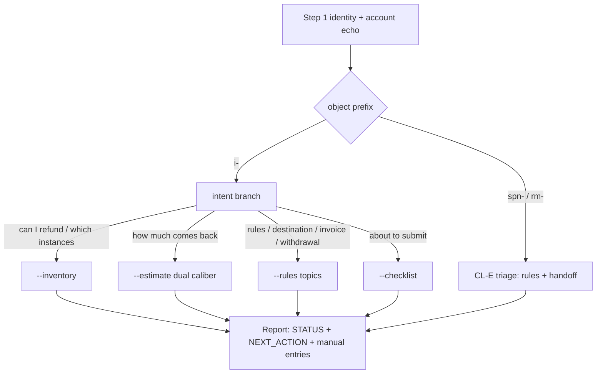

# ECS Unsubscribe & Refund Guide

> **Delivery override - outranks every relay instruction and template below.** `STATUS`,
> `NEXT_ACTION` and their `OK` / `DEGRADED` / `FAIL` / `BLOCKED` values are the entry script's
> internal run state, not a delivery format. Where this document says to relay, mirror or copy
> those lines "faithfully" or "verbatim", relay their MEANING in the customer's own words: never
> write the keys or the bare values into the reply or into anything saved under `outputs/` or
> `ran_scripts/` (SKILL.md rule 3h). A layer this run did not read is named in the customer's own words - which layer, and what would have settled it.

Customer-side guidance for unsubscribing Alibaba Cloud ECS instances and understanding refunds: "I want a refund / to give back my server", "cancel my order and get money back", "five-day no-reason refund", "is the downgrade refund revocable", "will the money come back to my balance / can I withdraw it", "can the savings plan be unsubscribed", "did my refund request actually get submitted".

Core approach: confirm the caller's account first (account confusion is the #1 dead-loop root cause), then either (1) inventory which instances in THIS account are unsubscribable with charge-type / expiry / five-day-window interpretation, (2) compute a consumed-amount REFERENCE from the billing cycle and state the dual amount caliber honestly, (3) answer fixed refund-rule questions from the embedded provenance-labeled corpus, or (4) emit the mandatory five-point pre-submission notice and the six-item confirmation checklist. The refund itself is a commercial action: this skill NEVER submits, cancels or refunds anything -- it ends at evidence + rules + manual entry.

## Data Flows and External Calls

- **Alibaba Cloud BSS OpenAPI** (`business.aliyuncs.com`, HTTPS, API version
  `2017-12-14`): read-only queries `QueryAvailableInstances` (order-side
  ledger), `QueryInstanceBill` and `DescribeInstanceBill` (consumed-amount
  reference), `QueryCashCoupons` (vouchers at risk on refund).
- **Alibaba Cloud ECS** (regional endpoints, API version `2014-05-26`):
  read-only `DescribeInstances` (live charge type, status, expiry).
- **Alibaba Cloud STS** (`sts.aliyuncs.com`, API version `2015-04-01`):
  `GetCallerIdentity` for the account pre-check (UID used as a traceability
  label only).
- Calls are executed as `aliyun` CLI subprocesses from `scripts/` with
  argument lists (never shell), per-call timeout, retry-with-backoff on
  transient errors, credential-value masking on all error text, and the
  per-run User-Agent observability label described under Observability.
  Credentials are resolved solely by the CLI default chain; the scripts
  never read, print or forward any AccessKey, Secret or token. Order numbers
  are relayed masked (e.g. `20**...**85`). No non-Alibaba destination is
  contacted; no file is written.

## Absolute Rules

1. **ABSOLUTE PROHIBITION (read-only enforcement):** Under NO circumstances
   generate, write or execute any command or script that calls a mutating
   OpenAPI -- any action whose name begins with Create, Delete, Modify,
   Update, Put, Attach, Detach, Release, Renew, Reset, Start, Stop, Reboot,
   Replace, Authorize or Set -- INCLUDING commands "for the user to run
   manually" through this skill. Refund, unsubscription, order cancellation,
   invoice red-letter reversal, balance withdrawal and account closure are
   commercial actions: output manual steps + risk notice ONLY, never perform
   them.
2. **API WHITELIST:** the ONLY permitted OpenAPI actions are the read-only
   `sts:GetCallerIdentity`, `bssopenapi` `QueryAvailableInstances` /
   `QueryInstanceBill` / `DescribeInstanceBill` / `QueryCashCoupons`, and
   `ecs` `DescribeInstances`. Anything outside this whitelist is prohibited,
   even if it looks read-only.
3. **ABSOLUTE PROHIBITION (credentials):** never read, print or pass
   AccessKey / Secret / STS tokens explicitly; the default credential chain
   resolves everything. On `NoPermission` / `ImplicitDeny` name the missing
   action and point to [references/ram-policies.md](references/ram-policies.md).
4. **NO FABRICATION + MANDATORY DEGRADED:** refundable-residual value, the
   invoiceable-amount figures, the yearly no-reason usage count, campaign
   re-eligibility, withdrawal approval and unsubscription-request status have
   NO query API in this whitelist. For any of them output
   `STATUS: DEGRADED`, state the item has no query basis, give the manual
   entry -- never invent a number or verdict.
5. **MANDATORY AMOUNT CALIBER:** every figure relayed to the customer must
   carry both lines `ESTIMATE=<consumed reference>` and
   `AUTHORITATIVE=<value shown on the refund page>`. The refund page (and
   the actual credited amount) is the only authority; a consumed-amount
   total is never an answer to "how much do I get back".
6. **MANDATORY PRE-SUBMISSION NOTICE:** before guiding any submission, the
   full five-point notice plus six-item confirmation checklist from
   `scripts/areas/unsubscribe_refund/ecs_unsubscribe_refund.py --checklist` must be output verbatim
   (one-time relay; all six items answered before an assisted request).
7. **EXECUTION RULE FOR ERRORS:** every API failure is logged
   `[WARN] <Code>: <Message>` on stderr, recorded in `errors[]`, and the run
   continues with the remaining queries; the report is still produced with
   the data at hand.

## Execution Principle

CRITICAL -- MANDATORY EXECUTION: all diagnostics run through the single
entry `scripts/areas/unsubscribe_refund/ecs_unsubscribe_refund.py`. The Agent is strictly prohibited
from assembling raw `aliyun` CLI commands, calling the APIs ad hoc, or
importing the internal `_cli.py` / `_constants.py` directly -- the entry
embeds pagination, retry, degradation, masking and observability that ad-hoc
commands lack, and the platform mocks intercept the CLI layer it drives. If
the entry script errors, do NOT hand-work around it: relay its `STATUS` /
`NEXT_ACTION`. Knowledge questions are answered from the script's
`--rules` output or `references/`, never from model memory.

## Trigger Conditions

Use this skill when the customer's own wording matches one of these phrases
(the same list the `description` advertises):

- "ECS refund"
- "unsubscribe my instance"
- "cancel the order and refund"
- "five day no reason refund"
- "downgrade refund cancel"
- "savings plan unsubscribe"
- "refund goes to balance"
- `InvalidInstanceId.NotFound` (the customer pasted a query error)
- `Throttling.User` (the customer pasted a query error)

Match on the symptom sentence or pasted error, not on product vocabulary.
"Renewal price", "why is this item on my bill", "when does an expired
instance auto-release", "trial expiry stop-billing" and "convert to
pay-as-you-go" are DIFFERENT tiers -- hand off per the description's Do-NOT
list. If the request degrades into disk-full / instance-boot / IO issues,
hand off to the diagnosis skills of those domains instead of running any
guest command (this skill never enters the instance).

## Observability

All OpenAPI calls (invoked through the aliyun CLI by the scripts) include:
- **User-Agent template**: `AlibabaCloud-Agent-Skills/{skill-name}/{session-id} skill-version/{skill-version}`,
  where `{skill-name}` is `area:unsubscribe-refund`.
- **session-id**: a 32-character hex string (`uuid.uuid4().hex`) generated
  once per script run and attached to every CLI invocation of that run via
  `--user-agent`, so all calls of one diagnosis correlate. The shared CLI
  layer implements this lazily on the first call and caches it per run.

## Prerequisites and Credentials

1. **aliyun CLI 3.x** -- the only API channel (built-in metadata mode for
   `bssopenapi` / `ecs`, plugin mode `aliyun sts get-caller-identity` for
   STS). No SDK, no HTTP signing.
2. **Python 3.9+**, standard library only (see `scripts/requirements.txt`).
3. **Credentials** -- resolved automatically by the aliyun CLI default
   credential chain (environment or `~/.aliyun/config.json`). Never ask the
   user for AK/SK; nothing is cached to disk. If the identity pre-check
   fails, guide the user to `aliyun sts get-caller-identity` and stop.

```bash
cd $SKILL_DIR
python3 scripts/areas/unsubscribe_refund/sts_token.py          # identity + UID label, read-only
```

## User Confirmation

Every cloud call of this skill is read-only, so no execution gate is needed.
The confirmation discipline lives at the OUTPUT gate instead, and is
mandatory:
1. **Account echo first** -- always show the UID the queries run against and
   have the customer confirm it is the buying account before any
   "not found" / amount conclusion (prevents the account-confusion dead
   loop).
2. **Notice before submission guidance** -- the five-point notice +
   six-item checklist (`--checklist`) must appear in full before the
   customer is pointed at submitting anything; the customer submits (or
   clicks the confirmation tool) themselves.
3. **Dual amount caliber** on every relayed figure (Absolute Rule 5).

## Orchestration



| Module | File | Responsibility |
|---|---|---|
| M1: refund rules | [references/unsubscribe-refund__refund-rules.md](references/unsubscribe-refund__refund-rules.md) | Fixed rule corpus CL-C: five-day window, yearly limit, timing, retention, downgrade irreversibility, with provenance |
| M2: destinations | [references/unsubscribe-refund__refund-destinations-and-invoice.md](references/unsubscribe-refund__refund-destinations-and-invoice.md) | Original-path vs balance branch, invoice red-letter reversal, withdrawal / 100 CNY reserve linkage |
| M3: special products | [references/unsubscribe-refund__special-products.md](references/unsubscribe-refund__special-products.md) | Savings plans, campaign packages, order-type triage CL-E |
| M4: confirmation template | [references/unsubscribe-refund__confirmation-template.md](references/unsubscribe-refund__confirmation-template.md) | Five-point notice + six-item checklist (CL-F), relay formats |
| M5: RAM policies | [references/ram-policies.md](references/ram-policies.md) | Minimal read-only RAM actions, prefix caveat, grant steps |

## Input Parameters

- **instance / order id** (`--instance-id`): optional. Omit to list the
  whole account. `i-` / `spn-` / `rm-` prefixes route to the refund track,
  the savings-plan triage, or the RDS handoff.
- **region** (`--region`): optional single-region scope for `--inventory`.
  Omitted -> the common-region sweep in `scripts/areas/unsubscribe_refund/_constants.py` runs and the
  sweep is DECLARED as auto-filled in the output (auto-fill first, ask
  second; ask only when the customer wants a different region).
- **billing cycle** (`--billing-cycle YYYY-MM`): required in form for
  `--estimate`; omitted -> current month, auto-filled and declared.
- **UID**: never asked -- derived via `GetCallerIdentity`, used as a
  traceability label. Any auto-filled parameter MUST be declared in the
  final answer ("region auto-swept ...", "billing cycle defaulted to ...").

### Exit codes (contract)

- `0` -- conclusion produced: `STATUS: OK` or `STATUS: DEGRADED` (partial
  evidence; every missing item is named in `errors[]`).
- `1` -- no usable conclusion: `STATUS: FAIL` (credential chain broken,
  required input invalid, or every evidence channel failed). `NEXT_ACTION`
  names what to ask or fix.
- `2` -- argparse usage error only; a diagnosed condition never exits 2.

## Execution Flow

1. **Scope and identity (Step 1)** -- run the entry in the mode the intent
   needs; it performs the STS pre-check itself and echoes the UID. Confirm
   with the customer that this is the account that bought the resource.
2. **Triage the object** -- non-`i-` ids go through the CL-E triage output
   (rules + handoff, `STATUS: DEGRADED` where the verdict is not queryable).
3. **Gather evidence** -- `--inventory` for the unsubscribable ledger
   (order-side ledger joined with the live regional ECS view, charge type /
   expiry / five-day-window interpretation), or `--estimate` for the
   consumed-amount reference with the coupon-at-risk list.
4. **Answer with fixed rules** -- `--rules --topic <key>` for eligibility
   windows, destination branch, invoice reversal, withdrawal reserve,
   savings-plan and campaign limits; relay the provenance label so the
   customer sees which lines are official-doc vs support position.
5. **Gate the submission** -- before ANY submission guidance output
   `--checklist` verbatim; the customer performs the submit on the refund
   page, confirming the page-shown amount.
6. **Conclude** -- compose the report per the Final Answer Contract; state
   every `errors[]` / degraded item honestly.

## Available Scripts

| Script | Purpose |
|---|---|
| `scripts/areas/unsubscribe_refund/ecs_unsubscribe_refund.py` | Single entry: `--inventory` / `--estimate` / `--rules [--topic|--list-topics]` / `--checklist`, `--json`, `--profile`, `--region`, `--billing-cycle`, `--instance-id`, `--reason` |
| `scripts/areas/unsubscribe_refund/sts_token.py` | Standalone identity pre-check (`GetCallerIdentity`), UID traceability label |
| `scripts/areas/unsubscribe_refund/_cli.py` | Internal shared CLI layer: plugin-mode commands, per-call timeout, retry, masking, UA/session-id, pagination |
| `scripts/areas/unsubscribe_refund/_constants.py` | Embedded constants: endpoints, region sweep, rule corpus, notices, triage, entries (no data files) |

## Important Notes

- **Apply != money back**: an in-chat or verbal request is not a submission;
  some assisted refunds additionally need the customer to click a
  confirmation tool. Never say "your refund is running" -- there is no
  unsubscription-request query API (`STATUS: DEGRADED` + order-list page).
- **Yearly no-reason count is account-level and unqueryable**: one instance
  per product per natural year, and a subscription ECS instance shares that
  quota with resource packages and reserved instance coupons. State the rule;
  the refund page is the final checker.
- **Stop is not release**: stopped pay-as-you-go instances keep charging
  disks / public IP / image; only release ends billing.
- **Retention after a refund is per resource**, not one blanket window: the
  instance enters the "expired after refund" state, where vCPU, memory and the
  fixed public IP are released within 24 hours and the cloud disks within 15
  days (a disk is kept if "release disk with instance" is off). Snapshot before
  submitting; before the resources are released, manually renewing the
  unsubscribed instance in the ECS console can still rescue it, although data
  loss or a changed fixed public IP may remain.
- **Savings plans are not self-service refundable**; once the covered
  instance is released the plan stops incurring deduction charges;
  exceptions need manual commercial approval, never promised here.
  Flexible-edition plans cannot be re-purchased after refund.
- **Downgrade refunds are irreversible** once the order takes effect;
  restore = upgrade again and pay the difference (spec-change purchase
  feasibility itself is a different tier's skill).
- **Current-month bill amounts accumulate** until the cycle settles; label
  any in-progress figure.
- **Campaign re-order pricing has no query basis**: degrade to "check the
  campaign page / human support" instead of repeating an agent's one-off
  "yes you can still get 99" from a single ticket.

## Examples

**Example 1 -- "I want to unsubscribe my server and get a refund"**

```bash
python3 scripts/areas/unsubscribe_refund/ecs_unsubscribe_refund.py --inventory --json
```

Echo the UID for account confirmation, relay the per-instance refund-track /
release-track table and the five-day-window flags, then paste
`--checklist` before any submission pointer.

**Example 2 -- "How much will I get back if I cancel?"**

```bash
python3 scripts/areas/unsubscribe_refund/ecs_unsubscribe_refund.py --estimate --billing-cycle 2026-09 --instance-id i-bp1xxxx
python3 scripts/areas/unsubscribe_refund/ecs_unsubscribe_refund.py --rules --topic refund-destination-branch
```

Relay the consumed reference ONLY as `ESTIMATE=... / AUTHORITATIVE=refund
page`, list the coupons that would be voided, and explain the original-path
vs balance branch with its provenance.

**Example 3 -- "Is there a savings plan refund? I unsubscribed everything already"**

```bash
python3 scripts/areas/unsubscribe_refund/ecs_unsubscribe_refund.py --inventory --instance-id spn-xxxx
python3 scripts/areas/unsubscribe_refund/ecs_unsubscribe_refund.py --rules --topic savings-plan-no-unsubscribe
```

Relay the triage (not self-service refundable; released covered instance ->
no further charges), hand special-approval requests to a human ticket, and
never promise the approval outcome.

## Error Handling

| Condition | Cause | Resolution |
|---|---|---|
| Credential-chain failure | CLI not configured | `aliyun sts get-caller-identity`; never accept AK/SK from the chat |
| `NoPermission` / `ImplicitDeny` | Missing BSS/ECS read action | Name the missing action, continue other queries, point to [references/ram-policies.md](references/ram-policies.md) |
| `InvalidParameter` / `MissingParameter` | Bad billing cycle / region / id | Echo the offending value, fix format, rerun |
| `InvalidInstanceId.NotFound` | Id typo or wrong account/region | Suspect account confusion FIRST (identity echo), then the order-list page |
| `Throttling.User` | Rate limited | Retried with backoff; after retries, `[WARN]` and continue |
| Empty inventory / empty bills | Account genuinely has no matching resources | A valid finding -- state it, check other regions/cycles before concluding "wrong account" |

Every failure follows `CliError` `Code: Message`, is masked of credential
values, is recorded in `errors[]`, and never aborts the remaining evidence
steps. Each run ends with `STATUS: OK|DEGRADED|FAIL` plus a `NEXT_ACTION:`
line.

## Final Answer Contract

The reply to the customer MUST:
1. Lead with the account UID the evidence was gathered under and the
   auto-filled parameters (region sweep, billing cycle) declared.
2. Relay the script's Summary lines and `STATUS` / `NEXT_ACTION` faithfully;
   quote only real values from the output.
3. Attach the dual amount caliber (`ESTIMATE` reference vs `AUTHORITATIVE`
   refund-page value) to every figure.
4. Include the full five-point notice whenever submission guidance is given.
5. End with the manual console entries (refund center, order list, invoice
   records, release page) and the human-handoff sentence for anything
   outside the whitelist -- this skill never submits, cancels or refunds.
