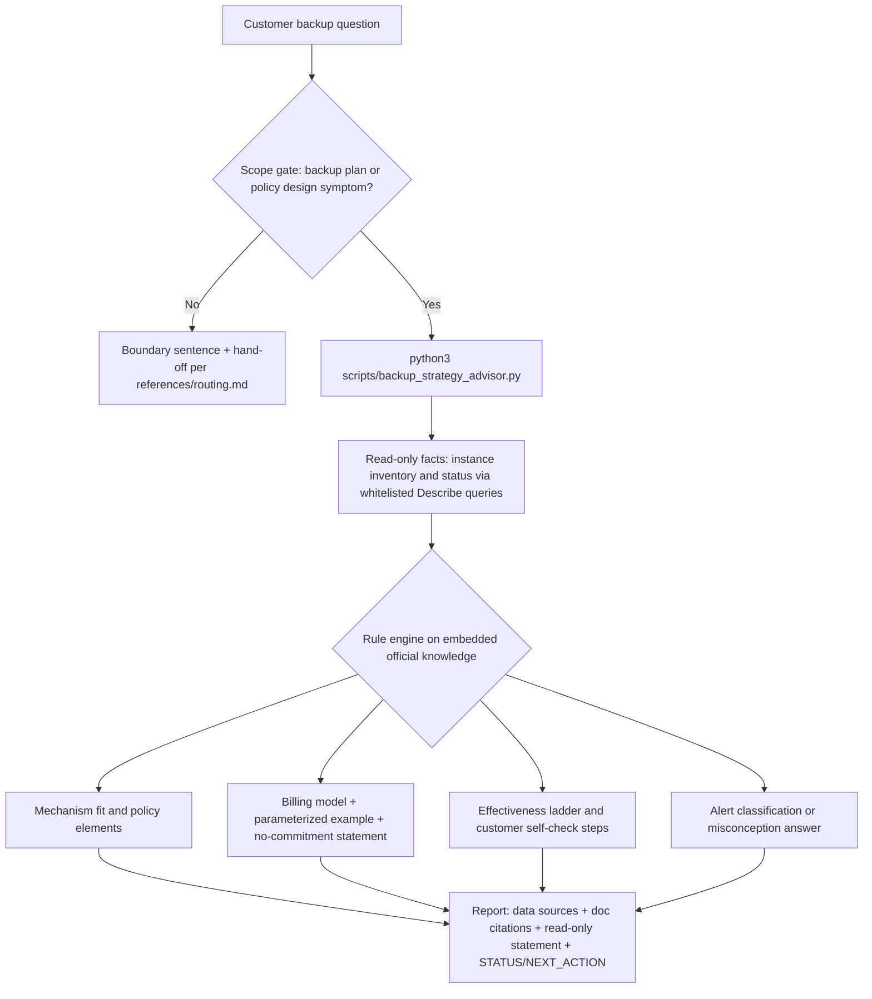

# ECS Backup Strategy Design (Read-Only Advisory)

Advises on ECS backup plans and policy design: mechanism fit (snapshot /
automatic snapshot policy / file backup / Cloud Backup database backup /
local or cross-region copy), frequency and retention design, the billing
MODEL and a parameterized cost example, policy-effectiveness checks,
failure-alert classification, misconception clearing, and boundary
recognition with hand-off. It gathers facts with the whitelisted read-only
queries, judges them against embedded official rules, and outputs an
evidence-based plan. Every console operation in the plan is a step for the
customer to perform: the exit of this skill is always "steps to the customer
+ performed by the customer + re-verified by the skill (read-only data or
the customer's console report)".

## Absolute Rules

1. **CRITICAL — MANDATORY EXECUTION:** All data gathering and every judgment
   MUST go through the entry script `scripts/backup_strategy_advisor.py`
   (plus `scripts/sts_token.py` for the identity pre-check). You MUST NOT
   hand-write helper scripts, do NOT issue individual `aliyun` CLI calls for
   evidence, do NOT skip the STATUS/NEXT_ACTION contract, and if the script
   fails there is NO fallback to manual commands or inline code.
2. **ABSOLUTE PROHIBITION (read-only enforcement):** Under NO circumstances
   may you generate, write, or execute any command or script that calls a
   mutating API (`Create*` / `Delete*` / `Modify*` / `Update*` / `Set*` /
   `Put*` / `Add*` / `Remove*` / `Bind*` / `Unbind*` / `Attach*` / `Detach*`
   / `Release*` / `Reset*` / `Replace*` / `Reboot*` / `Start*` / `Stop*` /
   `Copy*` / `Apply*`), including "commands written for the user to run
   through this skill". You also run NO commands of any kind inside an ECS
   instance (read-only guest commands included): guest facts come from the
   customer's self-check checklist. When the customer asks you to configure
   or fix something, output the console steps for the CUSTOMER to perform
   and state that this skill is read-only.
3. **API WHITELIST:** The only permitted OpenAPI actions are
   `sts:GetCallerIdentity`, `ecs:DescribeInstances` and
   `ecs:DescribeInstanceStatus` (see [references/ram-policies.md](references/ram-policies.md)).
   Snapshot, automatic-snapshot-policy and file-backup query actions are NOT
   part of this release (their permission points are unverified): mark those
   facts NOT FETCHED and use the customer self-check path. Never call a
   whitelisted action outside the scripts.
4. **NO FABRICATION:** Conclusions come only from script API data or the
   embedded reference knowledge, never from model memory. Every statement of
   what exists (policy state, snapshot coverage, data volumes) must declare
   its source: API-fetched, customer-provided, or NOT FETCHED. A fixed billed
   amount and a "recovery confirmed" verdict are NEVER output. Quoted help
   URLs must carry the verification-date note from the report footer.
5. **EXECUTION RULE FOR ERRORS:** On any API error the script logs
   `[WARN] <Code>: <Message>` to stderr and continues the remaining queries;
   the report is still produced with the data at hand. A permission failure
   surfaces as `NoPermission` / `ImplicitDeny`: name the missing action and
   point to [references/ram-policies.md](references/ram-policies.md). Do not
   silently skip a failed fact, and do not retry by any other route.
6. **SCOPE GATE (the only confirmation gate):** If the main symptom belongs
   to a neighboring axis (snapshot-object operations, ransomware/security
   incidents, connectivity/performance faults, disk resizing, account or
   commercial matters, non-ECS products), answer ONLY the backup sub-question,
   state the boundary in one sentence, and hand off per
   [references/routing.md](references/routing.md). Never expand into another
   channel's diagnosis.
7. **Empty / not-found is a valid result — never react to it with a write.**
   If an instance id is not visible in the queried region, that is a complete
   finding: report it, suggest checking region/account, and stop. Do not
   propose creating anything to "make the check pass".

## Quick Start (the sanctioned commands)

```bash
# 1. identity pre-check (read-only)
python3 scripts/sts_token.py

# 2. the single entry point, e.g. a design question with cost model inputs
python3 scripts/backup_strategy_advisor.py \
    --region-id cn-hangzhou --instance-id i-bp1xxxxxxxx \
    --target whole-instance,database --data-size-gb 2048 \
    --change-gb 20 --change-period week --retention-days 7 \
    --snapshots-per-day 1 --cross-region
```

Everything else (facts fetch, rule judgment, report layout, degradation
log) happens inside the entry script. Do not reproduce its queries by hand.

## Trigger Conditions

Use this skill when the customer's own wording matches one of these phrases
(the same list the `description` advertises):

- "how to back up my ECS instance"
- "ECS backup plan recommendation"
- "do I need a backup policy"
- "periodic automatic snapshot policy design"
- "cross-region off-site snapshot backup"
- "automatic snapshot policy not working"
- "backup failed due to insufficient disk space"

Customers state symptoms, not root causes: match the symptom sentence or the
pasted alert wording, then let the script's decision rules route to the
mechanism judgment. When no instance id or region is available, still run
the entry script in pure-advisory mode: it exits `STATUS: FAIL` with a
`NEXT_ACTION` naming exactly what to ask for.

## Execution Principle

All diagnostics and rule judgments MUST be performed by the scripts under
`scripts/`. The Agent is prohibited from assembling its own `aliyun` CLI
commands or bypassing the scripts to call APIs directly — the scripts embed
validation, retry, error degradation, masking and observability that ad-hoc
commands lack. Interpret and relay the script output; do not re-implement
the queries; do not run guest commands. Knowledge questions are answered
from the entry script's `--topic` output or the `references/` modules, never
from memory.

## Input Parameters

| Parameter | Flag | Required | Description |
|---|---|---|---|
| region_id | `--region-id` | Yes for cloud-fact mode | Region of the instance(s); default `cn-hangzhou` auto-filled and declared |
| instance_id | `--instance-id` | No | Comma-separated `i-...` ids; without any instance info the skill runs pure advisory |
| backup objects | `--target` | Yes for design | `whole-instance` / `files` / `database` / `local-copy` / `off-site` (comma-separated, synonyms accepted) |
| data volume | `--data-size-gb` | No (customer-provided) | Total data to protect, in GB |
| change rate | `--change-gb` + `--change-period` | No (customer-provided) | Changed volume per day/week/month |
| retention | `--retention-days` | No | Desired snapshot retention in days |
| frequency | `--snapshots-per-day` | No | Scheduled snapshots per disk per day |
| disks covered | `--disk-count` | No (default 1, declared) | Disks the policy will be applied to |
| off-site flag | `--cross-region` | No | Include cross-region copy design |
| alert wording | `--error-text` / `--symptom` | No | Exact alert/symptom text to classify; translate non-English alerts to their English wording first |
| effectiveness | `--check-effectiveness` (+ `--customer-report`) | No | Policy-effectiveness section; the binding fact is customer-reported |

**Auto-fill declaration:** every defaulted parameter (region, disk-count,
target-defaulting from instance facts) MUST be restated in the final answer
as auto-filled. Data volumes, change rates, database locations and retention
demands CANNOT be auto-filled: they are customer-provided inputs, and the
report labels them as such.

## Credentials

Credentials are resolved automatically by the aliyun CLI default credential
chain (environment or `~/.aliyun/config.json`). The scripts never read,
print, pass, or cache any credential value, and never accept credential
arguments. If `sts get-caller-identity` fails, guide the customer to run
`aliyun configure` — never ask for any credential value.

## User Confirmation

This skill is read-only, so no per-run confirmation is required before the
scripts execute. The confirmation discipline lives in the SCOPE GATE
(Absolute Rule 6): when the request crosses into a neighboring axis, do not
proceed with diagnosis — state the boundary and hand off. Before running
cloud-fact mode, restate the scope (region, instance ids, read-only nature)
to the customer in one line; if the target is ambiguous, ask once.

## Orchestration



## Execution Flow

1. **Scope confirmation:** identify the backup objects the customer names
   (whole instance / files / database / local copy / off-site) and the axis
   of the request; if the main symptom belongs to a neighbor, route per
   Absolute Rule 6 instead.
2. **Identity pre-check:** run `python3 scripts/sts_token.py`; on failure
   report the credential-chain guidance and stop cloud-fact mode (rule-only
   answers may still proceed with the limitation stated).
3. **Entry script:** run `scripts/backup_strategy_advisor.py` with the
   parameters from the customer's wording; pass every stated volume,
   retention and frequency; do not substitute guesses for missing numbers.
4. **Relay the report:** present the script's sections faithfully — cloud
   facts (or NOT FETCHED markers), design per object with console steps for
   the customer, the billing model and example, the effectiveness ladder,
   and any classification verdict.
5. **Verification loop:** after the customer performs the console steps,
   re-run with `--check-effectiveness --customer-report "<console wording>"`
   (and the instance id) to rule-check the result against the ladder.
6. **Close:** data-source declaration, doc citations with the verification
   note, and the read-only statement (see Final Answer Contract).

## Observability

Every OpenAPI call (invoked through the aliyun CLI by the scripts) carries:

- **User-Agent template:** `AlibabaCloud-Agent-Skills/{skill-name}/{session-id} skill-version/{skill-version}`,
  where `{skill-name}` is `alibabacloud-ecs-backup-strategy-design`;
- **session-id:** a 32-character lowercase hex string (`uuid.uuid4().hex`)
  generated once per script run and attached to every CLI call of that run
  via `--user-agent`, so all calls of one advisory can be correlated.

The shared CLI layer implements this automatically (see `scripts/_cli.py`).

## Module Index

| Module | File | Responsibility |
|---|---|---|
| M1: Mechanisms and limits | [references/backup-mechanisms-and-limits.md](references/backup-mechanisms-and-limits.md) | Product identification, mechanism comparison, file-backup basic-edition limits, local-disk differences |
| M2: Billing models | [references/billing-models.md](references/billing-models.md) | Snapshot/copy/file-backup billing models, parameterized example, no-commitment statement, package note |
| M3: Policy design | [references/policy-design.md](references/policy-design.md) | Policy elements, the apply-to-disks binding rule, effectiveness ladder, re-check triggers |
| M4: Misconceptions | [references/misconceptions.md](references/misconceptions.md) | Customer-perception vs mechanism reality index (capacity display, overwrite, cold-backup, download bloat, shared responsibility) |
| M5: Routing | [references/routing.md](references/routing.md) | Boundary recognition, hand-off wording templates, exit paths |
| M6: RAM policies | [references/ram-policies.md](references/ram-policies.md) | Minimal read-only policy actually used by this skill |

## Available Scripts

| Script | Purpose |
|---|---|
| `scripts/sts_token.py` | Read-only caller identity check; derives the account UID traceability label |
| `scripts/backup_strategy_advisor.py` | Single entry point: design, cloud facts, effectiveness re-check, alert classification, knowledge topics; emits STATUS/NEXT_ACTION |
| `scripts/_cli.py` | Shared read-only CLI layer: timeouts, retry with backoff, credential masking, User-Agent session-id |
| `scripts/_constants.py` | Embedded rule data (no data files in `scripts/`, per MUST 1.1.2) |

Exit-code contract: `0` = `STATUS: OK` or `STATUS: DEGRADED` (usable
conclusion with recorded gaps); `1` = `STATUS: FAIL` (missing/invalid input
or every evidence call failed; `NEXT_ACTION` names what to ask); `2` =
argparse usage error only.

## Error Handling

| Situation | Handling |
|---|---|
| Credential chain not configured | Guide `aliyun configure`; never ask for credential values |
| `NoPermission` / `ImplicitDeny` on a whitelisted action | `[WARN] <Code>: <Message>` on stderr; facts degrade to NOT FETCHED; name the action and [references/ram-policies.md](references/ram-policies.md) |
| `InvalidParameter` / `MissingParameter` | `[WARN]` recorded, re-check the flagged value against the customer's wording; never silently substitute a guess |
| `Throttling.User` / 5xx / timeout | Retried automatically with backoff (up to 3 attempts); then `[WARN]` and continue |
| Instance not found in region | Valid finding: state it, ask the customer to confirm region/account; never react with a write |
| Alert wording unknown | Relay the classification gap honestly and give the ticket exit; do not guess the cause |

## Known Limitations (Data Boundaries)

- Read-only queries see only the CURRENT credential's account and the named
  region; cross-account resources and resources the customer has not
  identified are invisible. Any number fetched is point-in-time.
- NOT FETCHABLE in this release (customer self-check only): snapshot usage
  and snapshot lists, automatic-snapshot-policy objects and their disk
  bindings, file-backup job status and covered paths, in-guest disk usage,
  application consistency of database restores, and final billed amounts.
- Data volumes, change rates, database locations, retention demands and
  compliance requirements are inputs the CUSTOMER provides; conclusions
  based on them are labeled "customer-provided".
- The referenced help-document set is baseline **2026-08-30** (evidence
  batch) and is not formally re-verified in this build; re-verify each URL
  before quoting, and never present a rule as current beyond that note.

## Important Notes

- "Policy exists" is not "policy effective": the binding to disks decides
  (M3 ladder, step 2). Never confirm recovery-readiness from policy creation alone.
- The free file-backup basic edition excludes database installation
  directories, fixes retention at 30 days, and fails when capacity is
  exhausted instead of overwriting (M1 section 3). Surface these in every
  design that could lean on it.
- Cost answers are model + example + no-commitment statement, always (M2
  section 1). Package purchase and price promises go to the commercial
  hand-off.
- Every mutating idea ("bind the disk", "clean the disk", "take a snapshot
  now") is expressed as a step for the customer, never as an action this
  skill takes or a script it ships.
- Windows instances follow the same mechanism layer; guest-side self-check
  tooling differs and its evidence confidence is medium — point to official
  cleanup docs rather than tool names where possible.

## Examples

**Example 1 — database coverage gap**

> Customer: "Is my SQL Server on ECS covered? The free file backup is on."

```bash
python3 scripts/backup_strategy_advisor.py --region-id cn-hangzhou \
    --instance-id i-bp1xxxxxxxx --target files,database
```

The design section names the basic-edition exclusion of database
directories, the Cloud Backup database-backup layer, and the snapshot
safety net; the gap probes ask the customer to confirm the data-directory
path (self-check; the skill runs nothing in the guest).

**Example 2 — policy "not working" plus cost sizing**

> Customer: "I made an automatic snapshot policy for weekly backups but no
> snapshot showed up. Also roughly what would 7-day retention cost for a
> 500 GB disk with about 5 GB changing per day?"

```bash
python3 scripts/backup_strategy_advisor.py --region-id cn-chengdu \
    --instance-id i-2zexxxxxxxx --check-effectiveness \
    --target whole-instance --data-size-gb 500 --change-gb 5 \
    --retention-days 7 --snapshots-per-day 1
```

Effectiveness walks the ladder (region, applied-to-disks binding, scheduled
time point, snapshot list); the cost section gives the model, the
parameterized example, and the no-commitment statement — never a promised
bill figure.

**Example 3 — alert text and off-site design**

> Customer: "I got 'backup failed due to insufficient disk space'. I also
> need off-site copies."

```bash
python3 scripts/backup_strategy_advisor.py --error-text \
    "backup job failed due to insufficient disk space, please clean up or extend the disk"
python3 scripts/backup_strategy_advisor.py --region-id cn-hangzhou \
    --instance-id i-bp1xxxxxxxx --target whole-instance,off-site \
    --retention-days 7 --snapshots-per-day 2
```

The alert classifies to backup-precondition failure with the
snapshot-first + cleanup/extension guidance as customer steps; the off-site
design explains per-copy billing (create N, copy N) and the archived-snapshot
copy limit.

## Final Answer Contract

The final answer MUST:

1. relay the script `STATUS` (OK / DEGRADED / FAIL) and its `Summary`/
   findings faithfully — never present raw JSON;
2. cite only numbers, ids and verdicts that appear in the script output or
   the customer's own messages, each with its source label (API-fetched /
   customer-provided / NOT FETCHED);
3. declare every auto-filled parameter (region, disk-count, target default);
4. include the billing no-commitment statement whenever cost is discussed;
5. list the referenced official docs with the verification-date note;
6. close with the read-only statement: all console operations listed are
   guidance for the customer to perform; this skill changed nothing and ran
   nothing inside any instance.

**MANDATORY POST-OUTPUT VERIFICATION.** Before answering, verify the output
contains items 1-6 above. If any is missing, append it explicitly. An
answer that claims a committed amount, a confirmed recovery, or any action
this skill "performed" in the console is a hard violation of this skill's
contract.
